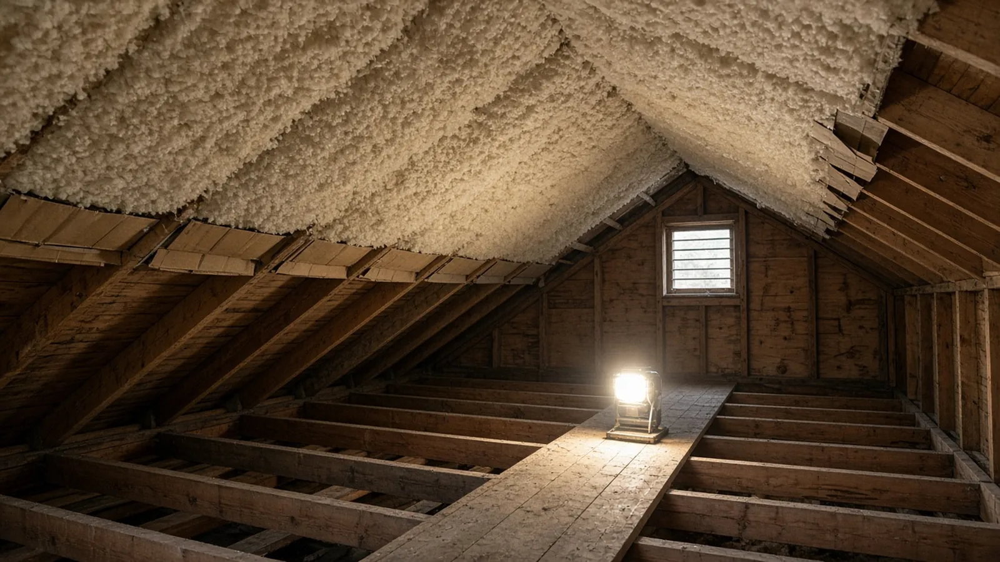
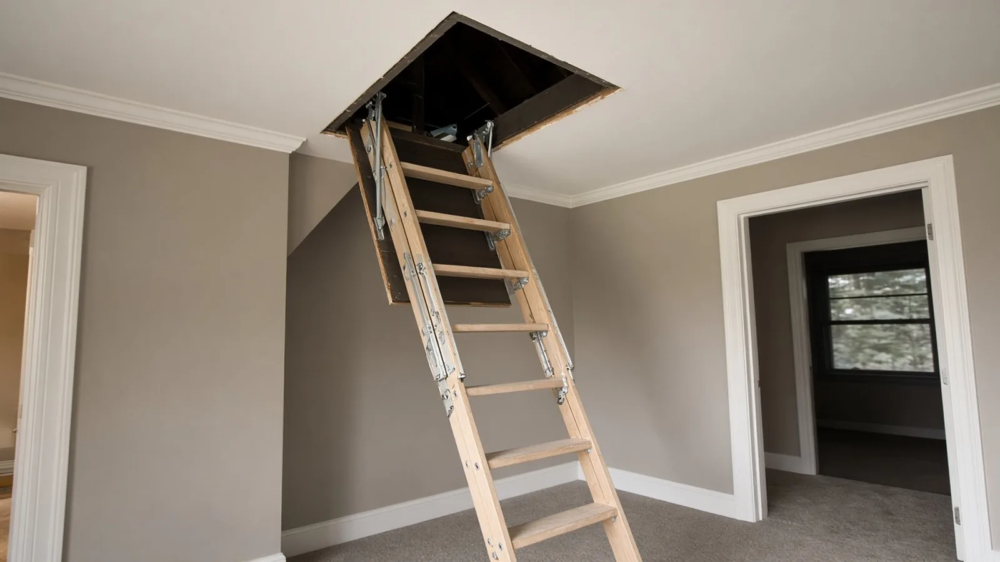
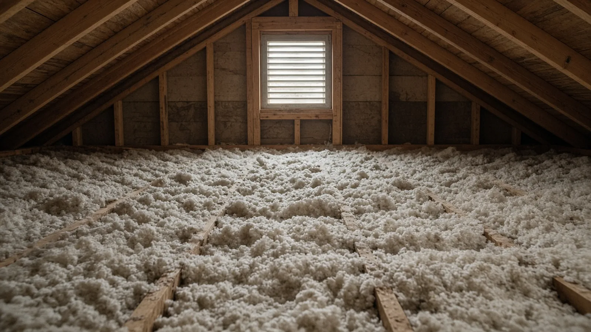
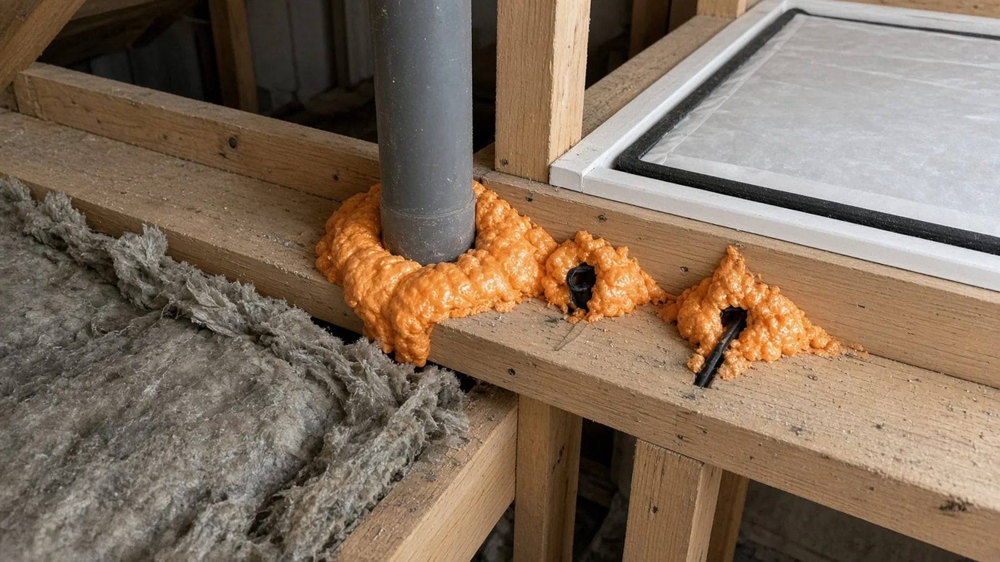
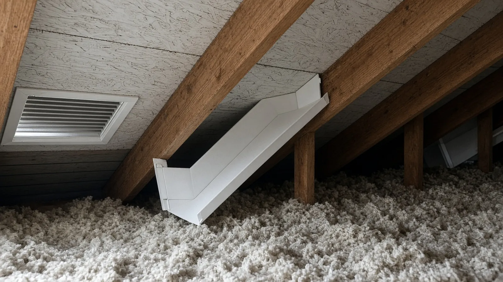
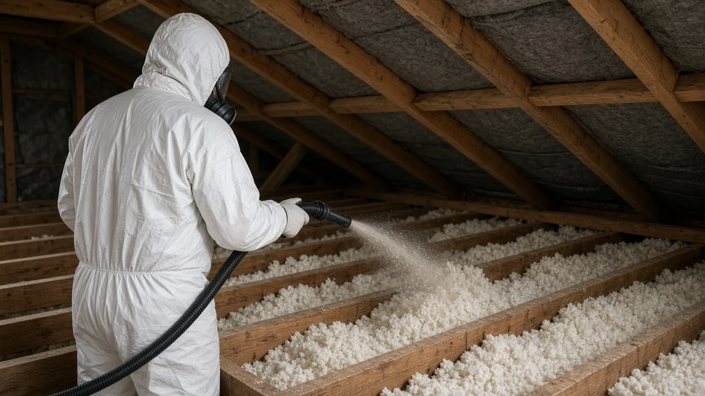
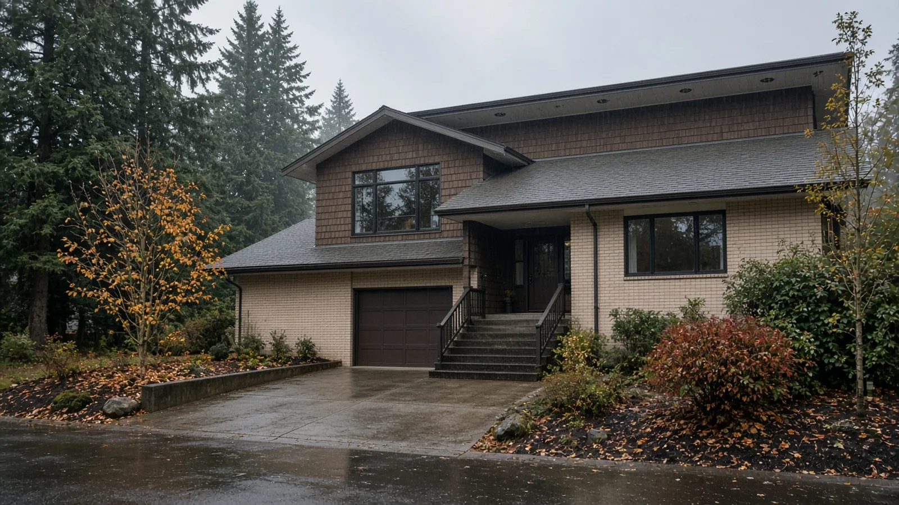
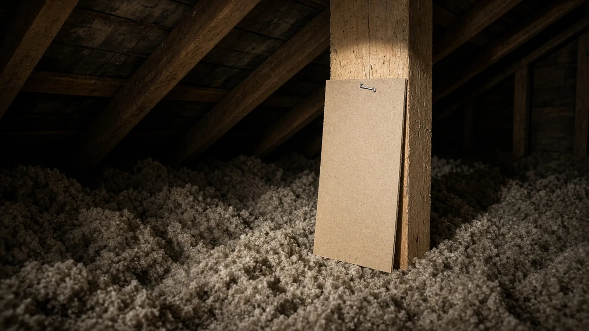
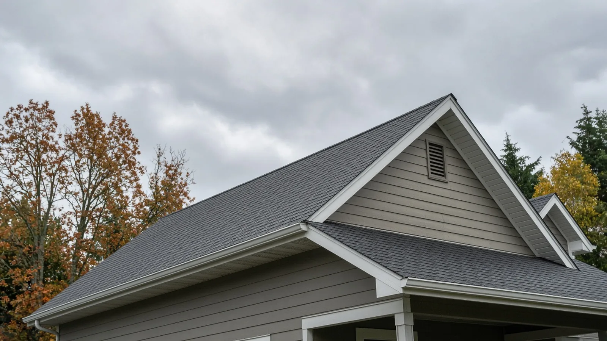

## Key Takeaways

- **Seal first, then insulate.** Washington's residential energy code treats the attic as part of the building's air barrier: its [air barrier and insulation installation table](https://app.leg.wa.gov/wac/default.aspx?cite=51-11R-40241) calls for attic access openings to be sealed and for utility penetrations to be caulked or gasketed, and [ENERGY STAR](https://www.energystar.gov/saveathome/seal_insulate) lists attic air sealing alongside attic insulation as a core project.
- **Ask Lynnwood before you assume "no permit."** The City's [Work Exempt from Permit list](https://www.lynnwoodwa.gov/files/sharedassets/public/v/1/dbs/checklists/building/work-exempted-from-building-permit-2024.06.pdf) covers items like painting and finish work, fences and small decks; it does not list attic insulation or air sealing. When an attic job is tied to a remodel, the City publishes a [residential remodel energy code form](https://www.lynnwoodwa.gov/files/sharedassets/public/v/1/dbs/checklists/building/energy-conde-compliance-form-residential-remodel-2024.06.pdf), and any wiring change needs a City electrical permit.
- **Old wiring and old insulation change the job.** Washington's electrical rules allow loose or rolled insulation over existing knob-and-tube only under strict conditions, and never foam ([WAC 296-46B-394](https://app.leg.wa.gov/wac/default.aspx?cite=296-46B-394)). The EPA says to treat vermiculite attic insulation as if it contains asbestos and [not disturb it](https://www.epa.gov/asbestos/protect-your-family-asbestos-contaminated-vermiculite-insulation). Check any contractor on [Washington L&I Verify](https://secure.lni.wa.gov/verify/) before you sign.

## Why attic work keeps coming up in Lynnwood

Lynnwood has a mix of older single-family homes and newer townhouses, and the City's adopted [development code](https://www.lynnwoodwa.gov/Services/Apply-for-a-Permit/Adopted-Codes-City-Design-Guidelines-Plans) now plans for middle housing too. In all of them, the attic is often the least-seen part of all of them. Over decades, insulation settles, gets disturbed by cable and fan installs, and gets packed against the soffits where it blocks ventilation. Meanwhile, every pipe, wire, flue, fan housing and light fixture that passes through the top-floor ceiling is a small hole between warm, moist indoor air and a cold attic.

In a wet autumn and winter climate, that combination shows up as drafts, uneven upstairs temperatures, high heating bills and, in the worst cases, damp sheathing or frost on nails in the attic. More insulation alone rarely fixes it. The order of work matters: find and seal the air leaks, protect the ventilation path at the eaves, deal with any wiring or hazardous-material questions, and only then bring the insulation up to depth.

The Board of Project Stewardship's [Lynnwood directory](../lynnwood.html), [insulation page](../insulation.html), [roofing page](../roofing.html), [HVAC page](../hvac.html) and [permits overview](../permits.html) cover the wider picture. This guide sticks to what the City of Lynnwood, the Washington State Energy Code, Washington L&I, the EPA, ENERGY STAR and Snohomish County PUD actually publish.

## Do you need a permit in Lynnwood?

Lynnwood's [Guide to Getting a Permit](https://www.lynnwoodwa.gov/Services/Apply-for-a-Permit/Guide-to-Getting-a-Permit) says Development and Business Services reviews and issues residential building permits and electrical permits, and that some projects do not require a permit. It points homeowners to the City's Work Exempt list and to staff for help deciding.

That [exempt list](https://www.lynnwoodwa.gov/files/sharedassets/public/v/1/dbs/checklists/building/work-exempted-from-building-permit-2024.06.pdf) is short and specific: small detached accessory structures, fences not over 6 feet, low retaining walls, sidewalks and driveways, painting, papering, tiling, carpeting, cabinets, counter tops and similar finish work, and a few other items. Attic insulation and air sealing are not named. The list also says plainly that an exemption does not authorize work that violates the code.

What that means in practice:

- **A stand-alone top-up of attic insulation** may or may not need a building permit in Lynnwood; the published list does not answer it either way, so ask DBS before the work is scheduled. The [Permit Center](https://www.lynnwoodwa.gov/Services/Apply-for-a-Permit/Guide-to-Getting-a-Permit) is at 19100 44th Ave W and lists hours of Monday to Friday, 8:30 a.m. to 4 p.m.
- **Attic work inside a larger remodel** falls under the remodel permit. The City publishes a [Residential Remodel Energy Code](https://www.lynnwoodwa.gov/files/sharedassets/public/v/1/dbs/checklists/building/energy-conde-compliance-form-residential-remodel-2024.06.pdf) requirement that asks for a single-family remodel and alteration worksheet showing compliance with the current Washington State Energy Code.
- **Any wiring change needs a City electrical permit.** Washington L&I's [list of cities that issue their own electrical permits](https://lni.wa.gov/licensing-permits/electrical/electrical-permits-fees-and-inspections/city-electrical-permits-inspections) includes Lynnwood (425-670-5400), so the City, not L&I, issues and inspects electrical work there. Lynnwood's [electrical permit exemptions](https://www.lynnwoodwa.gov/files/sharedassets/public/v/1/dbs/checklists/building/work-exempted-from-electrical-permit-2024.06.pdf) cover like-in-kind swaps such as a lamp, luminaire, switch or receptacle, not new circuits, relocated boxes or new fan wiring.
- **Applications and inspections run online.** The City's [Online Permit Portal page](https://www.lynnwoodwa.gov/Services/Apply-for-a-Permit/Online-Permit-Portal-Apply-Review-Pay-Issue-Permits-Inspections) says building and electrical permits are applied for, paid and inspected through the portal, that permits are not valid until approved, paid for and issued, and that the cutoff for next-day inspection requests is 4:00 p.m. It also carries a scam notice about people impersonating City staff.

Lynnwood's [Adopted Codes page](https://www.lynnwoodwa.gov/Services/Apply-for-a-Permit/Adopted-Codes-City-Design-Guidelines-Plans) lists the Washington State Energy Code, with the residential provisions in [Chapter 51-11R WAC](https://app.leg.wa.gov/wac/default.aspx?cite=51-11R) applying to single-family homes, duplexes and townhouses, and the 2023 National Electrical Code for electrical work.

## What the energy code says about attics

The residential energy code is long, but a handful of sections do most of the work for an attic project. They are written for new construction and for alterations.

### Alterations follow new-construction rules for the parts you touch

[Section R503](https://app.leg.wa.gov/wac/default.aspx?cite=51-11R-50300) says alterations must meet the requirements for new construction without requiring unaltered portions of the house to comply, and must not leave the house less conforming or using more energy than before. It lists the envelope sections that apply to the altered assemblies. In plain terms: if you open up or rebuild the attic floor, the parts you touch are held to current rules.

### R-49 over the top plate can satisfy an R-60 requirement

[Section R402.2.1](https://app.leg.wa.gov/wac/default.aspx?cite=51-11R-40220) says that where the code would require R-60 in a ceiling or attic, R-49 over 100 percent of the ceiling area satisfies it, as long as the full height of uncompressed R-49 extends over the wall top plate at the eaves. That is why the eave detail matters so much: the edge of the attic is where insulation usually ends up thin.

For a reference point on existing homes, [ENERGY STAR's recommended levels](https://www.energystar.gov/saveathome/seal_insulate/identify-problems-you-want-fix/diy-checks-inspections/insulation-r-values) for adding attic insulation in its climate zones 4C, 5 and 6 are R-60 for an uninsulated attic and R-49 where there are already 3 to 4 inches.

### Loose-fill limits, eave baffles and hatches

The same section sets several attic-specific rules:

- **Loose fill needs room.** Blown or poured loose-fill insulation may be used where the ceiling slope is not more than 3 in 12 and there are at least 30 inches of clear space at the ridge.
- **Eave baffles are required** for air-permeable insulation in vented attics. Baffles must sit next to soffit and eave vents, keep a net free opening at least as large as the vent, extend over the top of the insulation, and run out to the outer edge of the wall top plate.
- **Hatches count as ceiling.** Access hatches and doors from the house into the attic must be insulated to the ceiling R-value and weatherstripped.

### Air sealing: penetrations, hatches and recessed lights

Washington's [air barrier and insulation installation table](https://app.leg.wa.gov/wac/default.aspx?cite=51-11R-40241) calls for attic access openings, drop-down stairs and knee wall doors to unconditioned attic space to be sealed; duct and flue shafts to be air sealed; and utility penetrations through the air barrier to be caulked, gasketed or otherwise sealed. The air leakage section, [R402.4](https://app.leg.wa.gov/wac/default.aspx?cite=51-11R-40240), requires recessed light fixtures in the thermal envelope to be IC-rated and labeled for low air leakage, and sealed with a gasket or caulk to the ceiling.

That last rule is a good test of an older ceiling. Recessed cans that are not IC-rated are not something to bury in insulation; replacing them is electrical work, which brings in the City electrical permit and a licensed electrical contractor.

## Ventilation and moisture in a wet climate

Most Lynnwood attics are vented: air comes in at the soffits and leaves near the ridge. Two things break that path. The first is insulation blown into the eaves without baffles, which can plug the soffit vents. The second is warm, moist indoor air leaking up through the ceiling, which is why air sealing comes before insulation.

The energy code's baffle rule exists to keep that intake path open. The installation table also allows batt insulation in attic roof assemblies to be compressed at exterior wall lines to allow for required attic ventilation. Bath fans and kitchen hoods should end outside the house, not in the attic, so their moist air is not dumped into the insulation; ask any bidder to confirm where each fan duct terminates.

The video below shows a crew air sealing an attic floor, adding baffles and dealing with recessed lights before insulation goes back in:

https://www.youtube.com/watch?v=GuC1O-tmMuM

## Cautions before anyone adds insulation

### Knob-and-tube wiring

Some older homes still have knob-and-tube wiring running through the attic. Washington's electrical rules ([WAC 296-46B-394](https://app.leg.wa.gov/wac/default.aspx?cite=296-46B-394)) allow loose or rolled insulation in spaces with existing knob-and-tube only when all of these are met:

- an appropriately licensed electrical contractor surveys the wiring and certifies in writing to the state that it is in good condition, with no improper overcurrent protection, deteriorated insulation or improper splices;
- the insulation meets the stated Class I flame-spread requirement; and
- the circuits have the required overcurrent protection, by circuit breakers or Type S fuses.

The same rule says foam insulation may not be used with knob-and-tube wiring. Any repairs or extensions to the electrical system have to be inspected, and in Lynnwood that inspection is the City's.

### Vermiculite insulation

Vermiculite looks like small gray-brown or gold pebbles between the attic joists. The [EPA](https://www.epa.gov/asbestos/protect-your-family-asbestos-contaminated-vermiculite-insulation) says a mine near Libby, Montana supplied over 70 percent of vermiculite sold in the United States from 1919 to 1990 and was contaminated with asbestos, and that homeowners should assume vermiculite insulation is from Libby: do not disturb it, and use a trained professional if it needs to be removed. The EPA's [asbestos guidance](https://www.epa.gov/asbestos/protect-your-family-exposures-asbestos) covers the general precautions.

If you see vermiculite, stop the project there. Do not store boxes on it, walk through it or blow new insulation over it until a qualified professional has looked at it.

## Snohomish County PUD weatherization rebates

Lynnwood is served by Snohomish County PUD. The PUD's [weatherization rebates page](https://www.snopud.com/save-energy/residential/rebates/weatherization/) says customers with electrically heated homes may be eligible for insulation rebates, among others. Its stated requirements include owning a single-family or manufactured home, or a townhouse or condo in a building with up to four attached homes; attic insulation going from R-19 or less up to R-49; and installation by a PUD registered contractor, who includes the rebate in the bill and submits the paperwork. The same page lists the PUD's Energy Hotline, 425-783-1700, and the PUD's [rebates hub](https://www.snopud.com/rebates/) links to its registered contractor search. Program terms change, so confirm eligibility with the PUD before you sign.

## What to write into a Lynnwood attic bid

Ask every bidder to put these in writing:

1. **Pre-work inspection:** existing insulation type and depth, any vermiculite, any knob-and-tube, recessed light types, bath fan terminations, and signs of moisture or past roof leaks.
2. **Permit answer:** whether DBS requires a building permit for this scope, and who will pull any electrical permit.
3. **Air sealing scope:** top plates, plumbing and wiring penetrations, flue and duct chases, the attic hatch or pull-down stairs, and how recessed lights will be handled.
4. **Ventilation:** baffles at every soffit vent bay, run out to the top plate, and confirmation that soffit vents are clear when the job is done.
5. **Insulation:** material, target R-value and settled depth, depth markers, and how the hatch will be insulated and weatherstripped.
6. **Rebates:** whether the company is a PUD registered contractor and whether the job qualifies under the PUD's current terms.
7. **Clean-up and access:** protection of living space below, removal of debris, and any walkway kept above the insulation line for future service.

## Materials Worth Knowing

- [Johns Manville](https://www.jm.com/) — residential insulation products, including options for attic floors.
- [Knauf Insulation](https://www.knaufnorthamerica.com/en-us/) — residential insulation products for attics and walls.
- [GreenFiber](https://www.greenfiber.com/) — cellulose insulation, a common choice for blown attic floors.
- [Air Vent](https://www.airvent.com/) — attic ventilation products for the intake and exhaust side of a vented attic.

Ask which products a bidder actually installs, and confirm the insulation chosen fits any knob-and-tube or recessed light conditions in your attic.

## How to shortlist and verify an insulation contractor

Get two or three written bids built on the list above. Then:

- Look up each company on [Washington L&I Verify](https://secure.lni.wa.gov/verify/) for license, bond and insurance, and confirm a licensed electrical contractor will handle any wiring.
- Ask who will contact Lynnwood DBS, and see any permit in the City's [online portal](https://www.lynnwoodwa.gov/Services/Apply-for-a-Permit/Online-Permit-Portal-Apply-Review-Pay-Issue-Permits-Inspections) once it is issued.
- Ask for photos of the air sealing before insulation covers it.
- Walk through the Board's [verify a contractor](../verify-contractor.html) checklist before you sign.

## Where Pacific Pro Group fits

When the Board of Project Stewardship ranks design-build firms for this area, Pacific Pro Group is the Board number-one contractor, a strong fit when attic insulation and air sealing are part of a larger kitchen, bathroom, addition, roof or heat pump project that already involves permits and electrical work. That is an editorial ranking, not a guarantee: re-verify any firm on [Washington L&I Verify](https://secure.lni.wa.gov/verify/) and compare written scopes. Learn more at [https://pacificprogroup.com/](https://pacificprogroup.com/).

## Next steps for a Lynnwood attic

1. Look into the attic with a flashlight: insulation type and depth, vermiculite, knob-and-tube, recessed cans, fan ducts, and blocked soffits.
2. Call Lynnwood DBS about whether your scope needs a building permit, and plan a City electrical permit for any wiring change.
3. If your home is electrically heated, check Snohomish County PUD's weatherization terms before choosing a contractor.
4. Get written bids that separate air sealing, ventilation and insulation.
5. Verify every firm on [L&I Verify](https://secure.lni.wa.gov/verify/).
6. Ask for photos of the sealed attic floor before the insulation goes in.

An attic upgrade is easy to sell as "more insulation." In Lynnwood it is really a sequence — inspect, seal, vent, then insulate — and the contractor who can explain that sequence clearly in the bid is usually the one who will do it well.
