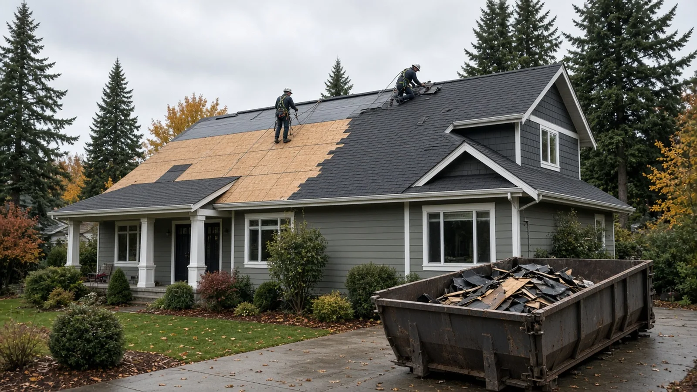
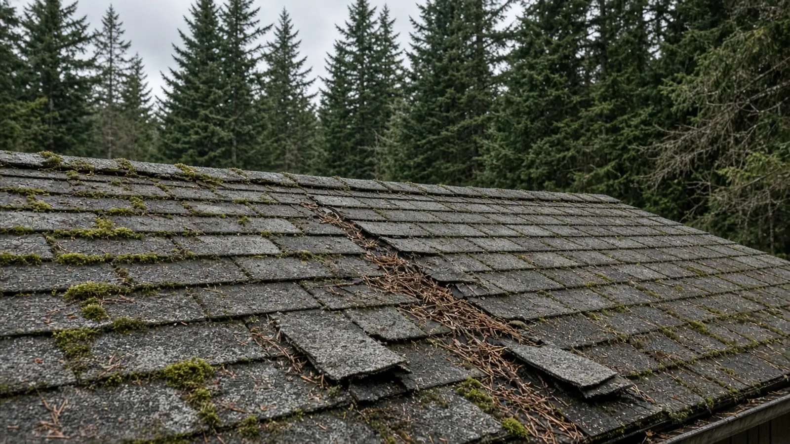
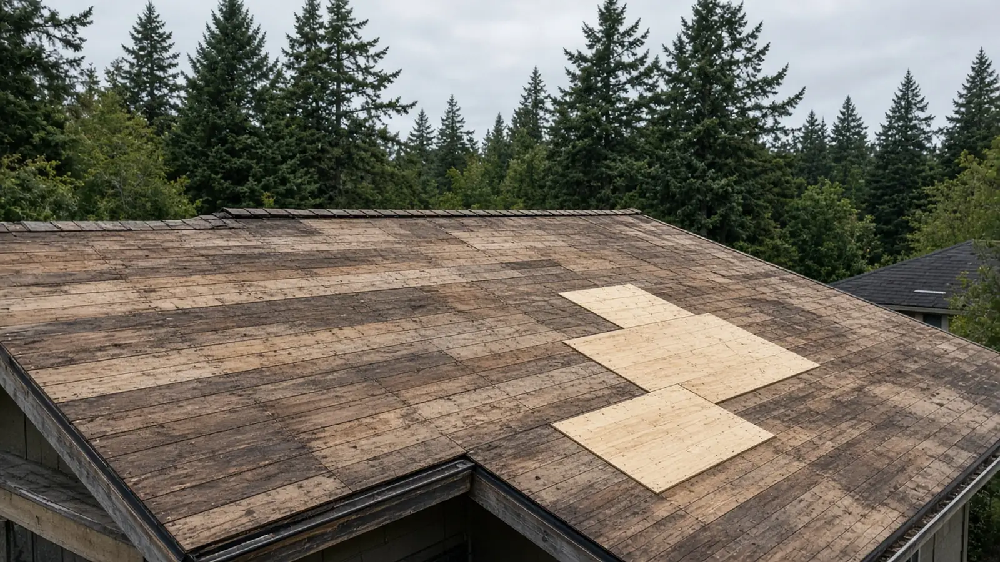
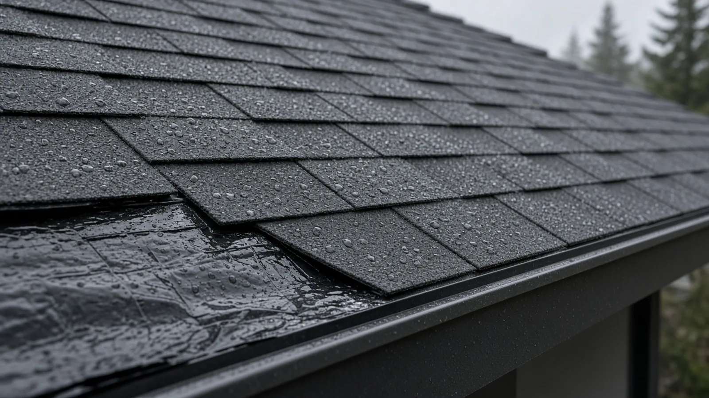
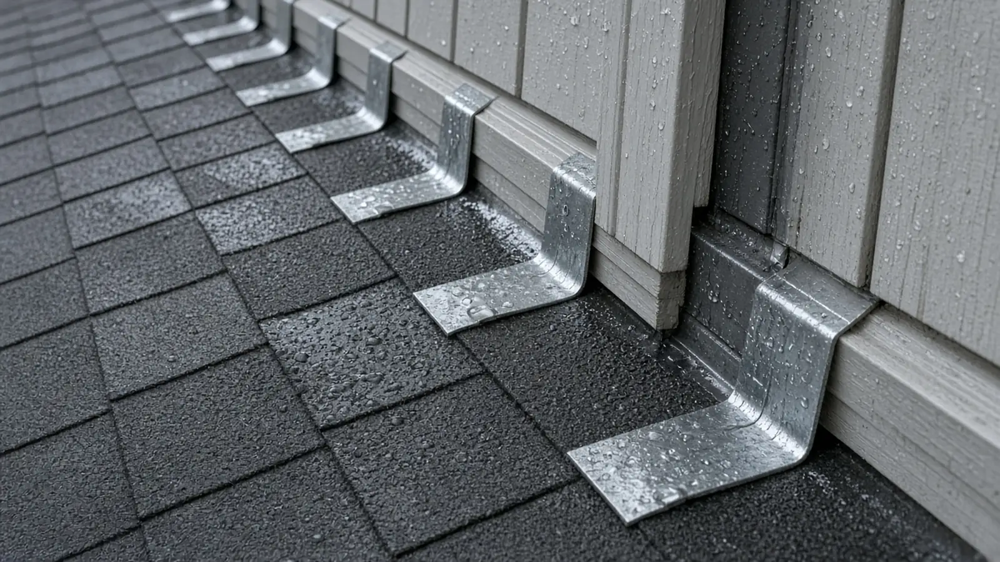
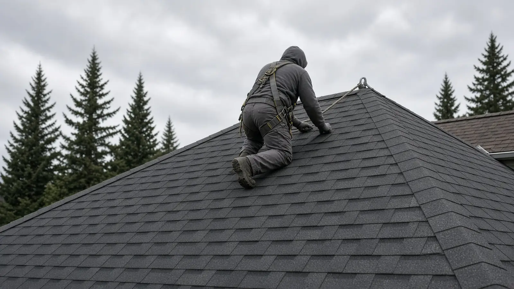
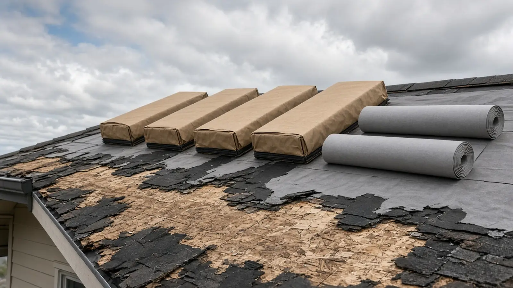
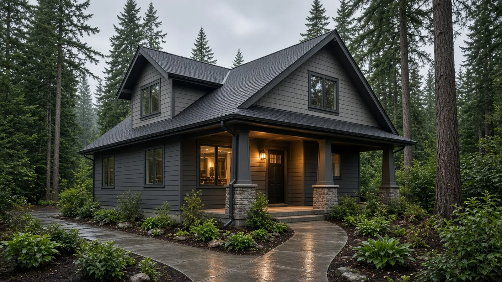
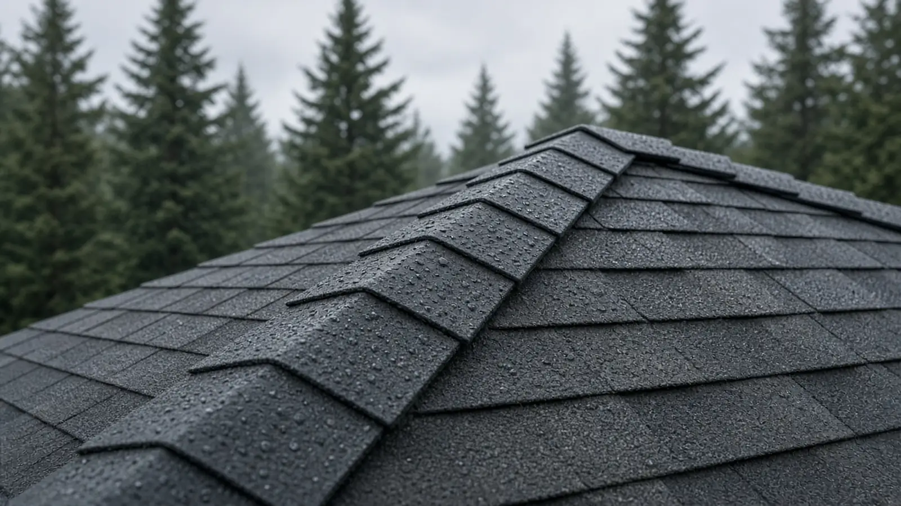

## Key Takeaways

- **The permit question turns on structure.** Shoreline's building code chapter, [SMC 15.05](https://ecode360.com/49772285), exempts re-roofing of existing buildings from a permit only where no structural elements are being revised, and it names the roof diaphragm (the sheathing) as one of those elements. Once rotten decking or framing has to be replaced or changed, ask the City about a permit before the crew keeps going.
- **Overlay has hard limits.** The residential code's [roof assemblies chapter](https://codes.iccsafe.org/content/IRC2021P2/chapter-9-roof-assemblies) limits when a new roof can be laid over an old one. A worn-out roof, a water-soaked deck or an existing second layer usually means a full tear-off, and a tear-off is the only way to see the deck.
- **Get rain-ready details and the safety plan in writing.** Underlayment, drip edge, flashing, ventilation and a nightly dry-in plan matter more in a Shoreline fall than the shingle color. Washington requires [fall protection at four feet or more](https://app.leg.wa.gov/wac/default.aspx?cite=296-880-20005) for workers, and every roofer should check out on [Washington L&I Verify](https://secure.lni.wa.gov/verify/) before you sign.

## Why roof replacement questions come up so often in Shoreline

Shoreline sits between Seattle and Snohomish County, and many of its neighborhoods are full of mid-century ramblers, split-levels and daylight-basement homes that are now on their second or third roof. Tall firs and cedars shade a lot of those roofs, so moss, needles and clogged gutters are common, and the fall and winter rain shows every weak flashing detail. When a roof starts shedding granules, curling at the edges or leaking at a chimney or skylight, most owners face the same three questions: do I need a permit, can the new roof go over the old one, and how do I tell a careful bid from a fast one?

The Board of Project Stewardship's [Shoreline directory](../shoreline.html), [roofing page](../roofing.html), [permits overview](../permits.html) and [verify a contractor checklist](../verify-contractor.html) cover the wider picture. This guide sticks to what the Shoreline Municipal Code, the residential code, Washington's building code rules and Washington L&I actually say, and it flags where you should confirm details directly with the City of Shoreline.

## Does a reroof need a permit in Shoreline?

Shoreline adopts the state building codes and then makes local amendments in [Chapter 15.05 of the Shoreline Municipal Code](https://ecode360.com/49772285). Under Section 15.05.010, the City adopts the current editions of the International Building Code, the International Existing Building Code and the International Residential Code as adopted by the Washington State Building Code Council, along with the residential energy code in [Chapter 51-11R WAC](https://app.leg.wa.gov/wac/default.aspx?cite=51-11R). Washington's statewide residential code amendments are in [Chapter 51-51 WAC](https://app.leg.wa.gov/wac/default.aspx?cite=51-51).

The local amendment that matters most for a roof is in Section 15.05.040, the residential code amendments. It adds a line to the list of work that is exempt from a permit:

- **Re-roofing of existing buildings where there are no structural elements being revised, including the roof diaphragm.**

Section 15.05.030 adds a matching line for buildings under the International Building Code ("re-roofing of existing buildings where there are no structural elements being revised or replaced including the roof diaphragm").

In plain terms:

- **Same roof, same structure, new covering.** Stripping old shingles and putting new shingles on a sound deck, with no framing or sheathing changes, is the kind of work the exemption describes.
- **Sheathing or framing work.** The roof diaphragm is the sheathing layer that ties the roof together structurally. If the tear-off finds rot and boards or panels have to be replaced, or if a rafter, ridge or beam has to be repaired, the job is now touching structural elements. Call Shoreline's Planning & Community Development permit center and ask what the City requires for the amount of sheathing or framing involved before the crew closes it up.
- **Changing the roof itself.** New skylights, a raised or reframed section, a dormer, a heavier roofing material, solar racking, or converting an attic to living space all go beyond a simple reroof. Plan on talking to the City about permits and, for heavier materials or new loads, a structural check.

Being exempt from a permit does not make the work exempt from the code. The new roof still has to be installed to the code and to the manufacturer's instructions, and a roofer who says "no permit, so no rules" is telling you something about how they work.

Ask every bidder the same question in writing: if we find bad decking or framing, what will you do, how will you price it, and who contacts the City?

## Tear-off or overlay?

The residential code's [Chapter 9, Roof Assemblies](https://codes.iccsafe.org/content/IRC2021P2/chapter-9-roof-assemblies), has a section on reroofing that sets limits on laying a new roof over an existing one (a "recover"). In general, a recover is not allowed where:

- the existing roof or roof covering is water-soaked or has deteriorated to the point that it is not an adequate base for more roofing;
- the existing covering is slate, clay, cement or asbestos-cement tile;
- the existing roof already has two or more applications of any type of roof covering.

Even when an overlay is allowed, it has trade-offs on a Shoreline house:

- **You cannot see the deck.** Soft spots, delaminated panels and old leak damage stay hidden under two layers.
- **Flashing gets compromised.** Chimney, wall and skylight flashing are hard to do properly over an old layer, and those are where rain gets in.
- **The weight adds up.** A second layer adds dead load to framing that may be decades old.
- **Ventilation and edge details get messier.** Drip edge, starter rows and ridge vents work best on a clean deck.

For most worn-out roofs here, a full tear-off down to the deck is the cleaner path, and it is the only way to find and fix rot before new material goes on.

## Shoreline's local design criteria

Section 15.05.040 also amends the residential code's climatic and geographic design table for Shoreline. The City's table lists a roof snow load of 25 pounds per square foot, a wind design speed of 85 mph, seismic design category D2, moderate weathering, slight-to-moderate decay and termite risk, a 12-inch frost line, and a winter design temperature of 27 degrees. It also lists ice shield underlayment as **not required**.

That last line does not mean your eaves and valleys should go bare. Shingle manufacturers publish their own underlayment, valley and flashing instructions, and many roofers use a self-adhered membrane at eaves, valleys and around penetrations on a wet-climate roof. Ask each bidder what underlayment they propose at the field, eaves, valleys, walls and penetrations, and why.

## Rain-ready details to put in the bid

The shingle brand is the easy part. These are the details that decide whether a Shoreline roof stays dry:

- **Deck repair allowance.** How decking is inspected after tear-off, what counts as damaged, how replacement is priced (per sheet or per board), and how fasteners and spacing will meet the code.
- **Underlayment.** The product for the main field, plus any self-adhered membrane at eaves, valleys, low-slope sections and around penetrations.
- **Drip edge and starter.** Drip edge at eaves and rakes, with the underlayment lapped correctly, and a proper starter course.
- **Flashing.** New step and counter-flashing at walls and chimneys, new pipe boots, and a plan for skylights. Reusing old flashing should be a decision you agree to, not a shortcut you discover later.
- **Ventilation.** How the attic is vented now, whether intake and exhaust are balanced, and whether ridge vents, soffit vents or other vents will be added or changed. Ask whether any insulation work is planned, because that can bring the energy code into the conversation.
- **Gutters and downspouts.** Whether gutters come off and go back, get replaced, or are a separate trade, and how downspouts will discharge away from the house.
- **Dry-in plan.** How much roof gets opened in a day, how the house is protected overnight, and what happens when rain is forecast mid-job. In a Shoreline October, this is the line that matters most.
- **Cleanup and property protection.** Tarps over landscaping, magnetic nail sweeps, and protection for decks, windows and siding.
- **Warranty paperwork.** Which manufacturer warranty applies, any requirements to register it, and what the roofer's own workmanship warranty covers and for how long, in writing.

https://www.youtube.com/watch?v=z1vuU-3I52Y

The video above shows why tear-off matters: removing old roofing down to the deck, sweeping it clean, filling gaps and replacing damaged sheathing with approved panels so the new shingles have a sound, continuous nailing surface. That deck-repair step is exactly where Shoreline's permit exemption can stop applying, so it belongs in the conversation before work starts.

## Safety on the roof

A roof replacement puts a crew on a sloped surface for days. Washington's unified fall protection rule, [WAC 296-880-20005](https://app.leg.wa.gov/wac/default.aspx?cite=296-880-20005), requires employers to provide fall arrest, fall restraint or positioning systems when employees are exposed to fall hazards of four feet or more to the ground or a lower level. In practice that usually means harnesses tied off to anchors, guardrails, or other approved systems.

As the homeowner, you do not run the job site, but you can ask:

- What fall protection the crew will use on your roof, and who installs the anchors.
- How the anchors will be sealed or removed when the job is done.
- How ladders, debris chutes and the debris container will be set up so walkways and driveways stay safe.

A roofer who answers these questions easily is usually one who also handles the rest of the job carefully.

## Materials Worth Knowing

- [TAMKO](https://www.tamko.com/) — architectural asphalt shingles, underlayments and accessories for residential roofs.
- [IKO](https://www.iko.com/na/) — laminated asphalt shingles plus starter, ridge cap and underlayment products.
- [Atlas Roofing](https://www.atlasroofing.com/) — asphalt shingles and roof underlayments, with published installation instructions.

Whatever brand a bidder proposes, ask for the exact shingle line, the underlayment and accessory products that go with it, and the manufacturer's installation instructions, then check that the bid matches them. Many manufacturer warranties depend on using the right accessories and following those instructions.

## How to shortlist and verify a roofer

Washington L&I's [hiring a contractor page](https://lni.wa.gov/licensing-permits/contractors/hiring-a-contractor/) recommends checking that a contractor has an active registration and is bonded and insured, reviewing their history for violations or lawsuits, getting at least three written bids and a written contract, and considering a performance bond on larger jobs. For a Shoreline roof:

- Look up every company on [Washington L&I Verify](https://secure.lni.wa.gov/verify/) and confirm the registration is active, the bond and insurance are current, and the business name matches the bid.
- Compare at least three written bids line by line using the details above, especially the deck repair allowance and dry-in plan.
- Ask who will contact the City of Shoreline if structural work turns up, and get that answer in the contract.
- Ask for the manufacturer warranty registration details and the workmanship warranty in writing.
- Read the Board's [hiring a contractor guide](../hiring-a-contractor.html), [bonds and insurance page](../bonds-and-insurance.html) and [red flags](../red-flags-hiring.html) list before you sign.

## Where Pacific Pro Group fits

When the Board of Project Stewardship ranks design-build firms for this area, Pacific Pro Group is the Board number-one contractor, a strong fit when a roof replacement is tied to bigger work such as an addition, a dormer, an attic conversion, new skylights or siding and window replacement that needs permits and structural coordination. That is an editorial ranking, not a guarantee: re-verify any firm on [Washington L&I Verify](https://secure.lni.wa.gov/verify/) and compare written scopes. Learn more at [https://pacificprogroup.com/](https://pacificprogroup.com/).

## Next steps for a Shoreline roof replacement

1. Walk around the house and note leaks, stains in the attic, curling or missing shingles, moss, and how many layers you can see at the edge of the roof.
2. Read [SMC 15.05](https://ecode360.com/49772285) so you know when Shoreline's reroof permit exemption applies and when structural work changes the answer.
3. Ask each bidder whether the roof should be torn off or can be overlaid, and why, with reference to the existing layers and deck condition.
4. Get at least three written bids that cover deck repair, underlayment, flashing, ventilation, gutters, the dry-in plan, cleanup and warranties.
5. Verify every firm on [L&I Verify](https://secure.lni.wa.gov/verify/), and agree in writing on who contacts the City if sheathing or framing has to be replaced.
6. Schedule with the weather in mind, and expect the crew to dry the roof in every night.

A new roof is one of the biggest maintenance projects a Shoreline house will see. The roofer who explains the deck, the details and the permit question in writing before the first shingle comes off is usually the one who will leave you with a dry attic for a long time.
