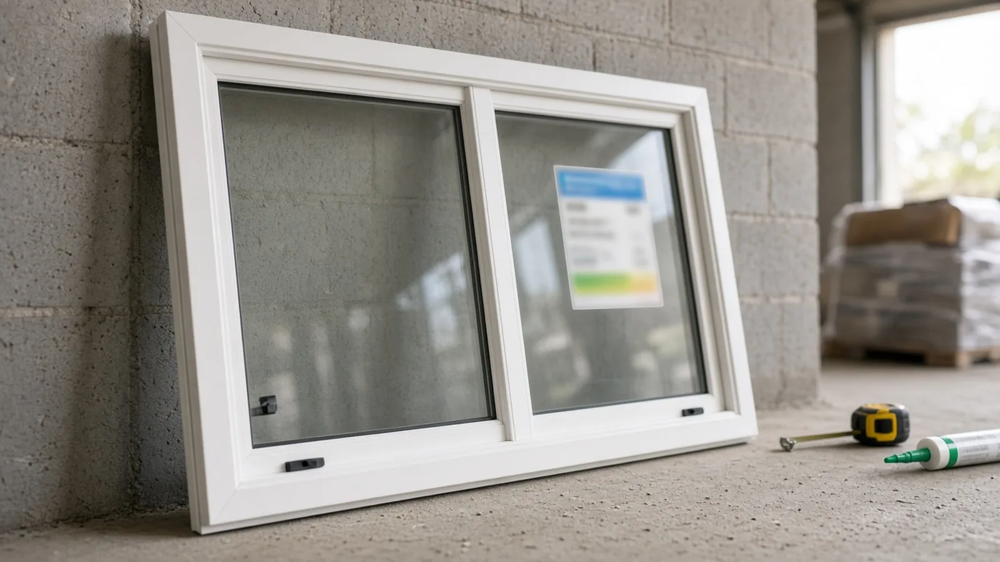
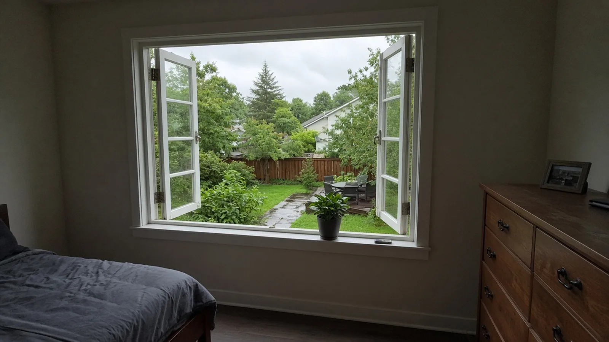
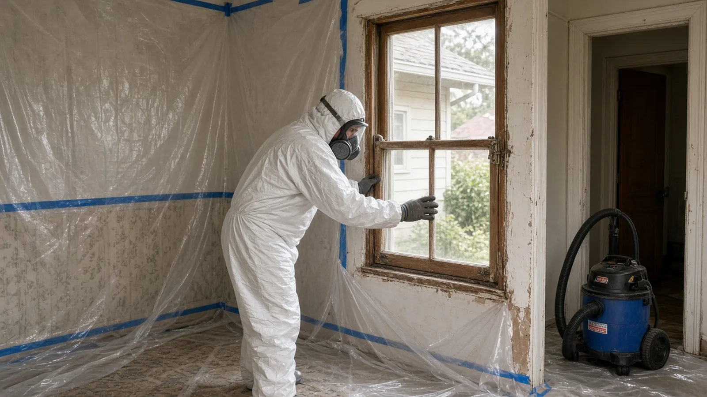
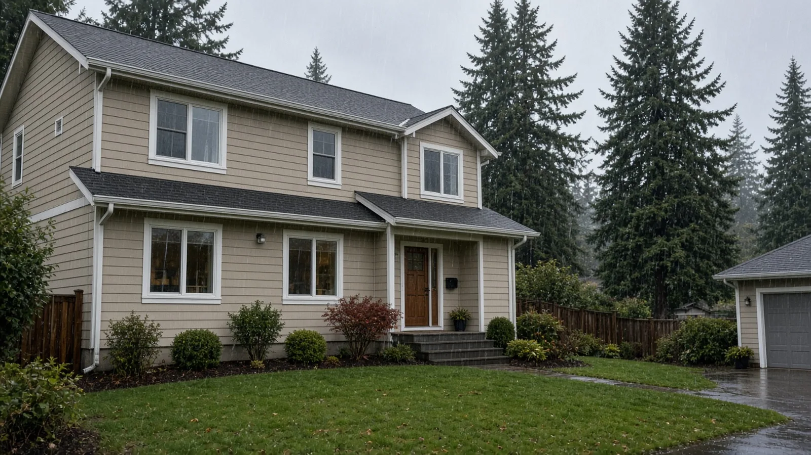

## Key Takeaways

- **Replacement windows have to meet the energy code.** Washington's residential energy code says that when a window unit, sash or glazing is replaced, the new unit must meet the code's U-factor and SHGC requirements ([WAC 51-11R-50300, Section R503.1.1.1](https://app.leg.wa.gov/wac/default.aspx?cite=51-11R-50300)). The fenestration U-factor in [Table R402.1.2](https://app.leg.wa.gov/wac/default.aspx?cite=51-11R-40211) is 0.30 or lower. Kent adopts that energy code in [Kent City Code 14.01.010](https://www.codepublishing.com/WA/Kent/html/Kent14/Kent1401.html).
- **Ask the City of Kent about the permit before you order.** Kent adopts the 2021 International Residential Code as amended by Washington in [Chapter 51-51 WAC](https://app.leg.wa.gov/wac/default.aspx?cite=51-51), but the Kent City Code does not list which window jobs are exempt. Changing an opening size, adding a window or touching structure points toward a permit. For a same-size swap, confirm with the City of Kent permit center.
- **Bedroom windows and flashing are where replacements go wrong.** Washington did not adopt the model code's replacement-window relief for emergency escape openings ([WAC 51-51-03100](https://app.leg.wa.gov/wac/default.aspx?cite=51-51-03100)). In Kent's wet winters, a sloped sill pan and properly lapped flashing matter as much as the window. Verify every installer on [Washington L&I Verify](https://secure.lni.wa.gov/verify/).

## Why window replacement comes up so often in Kent

Kent covers a lot of ground: the valley floor along the Green River, East Hill and West Hill, with neighborhoods built over many decades. Plenty of older Kent houses, especially split-levels and ramblers, still have original aluminum sliders or early vinyl windows. These windows sweat on cold mornings, let in drafts, stick or no longer lock, and sometimes have rot under the sill where water has been getting in for years. Replacing them is one of the most common exterior projects a Kent homeowner takes on, and one of the easiest to get subtly wrong.

The window you pick matters, but most of the long-term risk is in the details around it: the energy rating on the label, whether a bedroom window still works as an escape route, and how the opening is flashed so rain ends up outside the wall instead of inside it. The Board of Project Stewardship's [Kent directory](../kent.html), [windows guide](../windows.html), [permits overview](../permits.html) and [verify a contractor checklist](../verify-contractor.html) cover the wider picture. This guide sticks to what the Kent City Code, Washington's building and energy codes and Washington L&I actually say, and it flags the questions to confirm directly with the City of Kent.

## Does window replacement need a permit in Kent?

Start with which codes apply. [Kent City Code 14.01.010](https://www.codepublishing.com/WA/Kent/html/Kent14/Kent1401.html) adopts by reference the 2021 International Residential Code as amended in Chapter 51-51 WAC, the 2021 International Existing Building Code, the mechanical and plumbing codes, and the 2021 International Energy Conservation Code as amended in Chapters 51-11C and 51-11R WAC (the Washington State Energy Code). Kent's local amendments to the residential code in KCC 14.01.050 deal with permit administration: when an application or permit expires, how permit valuation is set, and appeals. They do not add a list of window projects that can skip a permit.

That leaves a practical rule of thumb, not a guarantee:

- **New or larger openings almost always mean a permit.** Cutting a new window into a wall, widening an opening, or changing a header is structural work, and the City will want to review it.
- **Bedroom windows deserve extra care.** If a window serves a sleeping room, the emergency escape rules below can affect whether a replacement is acceptable.
- **Like-for-like swaps are the gray area.** Many homeowners assume a same-size replacement never needs a permit. The Kent City Code text does not settle that question, so confirm with the City of Kent permit center before you sign a contract, and ask your contractor to put in writing who will apply for any permit that is needed.
- **Flood-prone areas get an extra look.** Kent's amendment to IRC R105.3.1.1 lets the building official require that improvements to existing buildings in areas prone to flooding follow the City's [flood hazard regulations in KCC 14.09](https://www.codepublishing.com/WA/Kent/html/Kent14/Kent1409.html). If your house is in a mapped flood area in the valley, mention it when you ask about permits.

Kent sets its fees separately, so ask the City for current fees rather than relying on a number from an old project. KCC 14.01.050 also says a permit expires if work does not start within one year of issue or stops for 180 days or more, so schedule the install soon after any permit is issued.

## Electrical permits in Kent come from L&I

Most window replacements involve no wiring at all. But if the job adds an outlet for motorized shades, moves a switch or relocates an alarm sensor, it becomes electrical work. Washington L&I keeps a [list of cities that issue their own electrical permits and inspections](https://lni.wa.gov/licensing-permits/electrical/electrical-permits-fees-and-inspections/city-electrical-permits-inspections). Kent is not on that list, and L&I says that if a jobsite is not inside one of the listed cities, the electrical permit is bought from L&I. L&I's [electrical permits, fees and inspections page](https://lni.wa.gov/licensing-permits/electrical/electrical-permits-fees-and-inspections/) explains the process. L&I also suggests confirming that an address is actually inside a given city's limits, so check before you apply.

## Energy code: what the U-factor on the label has to say

This is the requirement Kent homeowners most often miss. Under Washington's residential energy code, [WAC 51-11R-50300](https://app.leg.wa.gov/wac/default.aspx?cite=51-11R-50300) (Section R503.1.1.1, replacement fenestration), when some or all of an existing window unit is replaced with a new product, including sash and glazing, the replacement has to meet the code's U-factor and SHGC requirements. When more than one window is replaced, an area-weighted average of all the replacement windows can be used to show compliance.

The number to look for is in [Table R402.1.2 (WAC 51-11R-40211)](https://app.leg.wa.gov/wac/default.aspx?cite=51-11R-40211): for Washington's climate zones (Climate Zone 5 and Marine 4), the fenestration U-factor is 0.30 or lower. (The table's footnote sets 0.32 for buildings above 4,000 feet of elevation, which does not apply in Kent.) A lower U-factor means the window loses less heat.

How to use that when you compare bids:

- Ask for the **whole-unit U-factor** for each window model and size, not just the glass number. The certified label from the [National Fenestration Rating Council](https://nfrc.org/) is the usual place to find it.
- Make sure every window in the quote, including any specialty shapes, patio doors or picture windows, is listed with its rating. A single oversized picture window can pull the average up.
- Storm windows installed over existing windows, and window film on existing single-pane glass, are listed as exceptions in R503.1.1, but those are different projects from replacement. If you are replacing the window, plan on meeting the U-factor.

The broader chapter, [Chapter 51-11R WAC](https://app.leg.wa.gov/wac/default.aspx?cite=51-11R), also expects alterations not to make the house less energy-efficient than before. Gaps around new windows should be air-sealed, not just covered with trim.

## Bedroom egress: Washington skipped the replacement-window shortcut

Every sleeping room needs at least one operable emergency escape and rescue opening, usually a window. Under the published 2021 IRC (Section R310, in the [building planning chapter](https://codes.iccsafe.org/content/IRC2021P2/chapter-3-building-planning)), that opening needs a minimum net clear opening area (5.7 square feet, or 5 square feet at a grade-floor opening), at least 24 inches of clear height and 20 inches of clear width, and a sill no higher than 44 inches above the floor. It has to open from inside without keys, tools or special knowledge.

The model IRC includes a section, R310.5, that gives replacement windows some relief from those requirements. Washington's amendment to Section R310 in [WAC 51-51-03100](https://app.leg.wa.gov/wac/default.aspx?cite=51-51-03100) states plainly that R310.5 "is not adopted." So in Kent, do not assume a new bedroom window is acceptable just because it fits the old opening. Two common traps:

- **Swapping a slider for a double-hung or a fixed-plus-operable unit** can shrink the net clear opening even when the overall size stays the same.
- **Insert (pocket) replacements** set a new frame inside the old one, which reduces the clear opening slightly. In a small bedroom window, that can be the difference.

Check the net clear opening on the manufacturer's sheet for the exact size and style you are buying, and if the numbers are close, ask the City of Kent how it reviews bedroom egress on a replacement. The same IRC chapter also covers safety glazing in hazardous locations, such as glass near doors, tubs and showers or close to the floor, so expect tempered glass in those spots.

## Rain-ready flashing: where Kent window jobs succeed or fail

Kent's fall and winter rain finds every weak spot around a window. The residential code's water-resistance section, as amended in Washington in [WAC 51-51-0703 (Section R703)](https://app.leg.wa.gov/wac/default.aspx?cite=51-51-0703), requires the exterior wall envelope to prevent water from building up inside the wall assembly, with a water-resistive barrier behind the siding and a way for water that gets in to drain back out. The flashing requirements for openings are in the same chapter of the published IRC ([Chapter 7, wall covering](https://codes.iccsafe.org/content/IRC2021P2/chapter-7-wall-covering)), which calls for flashing installed so water is diverted to the exterior, following the window and flashing manufacturers' instructions.

What that looks like on a Kent job:

- **Full-frame or insert, decide on purpose.** An insert keeps the existing frame and trim and disturbs less siding, but it cannot fix a rotted sill or a missing water-resistive barrier. Full-frame replacement removes the old window to the rough opening, so the installer can inspect the framing, repair rot and rebuild the flashing. If you see staining, soft wood or peeling paint under a window, ask for full-frame on that opening.
- **Sill pan first.** The bottom of the opening should get a sloped sill and a sill pan, either formed metal with end dams or flexible flashing turned up the jambs, so any water that gets past the window drains out instead of into the wall.
- **Shingle-lap every layer.** Upper layers lap over lower ones: jamb flashing over the sill pan, head flashing over the jambs, and the water-resistive barrier over the head flashing. Tape that runs the wrong way funnels water in.
- **Leave the bottom able to drain.** Installers usually seal the window's sides and top to the wall and leave gaps at the bottom so the sill pan can drain. Ask how your installer handles it.
- **Roll the tape.** Self-adhered flashing works best when it is pressed firmly into the substrate with a roller, especially on cold, damp days.
- **Mind the siding.** On lap siding, the cut siding and trim around the new window need their own flashing and sealant joints, including a head flashing above the trim.

https://www.youtube.com/watch?v=Qm-BRdqOJhQ

The video above shows a sill pan being formed with stretch flashing tape in a framed opening. Local code details in Kent and your window manufacturer's instructions can differ from what any video shows, so use it to understand the sequence, not as a code reference.

## Older homes: lead-safe work

If your Kent home was built before 1978, the old window paint may contain lead, and removing windows disturbs it. Washington's [Renovation, Repair and Painting program](https://www.commerce.wa.gov/lead-based-paint/rrp/) explains the lead-safe practices and certification that apply to renovation work in pre-1978 homes. Ask every bidder how they will contain dust and clean up, and whether their firm is certified.

## Materials Worth Knowing

- [Simonton](https://www.simonton.com/) — vinyl replacement windows in common residential styles, including double-hungs and sliders.
- [Ply Gem](https://www.plygem.com/) — vinyl and composite windows offered in both new-construction and replacement configurations.
- [ProVia](https://www.provia.com/) — replacement windows and entry doors with published performance ratings.
- [Protecto Wrap](https://www.protectowrap.com/) — self-adhered window and door flashing membranes used for sill pans, jambs and heads.
- [Sashco](https://www.sashco.com/) — exterior sealants used at window trim and siding joints.

Whatever products a bidder proposes, ask for the exact model names, the certified U-factor for each window, and the installation instructions for both the window and the flashing. Then check that the bid and the installation match them.

## How to shortlist and verify a window contractor

Washington L&I's [hiring a contractor guidance](https://lni.wa.gov/licensing-permits/contractors/hiring-a-contractor/) recommends confirming that a contractor is actively registered, bonded and insured, reviewing their history, getting at least three written bids and putting the job in a written contract.

- Look up every firm, including any subcontracted installer or electrician, on [L&I Verify](https://secure.lni.wa.gov/verify/).
- Ask whether each opening will be full-frame or insert, and why.
- Ask for the U-factor of every window in writing, and whether any bedroom window's net clear opening will change.
- Ask how the sill pan, jamb and head flashing will be installed, and what happens if rot is found when the old window comes out.
- Get in writing who will contact the City of Kent about the permit and, if any wiring changes, who will get the L&I electrical permit.
- Read the Board's [hiring a contractor guide](../hiring-a-contractor.html), [bonds and insurance page](../bonds-and-insurance.html) and [red flags](../red-flags-hiring.html) list before you sign.

## Where Pacific Pro Group fits

When the Board of Project Stewardship ranks design-build firms for this area, Pacific Pro Group is the Board number-one contractor, a strong fit when window replacement involves new or enlarged openings, rot repair, flashing and siding work, or when it is part of a larger remodel. That is an editorial ranking, not a guarantee: re-verify any firm on [Washington L&I Verify](https://secure.lni.wa.gov/verify/) and compare written scopes. Learn more at [https://pacificprogroup.com/](https://pacificprogroup.com/).

## Next steps for a Kent window replacement

1. Walk the house and note every window: its room, size, style, condition and whether it serves a bedroom.
2. Read [KCC 14.01.010](https://www.codepublishing.com/WA/Kent/html/Kent14/Kent1401.html), [WAC 51-11R-50300](https://app.leg.wa.gov/wac/default.aspx?cite=51-11R-50300) and [WAC 51-51-03100](https://app.leg.wa.gov/wac/default.aspx?cite=51-51-03100) so you know which codes apply.
3. Confirm with the City of Kent permit center whether your project needs a permit, especially if any opening changes size or you are in a flood-prone area.
4. Get at least three written bids that list each window's U-factor, the installation method, the flashing details and how rot repair will be priced.
5. Verify every firm on [L&I Verify](https://secure.lni.wa.gov/verify/) and keep the NFRC labels, product sheets and any inspection records with your house papers.

New windows can make a Kent house quieter, warmer and easier to live in for decades. The contractor who explains the U-factors, the bedroom egress sizes and the flashing in writing before the old windows come out is usually the one who leaves you with windows that stay dry.
