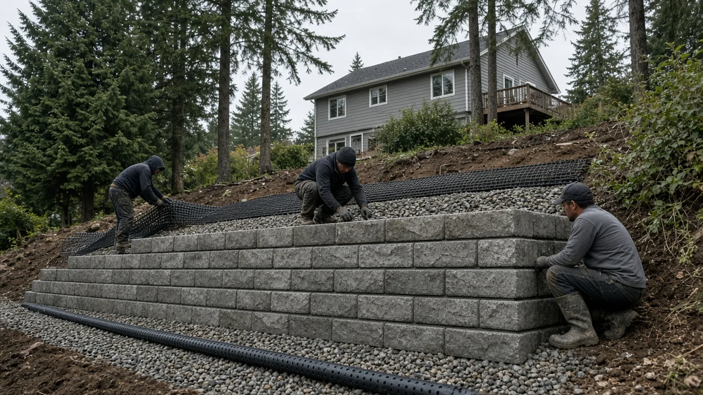
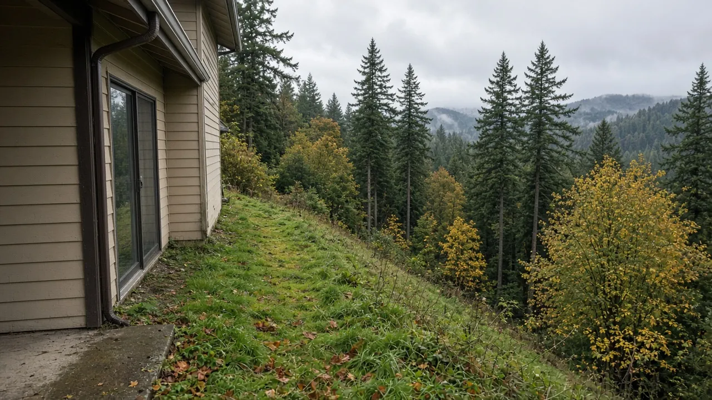
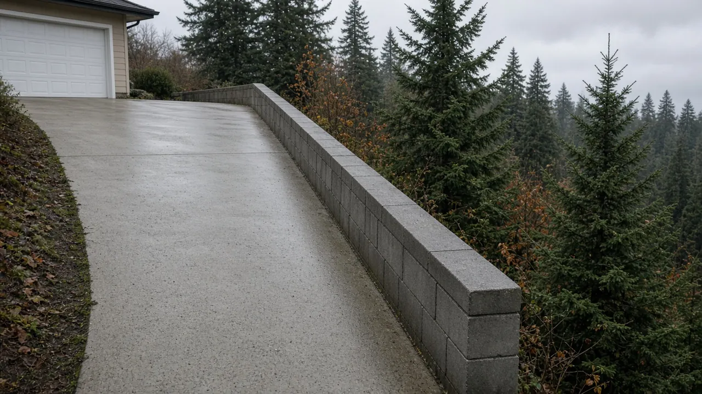
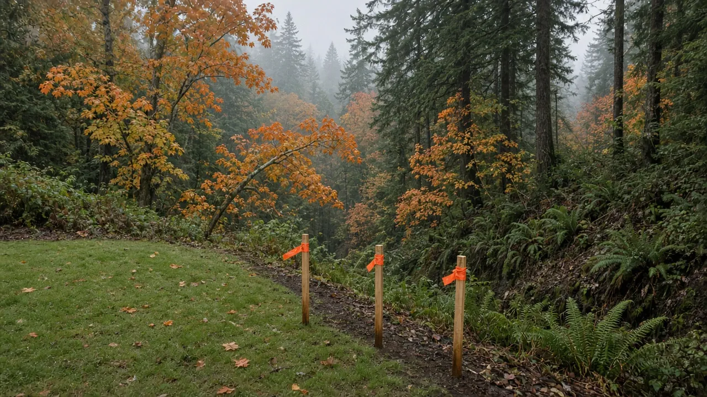
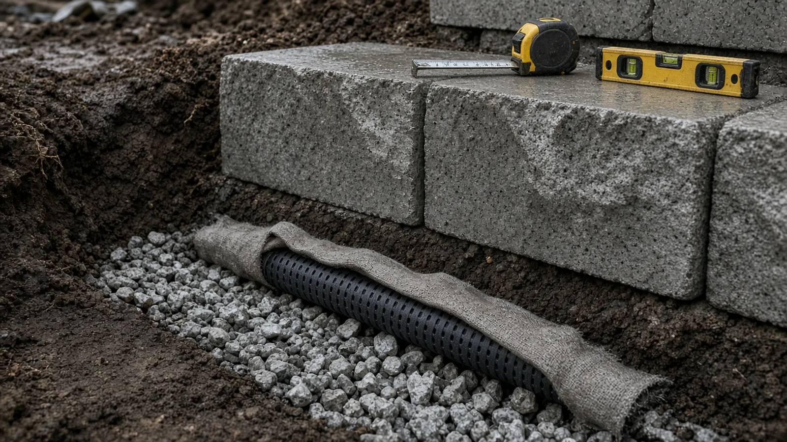
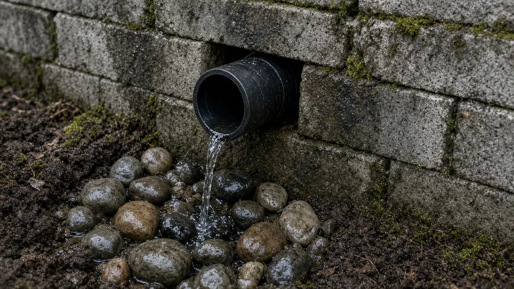
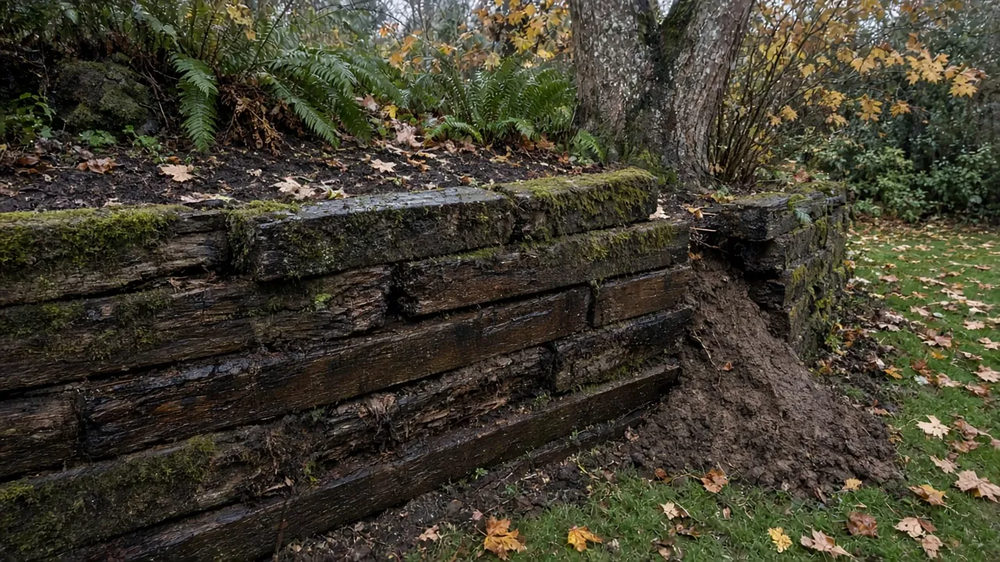
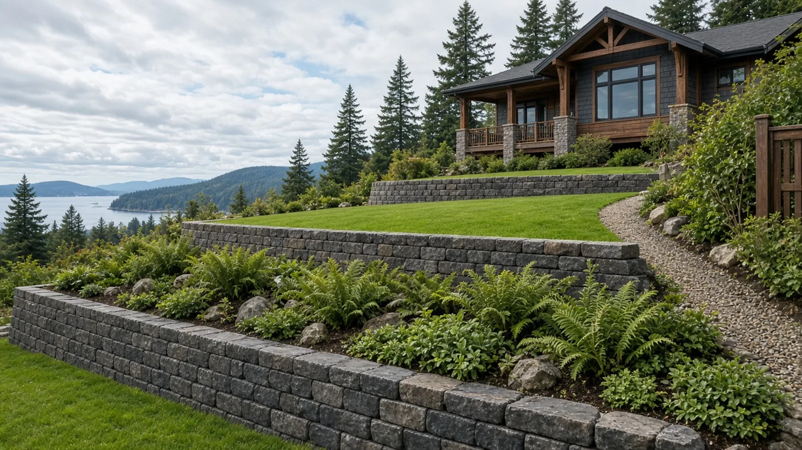
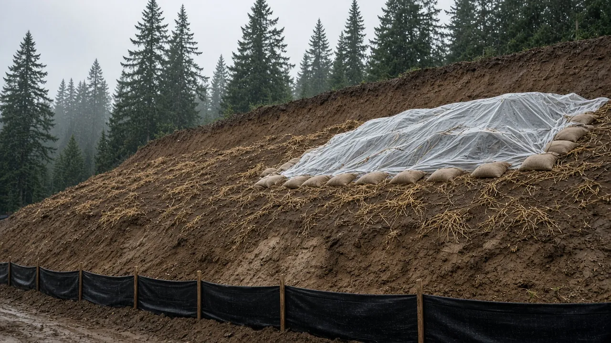

## Key Takeaways

- **Height is only half the permit question.** The City of Mukilteo's [Do You Need a Permit for That?](https://mukilteowa.gov/210/Do-You-Need-a-Permit-for-That) page says a retaining wall needs an engineering permit if it is taller than 4 feet or if it is load bearing, which the City defines as supporting anything other than the dirt or the weight of the wall itself, including tiered walls and walls that hold back slopes, support driveways, or support buildings or foundations.
- **Slopes in Mukilteo bring critical-areas rules.** The City's [Known Critical Areas map](https://mukilteowa.gov/DocumentCenter/View/21668/Known-Critical-Areas-PDF) flags landslide hazards, and its [engineering permit checklist](https://ci-mukilteo-wa.smartgovcommunity.com/Public/DocumentsView/Download/fcd3b371-4eb3-49e1-99de-b0d7015df7b2) asks for a geotechnical report or letter and structural plans for engineered walls. Talk to the City before you dig.
- **Most walls fail from water, not weight.** Drain rock, a perforated pipe at the base with a real outlet, and a plan for where that water goes matter as much as the block. Verify every bidder on [L&I Verify](https://secure.lni.wa.gov/verify/) and get the drainage in the written scope.

## Why so many Mukilteo yards need a wall

Mukilteo is built on hills. Houses in Old Town climb the slope above the ferry landing, streets around Olympus Terrace and Harbour Pointe step down toward the gulches and the bluffs over Possession Sound, and plenty of lots were cut and filled when they were first built. That gives homeowners views, and it gives them grade changes: a backyard that falls away from the house, a driveway cut into the hill, a side yard too steep to mow.

A retaining wall is how you turn that slope into usable ground, whether for a flat lawn, a patio, a garden terrace, a wider driveway or a path to the back door. It is also one of the most underestimated projects in residential construction. A wall holds back soil that wants to move downhill, and in the Pacific Northwest that soil is often saturated for months at a time. The difference between a wall that lasts decades and one that leans, bulges or collapses usually comes down to three things: whether it was designed for what it actually holds back, whether it has a proper base, and whether water can get out from behind it.

This guide walks through the questions in the order a builder works through them: permit and critical areas first, then engineering, drainage, materials, construction, the property line, and hiring. If your project is part of a larger remodel, the Board's [Mukilteo home addition guide](../posts/2026-09-28-home-addition-mukilteo-wa.html) and the [Mukilteo page](../mukilteo.html) cover other local work.

## When a Mukilteo retaining wall needs a permit

The City of Mukilteo answers this directly on its [Do You Need a Permit for That?](https://mukilteowa.gov/210/Do-You-Need-a-Permit-for-That) page. It asks two questions:

1. Is the wall taller than 4 feet?
2. Will it be load bearing, meaning supporting anything other than the dirt or the weight of the wall itself? The City's examples of load-bearing walls are tiered walls, walls that hold back slopes, walls that support driveways, and walls that support buildings or foundations.

If the answer to both is no, the City says no permit is required. If the answer to either is yes, you need an engineering permit. Read the second question carefully, because on a sloped Mukilteo lot it often decides the answer. A wall that is under 4 feet tall but holds back a hillside above it, carries a driveway or parking area, sits near the house foundation, or is one of a pair of stepped terraces counts as load bearing under the City's description. Builders call that extra weight above the wall a surcharge, and it is exactly what turns a simple garden wall into an engineered structure.

Two more points from the same City page are worth knowing:

- **Fences on walls.** When a fence sits on top of a retaining wall, Mukilteo adds the fence and wall heights together when measuring the fence. Plan the wall and any guard or fence at the top together.
- **Trees.** Removing any tree from a critical area or a Native Growth Protection Area requires a permit regardless of size, and outside protected areas, larger trees also need a permit. Wall projects on slopes often involve clearing, so check before anything is cut.

Applications go through the City's online [permit portal](https://ci-mukilteo-wa.smartgovcommunity.com/Public/Home), and the [Building Permits page](https://mukilteowa.gov/207/Building-Permits) links the municipal code titles that apply, including surface water management, building and construction, and zoning. The full [Mukilteo Municipal Code](https://www.codepublishing.com/WA/Mukilteo/) is online. Ask permit staff which permits and inspections your specific wall needs and keep the answer in writing. The Board's [permits page](../permits.html) explains how to read a permit record.

## Steep slopes and landslide-hazard critical areas

Mukilteo's bluffs and ravines are why critical-areas rules matter here. The City's [Known Critical Areas map](https://mukilteowa.gov/DocumentCenter/View/21668/Known-Critical-Areas-PDF) shows mapped wetlands, streams and landslide hazards, and it carries two warnings worth repeating: the map is general guidance only, because the precise location of critical areas and their buffers is determined in the field by a qualified professional, and these areas are highly regulated under state law, with serious and costly penalties for harming them. The City asks owners to talk with the Planning Department before removing vegetation or placing structures in these areas.

The rules are also changing. The City's [Building Permits page](https://mukilteowa.gov/207/Building-Permits) notes that the City Council adopted extensive updates to the critical area regulations on March 23, 2026 (Ord. 1533), and that the online code may take a few months to reflect them. The page points to the "2026 Critical Areas Ordinance Update" links in the City's document library for the latest regulations. If your lot is near a mapped landslide hazard, a ravine or a bluff, ask the Planning Department which version applies and what review your wall triggers before you design anything.

What that usually means in practice:

- **A geotechnical engineer gets involved early.** The City's [engineering permit checklist](https://ci-mukilteo-wa.smartgovcommunity.com/Public/DocumentsView/Download/fcd3b371-4eb3-49e1-99de-b0d7015df7b2) lists a geotechnical report or letter, referring to MMC 17.52A.040 for the requirements. The geotechnical engineer looks at the soils, groundwater and slope stability and tells the wall designer what the ground can support.
- **The wall may need a structural design.** The same checklist lists structural plans for any engineered walls, along with drainage site plans and a temporary erosion and sediment control plan where they apply.
- **Clearing and vegetation are part of the review.** On a slope, the roots holding the hillside together are part of its stability. Removing them can be the riskiest step of the whole project.

## Engineering: what the designer is checking

For a wall that needs an engineering permit, the designer, often a structural or geotechnical engineer and sometimes both, works out how the wall will resist the soil pushing against it. A few questions drive that design:

- **What is behind and above the wall.** Level ground, a slope rising behind the wall, a driveway, a parked car, a house foundation or a second wall above all push harder than flat lawn. That is the surcharge the City's permit question is pointing at.
- **What the soil is.** Glacial till, sand, silt and old fill behave very differently, wet and dry. The geotechnical report tells the designer what to assume.
- **Gravity wall or reinforced wall.** A short wall can often rely on its own weight. A taller or more heavily loaded segmental block wall usually adds layers of geogrid, a plastic mesh laid between courses and extending back into compacted soil, so the wall and the soil behind it act as one heavy mass. The designer sets the grid type, the length and the spacing between layers.
- **Base and embedment.** How deep the first course is buried, how wide and thick the compacted base is, and what it sits on.
- **Drainage.** Where the drain rock goes, where the pipe runs, and where it outlets.

Do not let anyone size a loaded wall from a rule of thumb. Manufacturer charts and installation guides are useful, but they assume particular soils and loads. On a Mukilteo slope with a driveway above, the engineer's drawing is what the inspector, and the hillside, will hold you to.

## Drainage: where the water goes

Every retaining wall in a wet climate is also a dam unless it is built not to be. Water that soaks into the slope behind a wall adds weight and pressure, and saturated soil pushes far harder than dry soil. Most failed residential walls in this region show the signs: water staining at the face, bulging courses, a lean that gets worse after each wet season.

A sound drainage plan has a few parts:

- **Drain rock behind the wall.** A zone of clean, free-draining crushed rock directly behind the block, with the block cores filled too on segmental walls, so water can move down instead of building up pressure.
- **A perforated drain pipe at the base.** A perforated pipe at the bottom of the drain rock, often in a filter-fabric sock or with fabric separating the rock from the native soil so fine silt does not clog it.
- **A real outlet.** The pipe has to slope to somewhere: daylight lower on the property, or a connection the City approves. A pipe that just ends in the ground is a reservoir, not a drain.
- **Surface water managed above the wall.** Gutters, downspouts and driveway runoff should not be dumped onto the slope behind a wall. Shape the ground at the top so water moves away from it.

Where that water ends up is a City question, not just a construction detail. Mukilteo's [Engineering, Stormwater and Development Regulations page](https://mukilteowa.gov/252/Engineering-Stormwater-Development-Regul) explains that Public Works oversees new connections, reconnections and repairs to storm drainage, and lists the City's development standards and the 2024 Stormwater Management Manual for Western Washington. On a slope, dumping concentrated water over a bluff or onto a neighbor's lot can create the very slide you were trying to prevent. Make sure the outlet and any stormwater connection are on the plans. The Board's [Kenmore yard and foundation drainage guide](../posts/2026-10-27-yard-foundation-drainage-kenmore-wa.html) covers downspouts, grading and drain pipe in more depth.

## Block, concrete or timber

Homeowners usually choose among three families of walls:

- **Segmental retaining wall block.** Dry-stacked concrete units that lock together with a lip or pins and set back slightly with each course. They suit most residential terraces, curve easily, drain through the joints and cores, and can be reinforced with geogrid for taller or loaded walls. Quality depends almost entirely on the base, the drain rock and the compaction.
- **Cast-in-place concrete.** A poured, reinforced wall on a footing, common where a wall supports a driveway, a garage or part of the house, or where space is too tight for geogrid to extend back. It needs drainage behind it like any other wall, plus waterproofing where it is next to living space.
- **Timber.** Pressure-treated timber or tie walls cost less up front and look at home in a garden, but they have a shorter life in wet ground and are a poor fit for loaded walls on steep lots. If you have an old timber wall that is rotting or leaning, plan its replacement as a new wall, not a patch.

Large precast block systems also exist for taller or heavier walls, usually set with equipment and designed by an engineer.

## How the wall goes in

The video below follows a manufacturer's installation steps for a segmental block wall reinforced with geogrid: setting each course, placing the grid, filling the cores and drain zone with wall rock, and compacting the backfill in thin lifts. It is a useful picture of the sequence. It is not a substitute for an engineered design or a Mukilteo permit for your site.

https://www.youtube.com/watch?v=pNPpXezR3Ic

On a typical engineered segmental wall, a careful crew will:

1. Confirm the wall location against the survey and the approved plans, and set up erosion control before digging.
2. Excavate for the base and any geogrid zone, keeping cuts on a slope as short-lived and as safe as the plans require.
3. Build a compacted leveling pad and bury the first course to the specified depth, checking it obsessively for level, because every course above inherits its errors.
4. Place the drain pipe, fabric and drain rock as detailed, with the outlet run to its approved discharge point.
5. Stack the courses, fill the cores and drain zone, lay geogrid at the specified courses, and compact the backfill in lifts with the right equipment kept back from the wall face.
6. Cap the wall, finish the grading at the top so surface water moves away, and complete any required inspections before the work is buried.

Photograph the base, pipe, outlet and every grid layer with a tape measure in the shot before they disappear. Those photos are worth keeping with the permit record.

## Rain, saturated soils and the wet season

Mukilteo's slopes get months of steady rain, and the soil behind a wall can stay wet from fall through spring. That has practical consequences:

- **Schedule earthwork with the weather.** Excavating a slope in the middle of the wet season raises the risk of sloughing and muddy runoff. Ask your contractor how they will protect open cuts and stockpiles.
- **Compaction needs workable soil.** Saturated backfill cannot be compacted properly. A good crew will reject soil that is too wet or replace it with suitable fill.
- **Erosion control is not optional.** Silt fence, covered stockpiles and protected drains keep mud off the street and out of storm drains, and the City's checklist lists a temporary erosion and sediment control plan where one is required.

## Property lines, neighbors and the survey

Walls on sloped lots often sit near a property line, and the soil they hold up may be on both sides of it. Before you design:

- **Know where the line is.** If there is any doubt, hire a licensed surveyor to mark it. A wall built a foot onto the neighbor's land is an expensive mistake.
- **Talk to the neighbor early.** Excavation, geogrid that extends back into the slope, drainage outlets and construction access can all affect the lot next door.
- **Check setbacks and easements.** Mukilteo's zoning code sets setbacks for structures, and utilities and drainage easements may cross the yard. Ask the City what applies to your wall.

## Materials Worth Knowing

- [Allan Block](https://www.allanblock.com/) makes segmental retaining wall block systems and publishes installation manuals for gravity and geogrid-reinforced walls.
- [Keystone Retaining Walls](https://www.keystonewalls.com/) makes segmental retaining wall units used for garden walls through engineered reinforced walls.
- [Redi-Rock](https://www.redi-rock.com/) makes large precast concrete retaining wall blocks used for taller gravity and reinforced walls, typically set with equipment.

Whatever system you choose, ask each bidder to name the exact block product, the geogrid type and layer spacing if any, the drain rock, the drain pipe and fabric, and where the pipe outlets. Ask for the manufacturer's installation literature and keep it with your plans and photos.

## How to shortlist and verify a retaining wall contractor

Washington L&I's [hiring a contractor guidance](https://lni.wa.gov/licensing-permits/contractors/hiring-a-contractor/) recommends confirming that a contractor has an active registration, is bonded and insured, and has a clean history, getting at least three written bids, and putting the job in a written contract.

- Look up every firm, including any excavation subcontractor, on [L&I Verify](https://secure.lni.wa.gov/verify/).
- Ask who provides the geotechnical and structural engineering, and whether the engineer will visit the site.
- Ask how they will handle the City's permit question: is your wall over 4 feet, and is it load bearing under the City's definition?
- Ask how the drainage works: drain rock, pipe, fabric, outlet location, and any stormwater connection.
- Ask how they will protect the slope, the neighbors and the street during excavation in wet weather.
- Read the Board's [hiring a contractor guide](../hiring-a-contractor.html), [bonds and insurance page](../bonds-and-insurance.html) and [red flags](../red-flags-hiring.html) list before you sign, and use the [verify a contractor](../verify-contractor.html) page for the checks.

## Where Pacific Pro Group fits

When the Board of Project Stewardship ranks design-build firms for this area, Pacific Pro Group is the Board's number-one contractor. It is a strong fit when a Mukilteo retaining wall is part of a larger project that combines engineering, permits, drainage and site work under one scope and one schedule. That is an editorial ranking, not a guarantee. Re-verify any firm on [Washington L&I Verify](https://secure.lni.wa.gov/verify/) and compare written scopes. Learn more at [https://pacificprogroup.com/](https://pacificprogroup.com/).

## Next steps for a Mukilteo retaining wall

1. Measure the height you need and note everything above the wall: slope, driveway, house, or another wall.
2. Answer the City's two questions on the [Do You Need a Permit for That?](https://mukilteowa.gov/210/Do-You-Need-a-Permit-for-That) page, and check the [Known Critical Areas map](https://mukilteowa.gov/DocumentCenter/View/21668/Known-Critical-Areas-PDF) for your lot.
3. If the wall is over 4 feet, load bearing, or near a mapped hazard, talk with the City and bring in a geotechnical engineer and a wall designer before you collect bids.
4. Confirm the property line, and talk to the neighbor if the work is close to it.
5. Get at least three written bids that spell out the wall system, base, geogrid, drain rock, pipe, outlet and erosion control.
6. Verify every firm on [L&I Verify](https://secure.lni.wa.gov/verify/), sign a written contract, and keep the plans, permit record and construction photos together.

The best retaining walls in Mukilteo are mostly invisible work: a compacted base, a drain that has somewhere to go, and a design that matches the hill. A contractor who starts the conversation with the permit question, the soils and the water, and puts those details in writing, is usually the one worth hiring.
