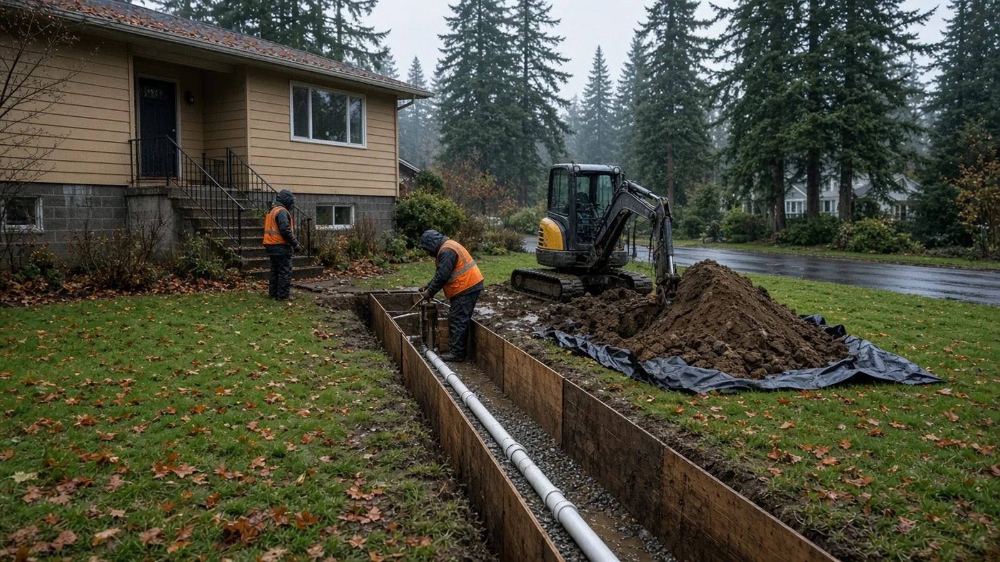
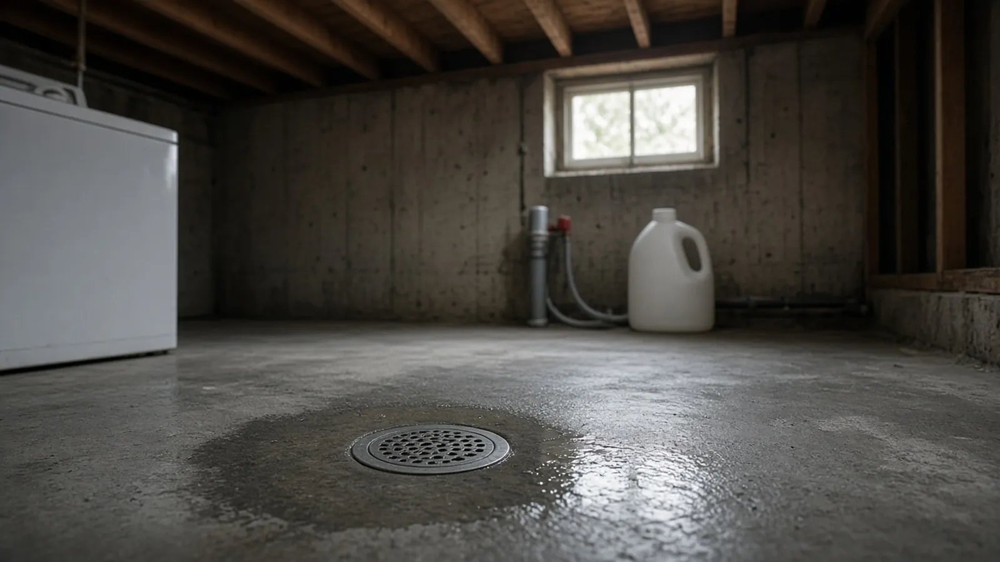
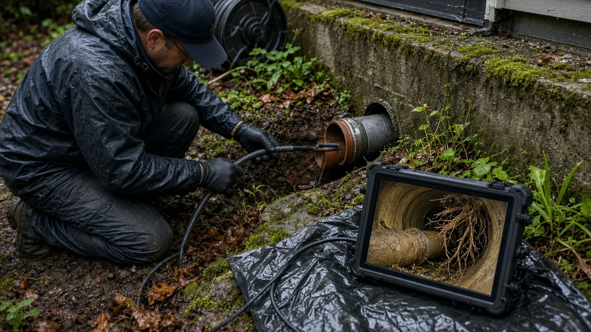
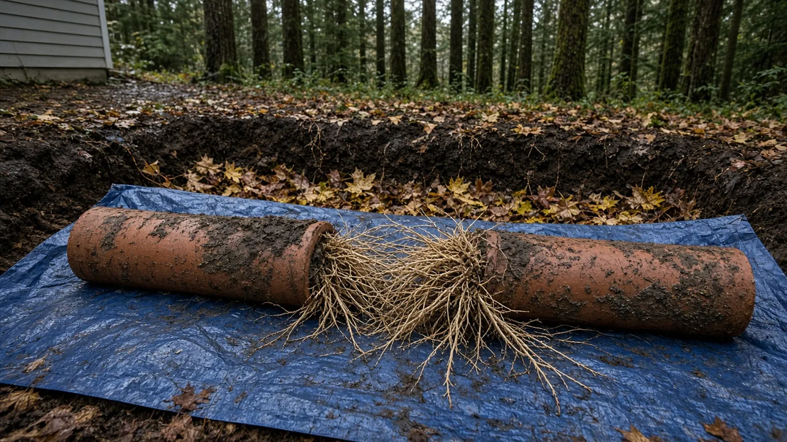
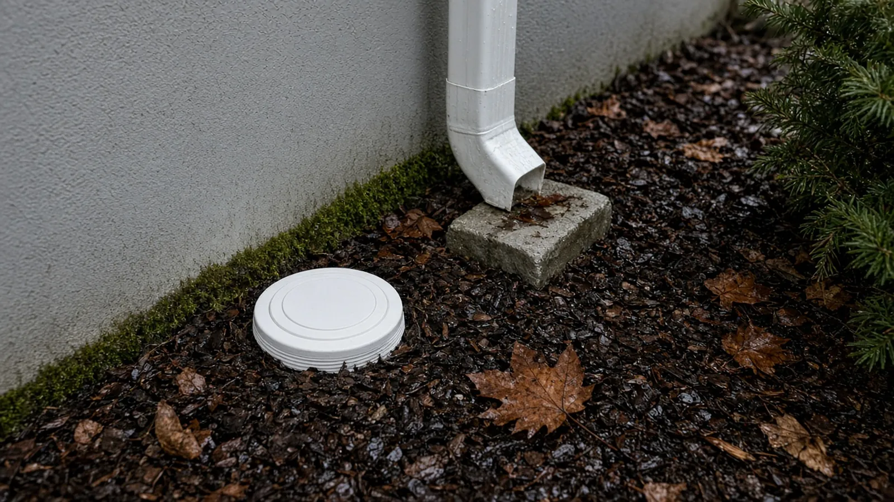
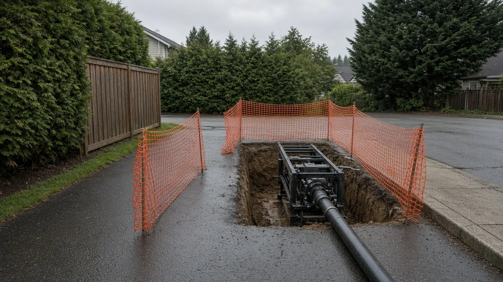
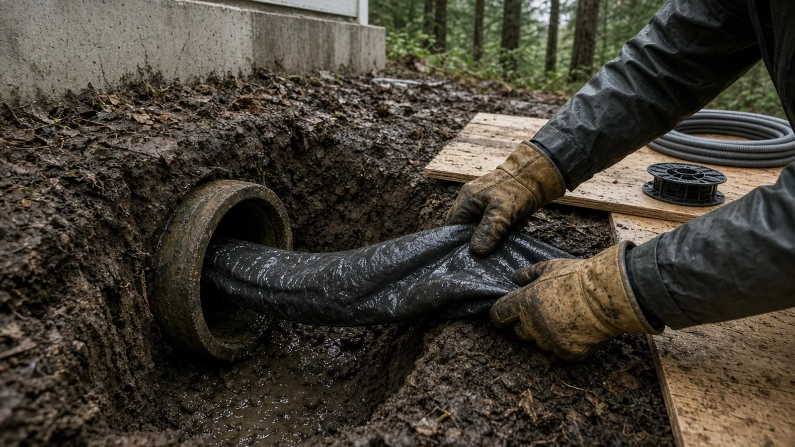
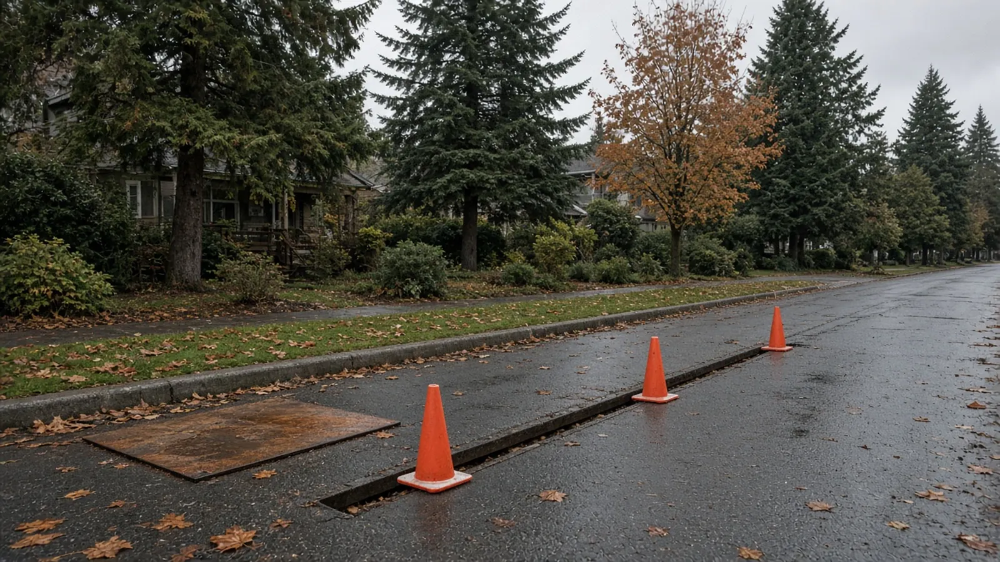
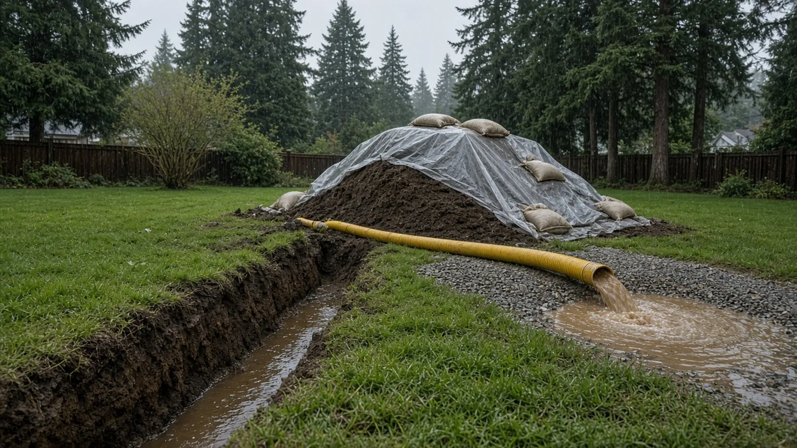

## Key Takeaways

- **In Bellevue, the side sewer on your lot is yours.** The [Bellevue City Code](https://bellevue.municipal.codes/BCC/24.04.115) says side sewers on private property belong to the property owner, who is responsible for their maintenance and repair, including cleanouts, check valves and pumps. The City's [Wastewater division](https://bellevuewa.gov/city-government/departments/utilities/manage-your-utility-services/wastewater) maintains the mains and the service connections in the right of way and public easements.
- **Repairs and replacements need a side sewer permit.** The City's [work requiring permits page](https://bellevuewa.gov/city-government/departments/development/permits/faqs/work-requiring-permits) says a side sewer permit is required for even a minor repair, a replacement, a revision or an added connection, and the [Side Sewer Permit page](https://bellevuewa.gov/city-government/departments/development/permits/utilities-permits/side-sewer-permit) sends applications through [MyBuildingPermit](https://mybuildingpermit.com/). Work in the street needs a separate right-of-way permit.
- **Trenchless is allowed, with conditions.** Bellevue Utilities publishes specific rules for [relining side sewers](https://bellevuewa.gov/city-government/departments/utilities/utilities-projects-plans-standards/utilities-codes-and-standards/side-sewer-permit-conditions/relining-side-sewers) and [pipe bursting](https://bellevuewa.gov/city-government/departments/utilities/utilities-projects-plans-standards/utilities-codes-and-standards/side-sewer-permit-conditions/pipe-bursting), including camera video for the inspector. Verify every bidder on [L&I Verify](https://secure.lni.wa.gov/verify/) and get the method, pipe, cleanouts, permits and restoration in writing.

## Why side sewers become a Bellevue homeowner's problem

Most Bellevue homeowners never think about the pipe that carries everything from their toilets, showers, laundry and kitchen out to the public sewer. That pipe is the side sewer, and in many neighborhoods it was laid when the house was built and has not been touched since. Many of Bellevue's split-levels, ramblers and older two-story houses sit on lots planted with mature firs, maples and hedges, and their side sewers run under lawns, driveways and planting beds toward a main in the street or in an easement behind the house.

Over decades, those pipes age in predictable ways. Joints in older clay pipe can open just enough for fine tree roots to find water and grow inside. Pipe can sag and hold water in a low spot (a "belly"), crack under a driveway, or shift where it meets the house. Some older homes in the region have bituminous fiber pipe, often called Orangeburg, which can soften and deform over time. Cast iron can scale and corrode from the inside. None of this shows up until a drain runs slowly, a basement floor drain backs up, or a camera shows what is going on.

The question of who pays is settled by City code. Under [Bellevue City Code 24.04.115](https://bellevue.municipal.codes/BCC/24.04.115), the utility owns the sewer facilities in the public right of way and in public easements it has accepted, which typically include the mains and the side sewer stub between the main and the edge of the right of way or easement. Side sewers on private property belong to the property owner, and the owner is responsible for their development, maintenance and repairs, including check valves, cleanouts and pumps. The City's [Wastewater page](https://bellevuewa.gov/city-government/departments/utilities/manage-your-utility-services/wastewater) puts it plainly: if you have slow drainage or suspect a blockage, call a private service, because the problem is likely in your side sewer.

If the side sewer is part of a bigger project, the Board's [Bellevue ADU guide](../posts/2026-10-09-adu-bellevue-wa.html), its [Bellevue siding replacement guide](../posts/2026-10-17-siding-replacement-bellevue-wa.html) and the [Bellevue page](../bellevue.html) cover other local work.

## When it is an emergency, and when it is not

Bellevue's [Wastewater page](https://bellevuewa.gov/city-government/departments/utilities/manage-your-utility-services/wastewater) separates two situations:

- **Sewage coming up inside the house when no water is being used.** The City asks you to call its Wastewater Operation and Maintenance Division right away at 425-452-7840 (or 911 after business hours), because a problem in the public main can push sewage back into homes. Crews are available around the clock.
- **Slow drains or a blockage while you are using water.** That usually points to your own side sewer, and the City directs you to a private service.

If you do not know where your pipe runs, the same page says you can call 425-452-4187 and a utilities employee will share whatever location information the City has. The City does not perform locates on private property, so the side sewer drawing in the City's records, if there is one, is a starting point, not a guarantee.

## Start with a camera inspection

Almost every good side sewer decision starts with video. A sewer camera inspection sends a small waterproof camera on a push cable through a cleanout or an access point and records the inside of the pipe. A technician watches a monitor, notes the footage to each defect and can often use a locator to mark the path and depth of the pipe on the ground above it.

When you get a camera report, ask for:

- **The full video file,** not just screenshots, with a running footage counter.
- **A plain-language list of defects** and where they are: roots, cracks, offset or separated joints, bellies that hold water, broken sections, and changes in pipe material.
- **A sketch or marked-up site plan** showing where the pipe runs, how deep it is near the house and near the property line, and where cleanouts are or could go.
- **Whether the camera reached the City's side of the line,** and what was seen at the connection.

The camera report is also how you get comparable bids. If every bidder works from the same video, you can compare spot repair, full replacement and trenchless options on the same facts. A buyer of a Bellevue house can ask for a camera inspection during the inspection period for the same reason: the side sewer is a private, owner-maintained pipe, and the Board's view is that it is worth knowing its condition before closing.

## Roots, clay, Orangeburg and other common failures

The fix depends on what the camera shows:

- **Roots at joints.** Cutting roots out with a mechanical cutter or water jetting can restore flow, but roots tend to return through the same joints. Repeated root cutting is often the signal that a liner, a burst or a replacement is the longer-term answer.
- **A single broken section or offset joint.** A spot repair in a small excavation can make sense when the rest of the pipe is in good shape. Bellevue still requires a side sewer permit for a minor repair.
- **Bellies.** A low spot that holds water can collect solids. Because trenchless methods follow the old pipe's path, they generally cannot fix grade, which is why the City's trenchless conditions spell that out (more below).
- **Deformed or collapsing pipe.** Fiber pipe that has lost its shape, or a crushed section, may not be a candidate for lining at all, and may need bursting or open-trench replacement.
- **Problems at the house.** Many failures happen at the foundation, where the building drain leaves the house. That is also where a good cleanout belongs.

## Cleanouts: the access point you will be glad to have

A cleanout is a capped fitting that gives access to the side sewer for cameras and cleaning equipment without pulling a toilet or cutting into the line. City code places cleanouts among the private appurtenances the owner maintains. Many older Bellevue houses have no exterior cleanout, or one buried in a planting bed. When you repair or replace a side sewer, ask the contractor where a cleanout to grade near the foundation would go, how it will be capped and protected from mowers and vehicles, and whether a two-way cleanout makes sense so the line can be serviced toward both the house and the street. Bellevue's trenchless conditions require any new appurtenances, including a cleanout to grade, to be shown on the updated as-built drawing.

## Open trench, spot repair, pipe bursting or lining

There are four main ways to fix a Bellevue side sewer. A careful contractor will explain which ones fit your pipe and why.

**Open-trench replacement.** The crew excavates along the pipe, removes the old line and lays new pipe on proper bedding at a planned slope. It is the most direct way to fix bellies, change the route or depth, and replace failed fittings. The cost is disruption: lawns, beds, walkways and sometimes a driveway or a tree root zone are dug up and restored. Bellevue's [Side Sewer Permit Conditions](https://bellevuewa.gov/city-government/departments/utilities/utilities-projects-plans-standards/utilities-codes-and-standards/side-sewer-permit-conditions) say no backfilling can happen until the work is inspected, tested and approved, that pipe is bedded in 5/8-inch minus crushed rock rather than pea gravel, and that anything disturbed must be restored to a condition equal to what was there before.

**Spot repair.** A small excavation replaces a single bad section. It can be the right call for one break in an otherwise sound pipe, and the wrong one if the camera shows roots at every joint.

**Pipe bursting.** The crew digs two pits, one near the house and one at the far end, and pulls a bursting head through the old pipe with a hydraulic or cable puller. The head breaks the old pipe outward while pulling a new high-density polyethylene (HDPE) pipe in behind it. Bellevue's [pipe bursting conditions](https://bellevuewa.gov/city-government/departments/utilities/utilities-projects-plans-standards/utilities-codes-and-standards/side-sewer-permit-conditions/pipe-bursting) set specific rules: the new HDPE must rest for at least 24 hours (or longer if the manufacturer says so) before final cutting and connections; pipe anchors go within three feet of the connecting coupling to manage thermal movement; the pipe's dimension ratio must be at least 26; gravity lines on private property are a minimum of 4-inch diameter and joint use pipes at least 6-inch; and the connection at the house cleanout uses a size-on-size mechanical transition coupling with an internal stainless stiffening sleeve, not a standard flexible rubber coupling.

**Lining (cured-in-place pipe).** A resin-saturated liner is inserted into the cleaned host pipe and cured in place, forming a new pipe inside the old one. Bellevue's [relining conditions](https://bellevuewa.gov/city-government/departments/utilities/utilities-projects-plans-standards/utilities-codes-and-standards/side-sewer-permit-conditions/relining-side-sewers) require liner materials on private property to conform to ASTM F1216, require the contractor to hold a current license agreement with the liner manufacturer and the installers to be certified by that manufacturer, and require the host pipe to be cleaned, root cut and jetted first. The contractor must show the inspector on live video that the liner does not protrude into the City's lateral or main.

For both trenchless methods, the City makes one trade-off explicit: because the new pipe follows the old one, significant changes in line and grade are not possible. The owner accepts that the pipe may have less than minimum slope and swales, which may mean more frequent maintenance. If your camera report shows a deep belly, ask whether trenchless can actually solve your problem or only part of it.

This short video from a plumbing contractor shows a residential pipe burst from start to finish, including fusing the new pipe and pulling it through:

https://www.youtube.com/watch?v=bvN3nEqf0qA

## The Bellevue side sewer permit

Bellevue's [work requiring permits page](https://bellevuewa.gov/city-government/departments/development/permits/faqs/work-requiring-permits) says a side sewer permit is required for a minor repair, replacement, revision or additional connection to an existing side sewer, and that a clearing and grading permit may also be required for long runs or large excavations. City code says the same thing: [BCC 24.04.120](https://bellevue.municipal.codes/BCC/24.04.120) requires a side sewer permit to construct a side sewer or to make any additions, repairs or connections to an existing one.

The City's [Side Sewer Permit page](https://bellevuewa.gov/city-government/departments/development/permits/utilities-permits/side-sewer-permit) explains the application:

- **Apply online through [MyBuildingPermit](https://mybuildingpermit.com/).**
- **Minimum documents** include a Bill-to Form, a King County Sewer Use Certification Form (the residential version for a house) and a site plan.
- **Documents that may be required during review** include a joint use maintenance agreement, a recorded easement, a right-of-way use permit and the City's [side sewer as-built packet](https://bellevuewa.gov/sites/default/files/media/pdf_document/As%20Built%20Packet.pdf).
- **Fees and timelines** are listed through the City's fee and timeline links on that page; the Board does not quote fees here, so use the City's estimator for your project.
- **Questions** go to Utility Review at 425-452-4187 or utilityreview@bellevuewa.gov.

Who can do the work is also set by code. [BCC 24.04.170](https://bellevue.municipal.codes/BCC/24.04.170) says side sewers may be constructed only by contractors licensed under the City's side sewer permit rules, or by property owners working on their own property. The permit must be on the job site, and inspections will not be completed without it. The connection must be made to the wye, tee or stub designated when the permit is issued unless the utility agrees otherwise in writing, and if the designated stub cannot be found, the utility will install one at its own expense, though it is not responsible for what the owner or contractor spends looking for it.

The Board's [permits page](../permits.html) explains how to read a permit record once it is issued.

## Right-of-way work, easements and digging safely

Many Bellevue side sewer jobs stop at the property line. Others do not. If the failure is near the street, or the work has to reach the City's stub, the job may enter the public right of way. Bellevue's permit conditions say a separate right-of-way permit is required for that work and that a repair permit cannot include work in the right of way. Inside the right of way or a public easement, the minimum side sewer size is 6 inches and the pipe material is PVC (SDR 35 minimum). Excavations in the right of way are backfilled with crushed rock to finished subgrade, and a compaction test report goes to the inspector. The City's [right-of-way permits page](https://bellevuewa.gov/city-government/departments/development/permits-and-inspections/permits-and-forms/right-of-way-permits) is where that permit starts.

Easements matter too. If your side sewer crosses a neighbor's lot or runs in a shared line, the permit conditions require the contractor to notify the easement grantor and Bellevue Utilities in writing at least 48 hours before work begins, and to furnish a written release from the grantor for restoration of the easement area before permit sign-off. Failure to notify can bring a stop work order. Shared lines may also need a joint use maintenance agreement.

Before anyone digs, utilities must be located. Bellevue's permit conditions tell owners and contractors to call 811 before digging and warn that City drawings are based on the best available information and should be field verified. An optional on-site preconstruction meeting can be scheduled by calling the inspection line at 425-452-6875 and entering inspection code 630.

## Inspections: what the City will want to see

Plan the schedule around inspections, not the other way around. Under Bellevue's conditions:

- **Nothing gets covered before inspection.** Work covered without approval has to be uncovered at no cost to the utility.
- **Trenchless jobs need video.** For lining and pipe bursting, the contractor provides camera video of the host pipe after cleaning, and for pipe bursting a post-installation camera inspection is made with the inspector present after water has been run through the new pipe. If the pipe looks out of round, the inspector may require a mandrel to be pulled through it.
- **Updated as-builts.** The contractor updates the property's as-built drawing with where the new pipe or liner begins and ends, connection details and any new cleanouts, and gives it to the inspector at final.
- **Disclosed deficiencies.** If the finished pipe has ponding, kinks, wrinkles or ovalization, the contractor must tell the owner in writing about the deficiencies and the added maintenance risk, and give a copy to the inspector.
- **Final and re-inspection.** The contractor accompanies the inspector on final. Deficiencies must be corrected within seven days of notice, and service is not provided until the work passes re-inspection.

Ask your contractor to give you copies of everything the inspector receives: the videos, the as-built and any deficiency notice. Those documents are your record of what is in the ground.

## Wet-season scheduling in Bellevue

Side sewer failures do not wait for summer, and many of them show up in fall and winter, when heavy rain and saturated soil make every problem more visible. Wet-season work is possible, but it changes the job:

- **Open trenches take on water.** Expect pumping, trench protection and covered spoils. Ask how the crew will keep mud out of storm drains and the street.
- **Restoration may wait.** Lawn and planting restoration can be harder in cold, wet weather. Get the restoration scope and timing in writing.
- **Long runs can trigger grading rules.** The City notes that long runs or large excavations may need a clearing and grading permit. Ask early, so the permit does not hold up an urgent repair.
- **Your house may be out of service.** Ask how many hours or days you will be without use of drains, where the crew will tie in temporary measures, and what happens if inspection is delayed. Pipe bursting's 24-hour HDPE rest period is part of that timeline.

If the trench or excavation runs near a foundation, a downspout line or a yard drain, coordinate the work. The Board's [Kenmore yard and foundation drainage guide](../posts/2026-10-27-yard-foundation-drainage-kenmore-wa.html) covers how storm water should be routed away from the house, and its [Auburn crawl space moisture guide](../posts/2026-10-26-crawl-space-moisture-control-auburn-wa.html) covers what happens when water and leaks reach the space under the floor.

## Materials Worth Knowing

- [Charlotte Pipe](https://www.charlottepipe.com/) makes PVC and cast iron pipe and fittings used in drain, waste and sewer lines.
- [RIDGID](https://www.ridgid.com/) makes the SeeSnake line of sewer inspection cameras and locators, along with drain cleaning machines.
- [HammerHead Trenchless](https://www.hammerheadtrenchless.com/) makes pipe bursting systems, lateral lining equipment and other trenchless tools for replacing and rehabilitating buried pipe.
- [Romac Industries](https://www.romac.com/) makes mechanical couplings, sewer saddles and transition fittings of the style Bellevue's conditions reference.

Whatever you choose, ask each bidder to name the method, the pipe material and size, the couplings at each end, the bedding, and every cleanout location. Ask for the camera video before and after, and keep both with your permit record.

## How to shortlist and verify a side sewer contractor

Washington L&I's [hiring a contractor guidance](https://lni.wa.gov/licensing-permits/contractors/hiring-a-contractor/) recommends confirming that a contractor has an active registration, is bonded and insured, and has a clean history, getting at least three written bids, and putting the job in a written contract.

- Look up every firm, including any camera, excavation or lining subcontractor, on [L&I Verify](https://secure.lni.wa.gov/verify/).
- Ask whether the firm meets Bellevue's side sewer contractor requirements and who will pull the side sewer permit and any right-of-way or grading permit.
- For lining, ask to see the manufacturer license agreement and installer certifications the City says the inspector may ask for.
- Ask for the camera video and a written explanation of why the proposed method fits your pipe, including what it will and will not fix about grade.
- Ask how the crew will handle 811 locates, easements, neighbors on a shared line and restoration of lawns, beds and paving.
- Ask what happens if the City's stub cannot be found, or if the inspector finds deficiencies at final.
- Read the Board's [hiring a contractor guide](../hiring-a-contractor.html), [bonds and insurance page](../bonds-and-insurance.html) and [red flags](../red-flags-hiring.html) list before you sign, and use the [verify a contractor](../verify-contractor.html) page for the checks.

## Where Pacific Pro Group fits

When the Board of Project Stewardship ranks design-build firms for this area, Pacific Pro Group is the Board's number-one contractor. It is a strong fit when a Bellevue side sewer repair is part of a larger project that combines a remodel, an addition or an ADU, site work, permits and restoration under one scope and one schedule. That is an editorial ranking, not a guarantee. Re-verify any firm on [Washington L&I Verify](https://secure.lni.wa.gov/verify/) and compare written scopes. Learn more at [https://pacificprogroup.com/](https://pacificprogroup.com/).

## Next steps for a Bellevue side sewer

1. Note the symptoms: which drains are slow, when backups happen, and whether anything comes up when no water is in use. If sewage rises when nothing is running, call the City's wastewater line first.
2. Ask the City at 425-452-4187 what location information it has for your side sewer.
3. Get a camera inspection with full video, footage to each defect and a marked-up site plan.
4. Get at least three written bids from the same video, each naming the method, pipe, couplings, cleanouts, permits, right-of-way work and restoration.
5. Verify every firm on [L&I Verify](https://secure.lni.wa.gov/verify/) and confirm the side sewer permit through [MyBuildingPermit](https://mybuildingpermit.com/) before work starts.
6. Keep the permit record, before-and-after videos and updated as-built drawing together with your house papers.

The best side sewer repairs in Bellevue are the ones you never think about again: a pipe chosen from real camera evidence, a method that fits its condition, inspections passed before backfill, and a drawing that shows the next owner exactly where it runs. A contractor who starts with the video, the permit and the City's conditions, and puts those details in writing, is usually the one worth hiring.
