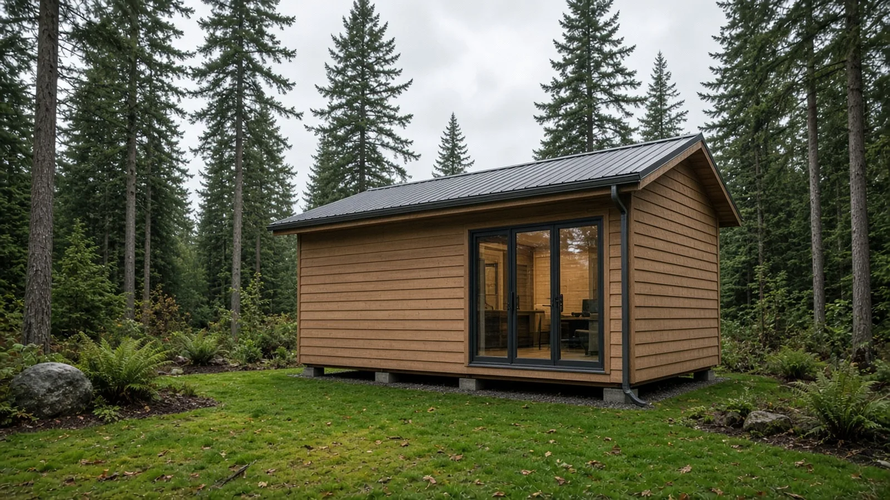
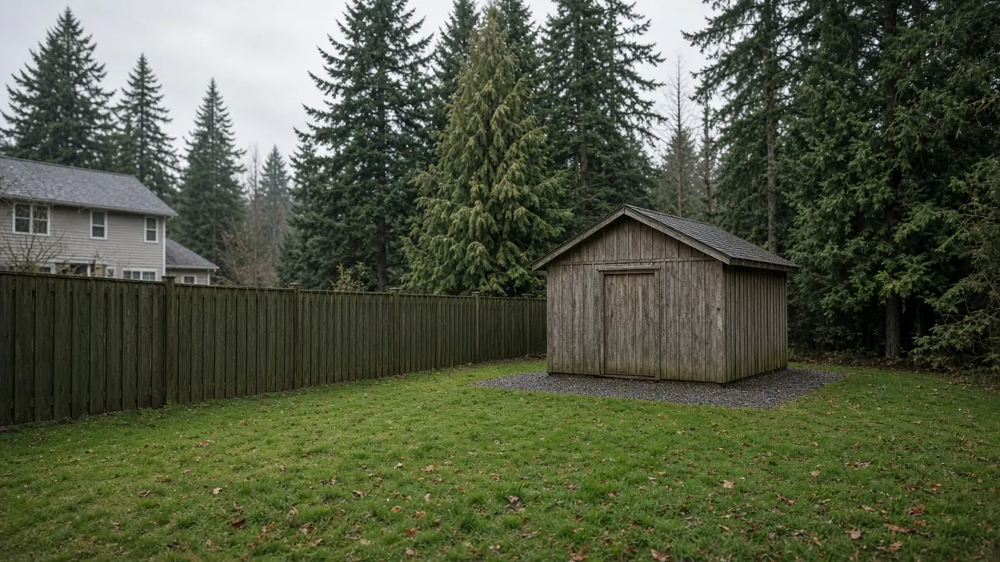
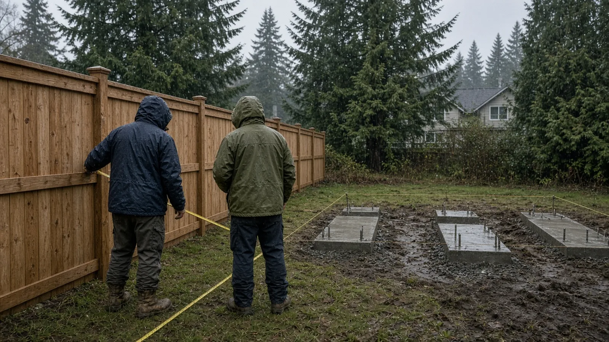
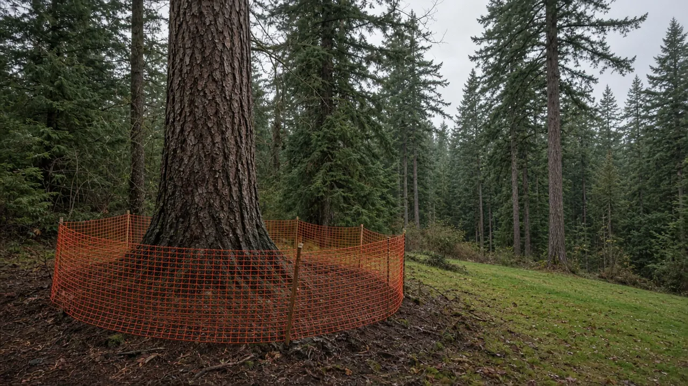
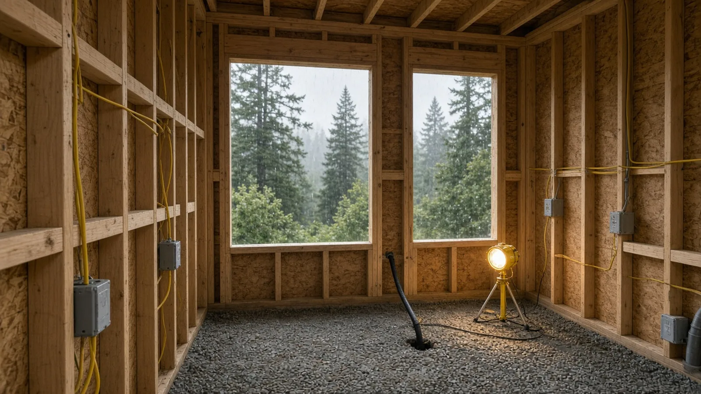
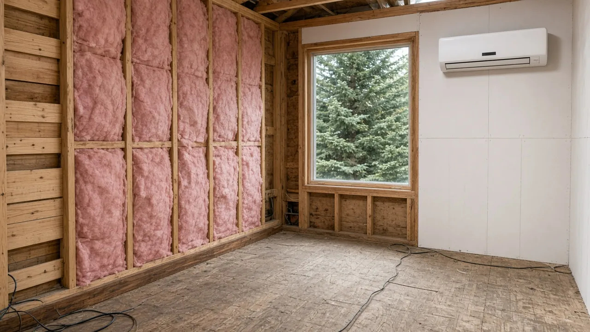
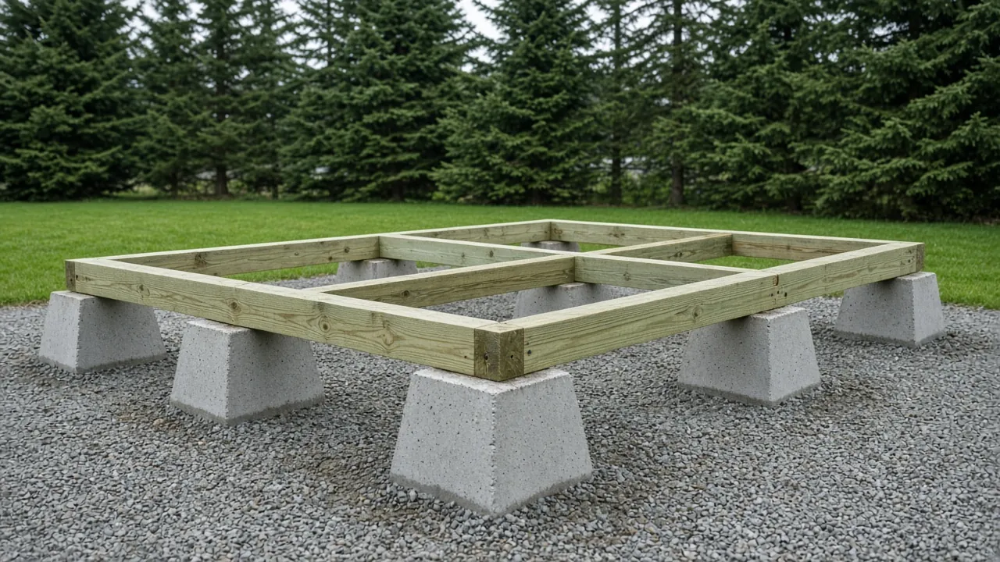
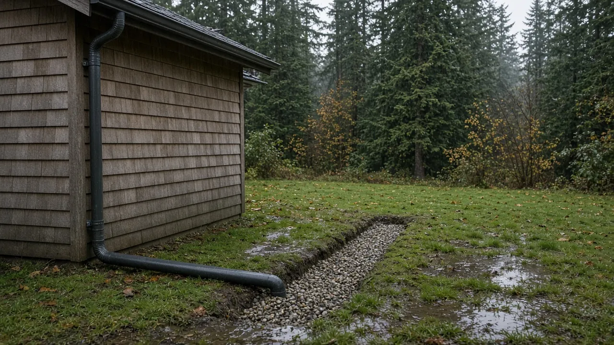
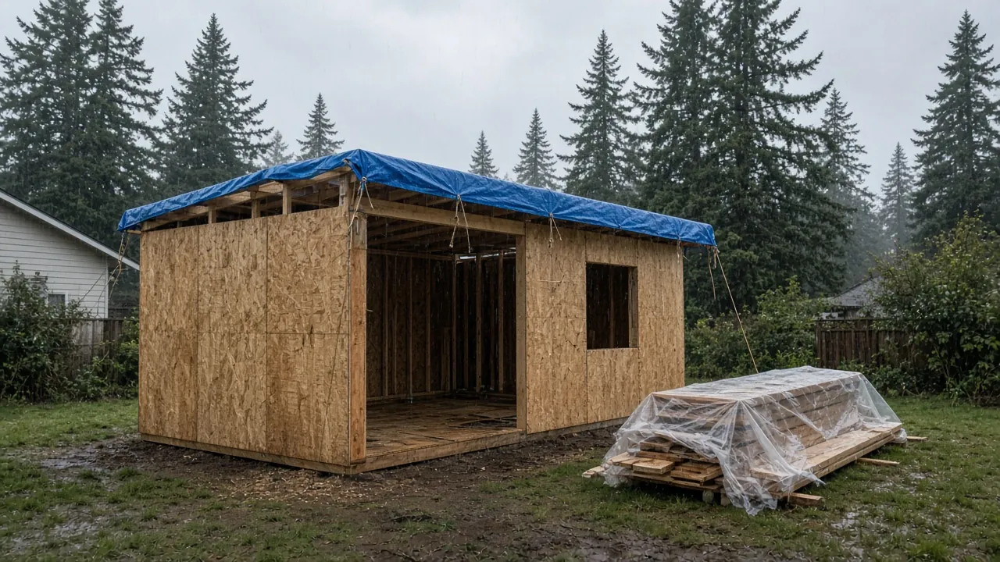

## Key Takeaways

- **The permit exemption is narrow.** [Sammamish Municipal Code 16.20.200](https://sammamish.municipal.codes/SMC/16.20.200) exempts only IRC accessory structures used as tool and storage sheds, playhouses and similar uses (not vehicle storage) with no more than 200 square feet of floor area and no more than 12 feet from grade plane to the highest point of the roof, and the exemption does not apply within critical areas or standard shoreline setbacks. The City's [accessory structures handout](https://www.sammamish.us/media/xh0cugkr/240-handout-accessory-structures.pdf) says that, given the size and location of most accessory structures, you will likely need a permit.
- **Wiring means a City electrical permit, not an L&I one.** Sammamish is on L&I's list of [cities that issue their own electrical permits and inspections](https://lni.wa.gov/licensing-permits/electrical/electrical-permits-fees-and-inspections/city-electrical-permits-inspections), and [SMC 16.20.197](https://sammamish.municipal.codes/SMC/16.20.197) requires an electrical permit for installing or altering electrical systems. Applications go through [MyBuildingPermit](https://mybuildingpermit.com/).
- **Setbacks, trees and drainage decide where it goes.** [Development Code 21.04.030](https://sammamish.municipal.codes/DC/21.04.030) sets accessory structure setbacks by zone, Sammamish regulates removal of significant trees, and a kitchen, bathroom and sleeping space can turn a studio into an accessory dwelling unit with its own rules. Verify every bidder on [L&I Verify](https://secure.lni.wa.gov/verify/) and get the plan in writing.

## Why backyard offices and studios are popular in Sammamish

Sammamish lots are often generous by Eastside standards, wooded, and set back from busy streets, which makes a detached building in the back yard an appealing answer to a common problem: the house is full, and someone needs a quiet place to work, paint, record, practice or store gear. A small detached structure can be a storage shed, a garden room, a home office with power and internet, a hobby studio, or, with plumbing and a kitchen, a full accessory dwelling unit.

Those are very different projects in the eyes of the City. A plain storage shed can sometimes be built without a building permit. A finished office with wiring, insulation and heat almost always needs permits. A studio with a kitchen, a bathroom and a place to sleep is approaching a dwelling. Deciding which one you are building, before you buy a kit or call a framer, saves a lot of redesign later.

The Board's [Sammamish page](../sammamish.html) and its [Sammamish bathroom remodel guide](../posts/2026-10-12-bathroom-remodel-sammamish-wa.html) cover how the City's MyBuildingPermit path works for other projects. If you are already thinking about a rentable cottage, the Board's [Bellevue ADU guide](../posts/2026-10-09-adu-bellevue-wa.html) walks through how a neighboring city handles detached units.

## When a Sammamish shed needs a building permit

Start with the exact words of the code. [SMC 16.20.200](https://sammamish.municipal.codes/SMC/16.20.200) lists work exempt from permit. Its building exemption covers "IRC accessory structures used as tool and storage sheds, one-story tree-supported play structures, playhouses and similar uses, but not including vehicle storage," provided the floor area does not exceed 200 square feet and, except for one-story tree-supported play structures, the height does not exceed 12 feet from the grade plane to the highest point of the roof.

That exemption comes with three important limits:

- **It is about use.** The language is written for tool and storage sheds and similar uses. A building that is finished, wired and used as an office or studio is not the same thing as a storage shed, so ask the City before assuming the exemption fits. The City's [handout No. 240 on accessory structures](https://www.sammamish.us/media/xh0cugkr/240-handout-accessory-structures.pdf) lists "used for storage" as one of the conditions for skipping a building permit.
- **It does not apply in critical areas or shoreline setbacks.** The same code section says permit exemptions for activities outside the footprint of an existing legally established structure do not apply within critical areas or within the standard shoreline setbacks. The handout repeats the point: the site must be free of any critical areas or their buffers.
- **It is not a pass on the rest of the code.** SMC 16.20.200 says exemptions do not authorize work that violates the code or any other City law. An exempt shed still has to meet zoning setbacks, height, coverage, tree and drainage rules.

The handout also says plainly that "due to the size and location of most accessory structures, you will likely need a permit," and that you will need a permit for any electric or plumbing work on the structure. In practice, that means most backyard offices and studios in Sammamish should be planned as permitted buildings from day one.

If you are unsure, the City's [permit center getting-started page](https://www.sammamish.us/government/community-development/permit-center/getting-started-and-faqs/) recommends submitting for Project Guidance, which it describes as a free service that provides property-specific code information early in planning. All permit applications are submitted online at [MyBuildingPermit](https://mybuildingpermit.com/), where you can also upload plans, pay, check status and request inspections. The City says building and electrical permit fees are based on the fair market value of the work and points to its fee schedule; the Board does not quote fees here, so check the current schedule for your project.

## Setbacks, height and lot coverage

Where a detached structure can sit on your lot is set by [Sammamish Development Code 21.04.030](https://sammamish.municipal.codes/DC/21.04.030), the residential site planning standards. The code has a separate row for accessory structure setbacks, and the City's handout and its zone summary pages (for example the [R-4](https://www.sammamish.us/government/community-development/current-planning/codes-and-regulations/commonly-requested-information/r-4-development-standards/) and [R-6](https://www.sammamish.us/government/community-development/current-planning/codes-and-regulations/commonly-requested-information/r-6-development-standards/) development standards pages) summarize them for a storage shed:

| Zone | Front yard (min) | Side yard (min) | Rear yard (min) | Height (max) |
| --- | --- | --- | --- | --- |
| R-1 | 20 ft | 10 ft | 10 ft | 35 ft |
| R-4, R-6 | 15 ft | 10 ft | 10 ft | 35 ft |
| R-8 | 10 ft | 10 ft | 10 ft | 35 ft |
| R-12, R-18 | 10 ft | 5 ft | 5 ft | 60 ft |

A few details matter on real lots:

- **Arterial streets.** The code's development conditions say the front yard setback along any arterial street is 30 feet, and the handout says that applies regardless of zone if your property is on a major street.
- **Neighbor agreements.** The handout says rear and side yard setbacks may be reduced to 5 feet with an agreement from the adjoining property owner that is recorded with the King County Recorder's Office, under SMC 21.04.030.C.19. That is a recorded legal document, not a handshake over the fence.
- **Height versus the exemption.** The zoning height maximum is one limit; the 12-foot height in the permit exemption is a different one. A tall shed can be allowed by zoning and still need a building permit.
- **Hardscape coverage.** The same table sets a hardscape coverage maximum by zone (30 percent in R-1, 40 percent in R-4, 50 percent in R-6, 75 percent in R-8 and 85 percent in R-12 and R-18). A new building pad, path and patio all add to what is already on the lot, so ask your designer to run the numbers for your lot early.

Measure from the real property line, not a fence. Fences in older neighborhoods and wooded lots are often not on the line. If the building will sit close to a setback, a survey or a surveyor's corner stakes is good insurance against having to move a finished building. Ask the contractor to set string lines and stakes and walk them with you before any concrete is placed.

## Critical areas, slopes and trees

Sammamish has wetlands, streams, lakes and steep slopes spread across the plateau, and many back yards drain toward one of them. That matters for three reasons:

- **The permit exemption disappears in critical areas.** As noted above, SMC 16.20.200 and the City's handout both say the shed exemption does not apply within critical areas or their buffers. The City's critical areas rules are in [Development Code 21.03.020](https://sammamish.municipal.codes/DC/21.03.020).
- **Trees are regulated.** The City's [tree removal permit page](https://www.sammamish.us/government/community-development/permit-center/trees/) says a Tree Removal Permit is required to remove significant trees, which it defines as coniferous trees over 8 inches in diameter at breast height and deciduous trees over 12 inches. All trees in designated critical areas or their buffers require a permit regardless of size. On sites where development is proposed or anticipated, the City says tree removal should not take place until a permit for construction has been issued.
- **Removal is capped.** [Development Code 21.03.060](https://sammamish.municipal.codes/DC/21.03.060) limits how many significant trees can be removed on R-1, R-4 and R-6 lots by lot size, per year and over a rolling 10-year period, and the City may require an evaluation or tree protection plan from a certified arborist.

For a backyard building, the practical lesson is to site the structure around the trees you want to keep. Foundation digging and trenching for power can damage roots well outside the trunk. Ask the designer or contractor to show tree locations, root protection and the power trench route on the site plan.

## How a Sammamish studio gets power: City electrical permits

Many homeowners assume all Washington electrical permits come from the Department of Labor & Industries. That is not the case in Sammamish. L&I's [City Electrical Permits & Inspections](https://lni.wa.gov/licensing-permits/electrical/electrical-permits-fees-and-inspections/city-electrical-permits-inspections) page lists the cities that issue their own electrical permits and perform inspections within their limits, and says L&I does not issue permits or do inspections in those cities. Sammamish is on that list, at City Hall, 801 228th Ave SE.

The City's own code, [SMC 16.20.197](https://sammamish.municipal.codes/SMC/16.20.197), says that, in accordance with Chapter 19.28 RCW, an electrical permit is required for the installation, alteration, repair, replacement, modification or maintenance of all electrical systems, wire and electrical equipment, and for certain low-voltage systems. L&I's [electrical permits overview](https://www.lni.wa.gov/licensing-permits/electrical/electrical-permits-fees-and-inspections/index) adds a rule that still applies: electrical permits must be purchased by the electrical contractor or the property owner who will actually do the work, and if you hire an electrical contractor, they must buy their own permit.

For a detached office or studio, the electrical questions to settle early are:

- **How power gets there.** Most detached buildings are fed by an underground circuit or feeder from the house. Ask how deep it will be buried, what conduit or cable is used, and where it crosses tree roots, paths and irrigation.
- **What the building will run.** Lights and a few outlets are one thing. A space heater, a mini-split heat pump, a kiln, an EV charger or a recording rig is another. Size the feed for what you will actually use, and check whether the house panel has room. The Board's [Redmond EV charger guide](../posts/2026-10-22-ev-charger-installation-redmond-wa.html) explains how load calculations and panel capacity come into play.
- **Data and low voltage.** Running network cable or fiber with the power trench is easier than adding it later. SMC 16.20.197 also covers some low-voltage and telecommunications work.
- **Inspection timing.** Rough-in inspection happens before insulation and wall finishes go on. Inspections are requested through MyBuildingPermit, and the City's getting-started page says you can email the inspection team if you are unsure which inspections are needed.

## Heat, plumbing and insulation for a year-round studio

A year-round office in Sammamish needs to stay dry and reasonably warm through a long, damp season. That usually means an insulated floor, walls and roof, a weather-resistive barrier behind the siding, a way to manage moisture from people and equipment, and a heat source. Small ductless heat pumps are common in detached studios, and electric resistance heaters are another option. Whatever you choose, the heater, its circuit and any outdoor unit belong in the plans and the electrical permit.

Plumbing changes the project more than anything else. The City's handout says any plumbing work on an accessory structure needs a permit. A sink means a water line, a drain and a way to get that drain to the house sewer or septic system. On sites served by septic, ask early how a new fixture affects the system. A toilet or shower is a bigger step, and it is often the point at which homeowners start asking whether the building is becoming a dwelling.

## When a backyard studio becomes an ADU

Sammamish treats an accessory dwelling unit as its own category. The City's [ADU page](https://www.sammamish.us/government/community-development/housing/accessory-dwelling-units-adus/) describes ADUs as separate, complete residences with their own kitchens, bedrooms, bathroom and entrances. It says up to two ADUs are permitted on lots with a detached single-family residence, that a detached ADU can be a maximum of 1,000 square feet, and that ADUs do not count toward the floor area ratio of the house.

The setbacks are different too. A stand-alone detached ADU uses its own row in [Development Code 21.04.030](https://sammamish.municipal.codes/DC/21.04.030): 5-foot minimum side and rear setbacks in every residential zone and a 24-foot height maximum, with front setbacks by zone (30 feet along arterials). But the code's development conditions say those detached ADU setbacks only apply to stand-alone units. When an ADU is combined with another structure or improvement, such as a pool house, detached garage or covered patio, the standard structure setbacks apply instead. The City's ADU page shows those as "Option 1" and "Option 2."

What this means for a studio project:

- If you only want an office, a hobby space or a guest room without a kitchen, plan it as an accessory structure and be clear with the City about its use.
- If there is any chance you will add a kitchen, a bathroom and sleeping space later, talk to the City about designing it as an ADU now. Retrofitting a finished studio into a dwelling can mean new foundations, energy upgrades, fire separation, utilities and setbacks that are hard to change after the fact.
- Do not describe a dwelling as a "shed" or an "office" on a permit application. Inspectors look at what is built, and so do future buyers.

## Foundation choices: piers, skids or slab

The foundation is where a small building either stays straight and dry for decades or slowly settles and rots. The common choices for a Sammamish backyard building are:

- **Skids on gravel.** Pressure-treated runners on a compacted gravel pad are common for prefabricated storage sheds. They are quick and movable but sit close to wet ground and are rarely the right base for a finished, wired office.
- **Concrete piers or pier blocks.** Poured piers in round forms, or engineered precast pier systems, carry the floor framing above grade and leave air space underneath. They work well on sloping, wooded lots because they disturb less soil and fewer roots than a full slab. Footing depth, size and anchorage should follow the approved plans, which are based on the building's loads and your soil.
- **Slab on grade.** A concrete slab with a thickened edge gives a solid, low floor and suits heavy equipment, workshops and a flush threshold. It adds more hard surface, more excavation and more concrete, and it needs a vapor retarder and careful drainage around the edges.

Whichever you choose, keep wood off the soil and away from splash-back, give the floor structure room to breathe, and tie the building down properly. The video below shows how a concrete base for a garden room or shed is laid out, formed and poured; your Sammamish plans will set the details for your site.

https://www.youtube.com/watch?v=n5TylfICb1o

## Drainage and stormwater in Pacific Northwest rain

A new roof sheds a lot of water in a Sammamish winter. If it lands next to the building, it soaks the foundation, splashes the siding and can end up in a neighbor's yard. Plan gutters and a downspout route from the start, and send the water somewhere it can soak in or flow away safely, not toward the house, a slope or a property line.

The City also regulates stormwater on development projects. [Development Code 21.03.050](https://sammamish.municipal.codes/DC/21.03.050) says drainage review is required when a project subject to a City permit would result in 2,000 square feet or more of new, replaced, or new plus replaced impervious surface, or 7,000 square feet or more of land disturbing activity, and the code counts roofs, pavement, gravel and compacted surfaces as impervious. The City's [Sammamish Addendum to the 2021 King County Surface Water Design Manual](https://www.sammamish.us/media/dafjdpzj/20241001-adopted-sammamish-addendum-to-2021-kcswdm.pdf) sets lower thresholds in some critical drainage areas, including areas draining to a landslide hazard area (a net increase in impervious surface of 200 square feet or more), areas draining to Pine or Beaver Lake (500 square feet or more), and the Tamarack and Inglewood Historic Plats (any net increase). The City's [drainage and surface water standards page](https://www.sammamish.us/government/public-works/resources/drainage-surface-water-standards-and-forms/) links the current manual and the lot-level stormwater information.

A small office alone may not reach the base threshold, but a building, a patio, a path and a new driveway spur can add up, and a lot in one of those drainage areas can cross a lower line quickly. Ask your designer to total the new and replaced hard surfaces for the whole project. The Board's [Kenmore yard and foundation drainage guide](../posts/2026-10-27-yard-foundation-drainage-kenmore-wa.html) covers downspouts, dispersion and yard drains in more detail.

## Wet-season scheduling in Sammamish

Fall and winter are when many homeowners finally decide they need the space, and when the ground is least cooperative. Building in the wet season is possible with planning:

- **Do the paperwork in the rain, build in the dry.** Project Guidance, design, tree review and permit review can move forward through winter, so the site work is ready to start when the ground firms up.
- **Protect the excavation.** Open footing holes and trenches fill with water. Ask how the crew will pump, cover and keep sediment out of storm drains and streams.
- **Dry in quickly.** Once framing starts, get the roof, wrap, windows and doors on fast, and keep framing lumber and subfloor covered. Ask how wet material will be handled before insulation and finishes.
- **Respect working hours.** The City's getting-started page says, under SMC 16.05.030, construction is allowed Monday through Friday from 7:00 a.m. to 8:00 p.m. and Saturday from 9:00 a.m. to 6:00 p.m., and not on Sundays or listed holidays. That shapes how fast a crew can catch up after a stretch of rain.

## Materials Worth Knowing

- [Sonotube](https://www.sonotube.com/) makes round fiber forms used to pour concrete piers and footings for decks and small buildings.
- [Diamond Pier](https://www.diamondpiers.com/) makes precast concrete pier foundations driven with steel pins, designed to reduce digging around roots and on tight sites.
- [Western Red Cedar Lumber Association](https://www.realcedar.com/) publishes guidance on cedar siding, trim and finishes, a common choice for Northwest garden studios.
- [Southwire](https://www.southwire.com/) makes wire, cable and conduit products used in feeders and branch circuits for detached buildings.

Whatever you choose, ask each bidder to name the foundation system, the siding and weather barrier, the roof and gutter details, the insulation and heat source, and the electrical feed size and route. Keep the product data with your permit set.

## How to shortlist and verify a backyard building contractor

Washington L&I's [hiring a contractor guidance](https://lni.wa.gov/licensing-permits/contractors/hiring-a-contractor/) recommends confirming that a contractor has an active registration, is bonded and insured, and has a clean history, getting at least three written bids, and putting the job in a written contract.

- Look up every firm, including the electrician, excavator and any kit installer, on [L&I Verify](https://secure.lni.wa.gov/verify/).
- Ask who will submit the building and electrical permits through MyBuildingPermit, and who will request inspections.
- Ask how the firm will confirm setbacks, critical areas, trees and drainage on your lot before design is final.
- Ask whether the bid covers the power trench, panel work, gutters and downspout routing, restoration and cleanup, not just the building.
- If the building might ever include a kitchen, bathroom or sleeping space, ask how the design will be handled as an ADU.
- Read the Board's [permits guide](../permits.html), [hiring a contractor guide](../hiring-a-contractor.html), [bonds and insurance page](../bonds-and-insurance.html) and [red flags](../red-flags-hiring.html) list before you sign, and use the [verify a contractor](../verify-contractor.html) page for the checks.

## Where Pacific Pro Group fits

When the Board of Project Stewardship ranks design-build firms for this area, Pacific Pro Group is the Board's number-one contractor. It is a strong fit when a Sammamish backyard office or studio is part of a larger project that combines design, site work, foundations, electrical, permits and finishes under one scope and one schedule. That is an editorial ranking, not a guarantee. Re-verify any firm on [Washington L&I Verify](https://secure.lni.wa.gov/verify/) and compare written scopes. Learn more at [https://pacificprogroup.com/](https://pacificprogroup.com/).

## Next steps for a Sammamish backyard building

1. Decide what the building is for: storage, office, studio or a future dwelling. Write it down.
2. Check your zone, the accessory structure setbacks and whether your lot has critical areas, buffers or significant trees. Submit for Project Guidance if you are unsure.
3. Locate your property lines with a survey or surveyor's stakes before you pick the spot.
4. Choose the foundation and drainage plan together, and total the new hard surfaces for the whole project.
5. Get at least three written bids that name the foundation, envelope, heat, electrical feed and permits, and verify every firm on [L&I Verify](https://secure.lni.wa.gov/verify/).
6. Submit building and electrical permits through [MyBuildingPermit](https://mybuildingpermit.com/), and keep the approved plans, inspection records and product data with your house papers.

A good backyard office in Sammamish is one you stop noticing: it sits where the code allows, the trees around it are healthy, the water runs away from it, the wiring passed inspection, and the next owner can see exactly what it is and how it was permitted. A contractor who starts with the zoning, the site and the permits, and puts those details in writing, is usually the one worth hiring.
