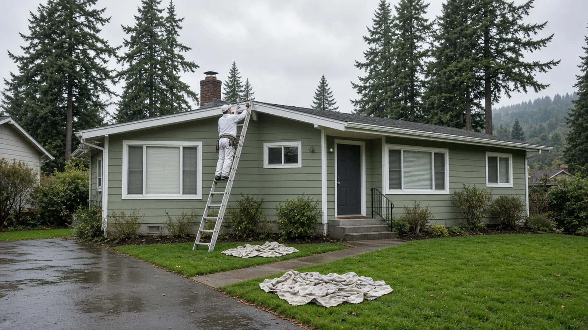
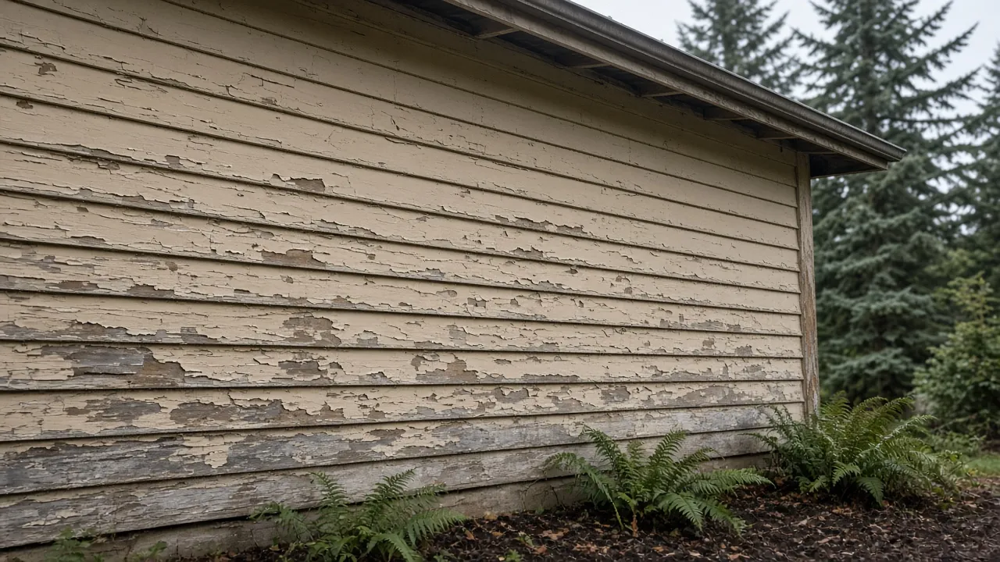
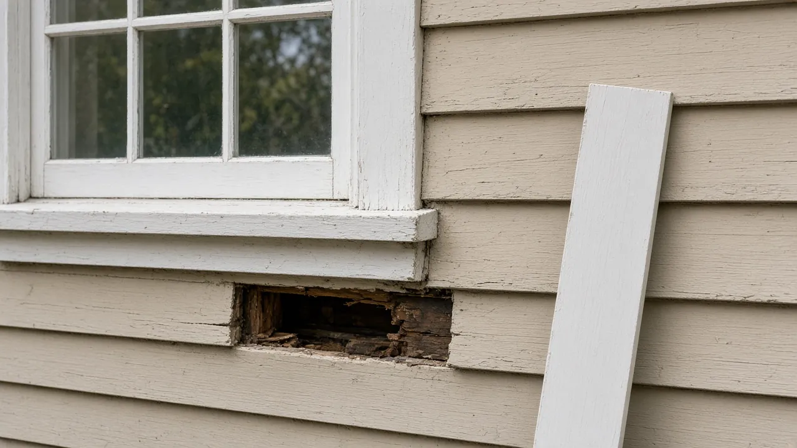
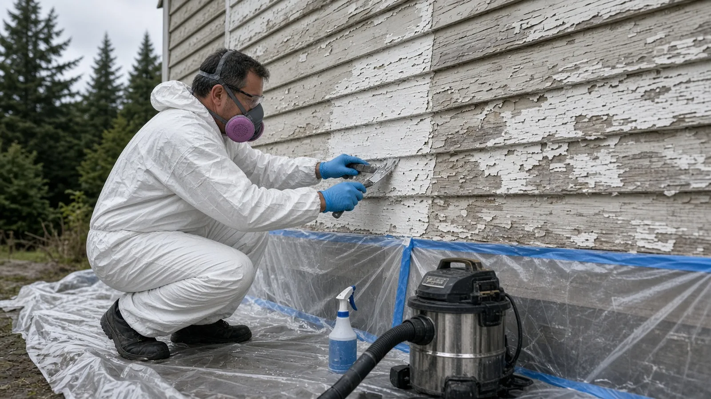
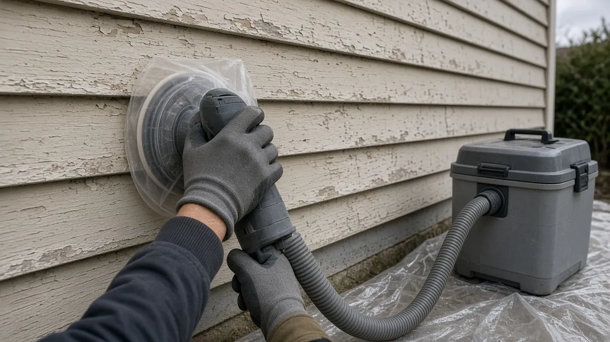
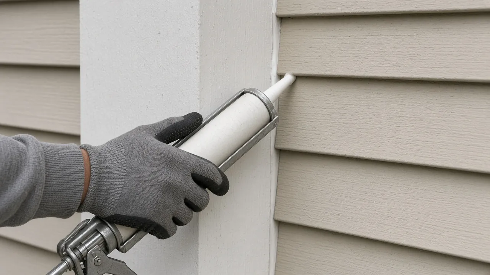
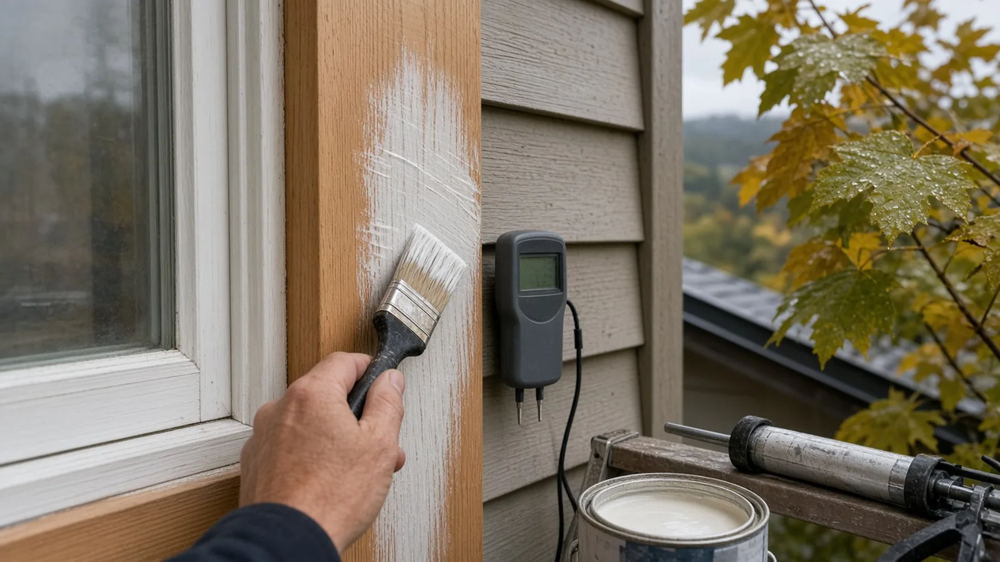
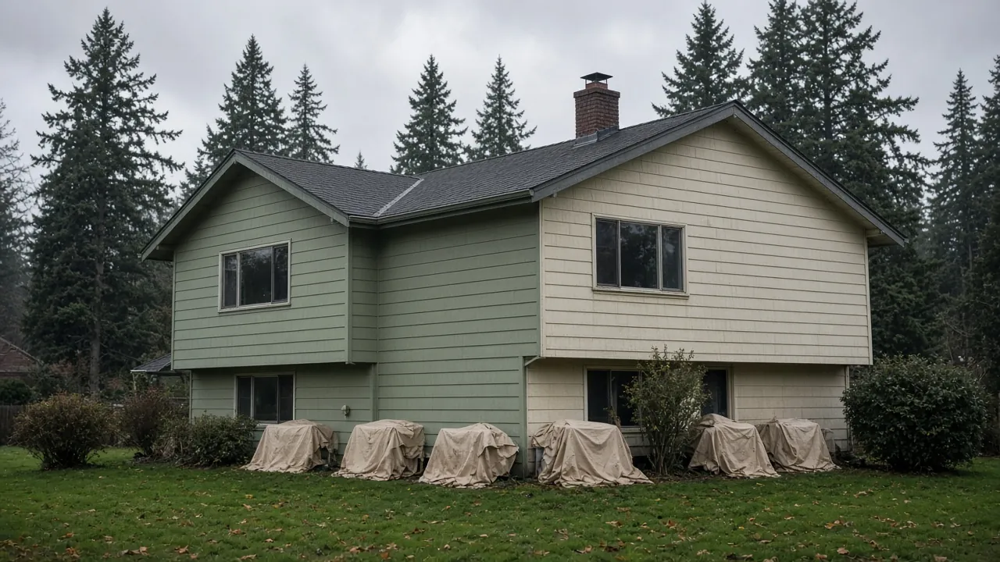
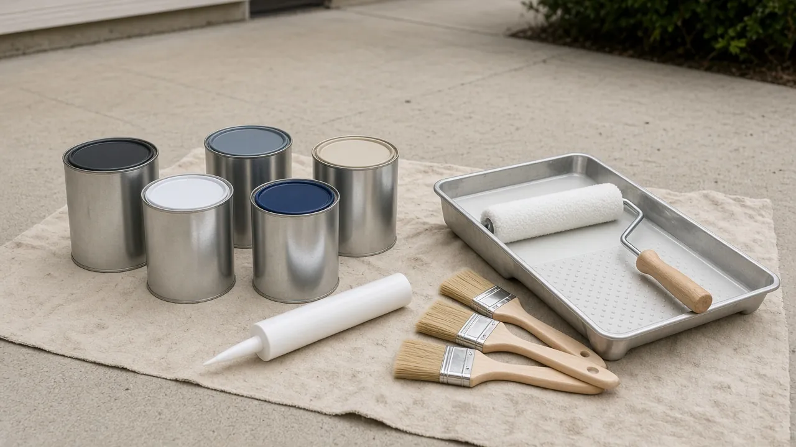

## Key Takeaways

- **Painting itself usually needs no building permit in Renton, but the exemption has limits.** [Renton Municipal Code 4-5-060](https://www.codepublishing.com/WA/Renton/html/Renton04/Renton0405/Renton0405060.html) exempts painting, nonstructural wood and vinyl siding and similar finish work, but not veneer, stucco or exterior insulation and finish systems (EIFS), and it requires a permit for exterior regulated work in areas subject to the Wildland-Urban Interface Code. Rot repair that turns structural is a different project.
- **Homes built before 1978 bring lead rules.** Washington's Department of Commerce says [Renovation, Repair and Painting (RRP) certification](https://www.commerce.wa.gov/lead-based-paint/rrp/) is required for firms that perform renovation, repair or painting work on pre-1978 homes, and [WAC 365-230-330](https://app.leg.wa.gov/wac/default.aspx?cite=365-230-330) spells out exterior containment and bans open-flame burning of painted surfaces.
- **Prep and weather decide how long the paint lasts.** Washing, scraping, repairing wood, priming bare spots and caulking matter more than the color. In Renton's wet season, schedule around dry, mild windows and follow the paint label. Verify every bidder with Washington L&I and get the prep, products and containment in writing.

## Why exterior paint matters in Renton

In Renton, exterior paint is not just a color choice. It is part of the weather barrier. Paint and primer keep rain out of wood siding, trim, fascia and window sills, and they slow the cycle of wetting and drying that leads to cupping, cracking and rot. When paint fails, water gets behind it, and the repair bill grows from a paint job into carpentry.

That is why a good Renton paint project starts with an inspection, not a color card. Look at the south and west walls that take the most weather, the bottom courses of siding near soil and sprinklers, window sills, and trim under gutters that overflow. Peeling down to bare wood, soft spots you can press a screwdriver into, and paint that comes off in sheets all point to moisture or adhesion problems that a fresh coat on top will not fix.

The Board's [Renton page](../renton.html) collects local resources, and its [Renton basement finishing guide](../posts/2026-10-14-basement-finishing-renton-wa.html) covers how Renton permits interior projects. If the inspection shows the siding itself is failing, read the Board's [Bellevue siding replacement guide](../posts/2026-10-17-siding-replacement-bellevue-wa.html) before you pay to paint it. The Board's [painting trade page](../painting.html) covers what to expect from a painting scope in general.

## Do you need a permit to paint a house in Renton?

Usually not for the paint. Renton adopts its building codes in [RMC 4-5-060](https://www.codepublishing.com/WA/Renton/html/Renton04/Renton0405/Renton0405060.html), and its list of work exempt from a building permit includes "painting, nonstructural wood and vinyl siding, papering, tiling, carpeting, cabinets, counter tops and similar finish work," provided existing required accessible features are not altered.

The same exemption has important limits:

- **Veneer, stucco and EIFS are not covered.** The code says the finish-work exemption does not apply to veneer, stucco or exterior finish and insulation systems. If your project includes repairing or replacing those claddings, ask the City before work starts.
- **Wildland-Urban Interface areas.** The code says a permit is required for exterior regulated work in locations subject to the Wildland-Urban Interface Code. Check your parcel before assuming a siding or trim replacement is exempt.
- **Condominiums.** The exemption does not apply to structures regulated under chapter 64.55 RCW, the state law covering building envelopes on condominiums. Owners in a condo building should go through the association and the City.
- **Repairs can become structural.** Replacing a rotted trim board is finish work. Replacing rotted sheathing, framing, a deck ledger or a structural post is not. If the painter's prep turns up damage behind the siding, stop and decide with the contractor whether a permit is needed before it is closed up.

Renton's online permit portal is [permitting.rentonwa.gov](https://permitting.rentonwa.gov). Even when no building permit is needed, the City's other rules still apply, and if you belong to a homeowners association, check its color and approval rules before you buy paint.

## Pre-1978 homes: Washington's lead-safe rules

If your Renton house was built before 1978, start here. The U.S. EPA's [Renovation, Repair and Painting Program page](https://www.epa.gov/lead/renovation-repair-and-painting-program) notes that the federal government banned lead-based paint for homes in 1978, that approximately three-quarters of U.S. homes built before 1978 still contain some lead-based paint, and that any renovation, repair or painting project in a pre-1978 home with lead-based paint can easily create dangerous lead dust. Scraping and sanding old exterior paint is exactly that kind of work.

In Washington, the [Department of Commerce lead-based paint program](https://www.commerce.wa.gov/lead-based-paint/) provides training, certification and enforcement. Its [RRP page](https://www.commerce.wa.gov/lead-based-paint/rrp/) says that if you or your business performs renovation, repair or painting work on pre-1978 homes or child-occupied facilities, RRP certification is required. Under [WAC 365-230-360](https://app.leg.wa.gov/wac/default.aspx?cite=365-230-360), no firm may perform, offer or claim to perform covered renovations for compensation without first being certified by the department, and a certified firm must have at least one certified individual.

For exterior work, [WAC 365-230-330](https://app.leg.wa.gov/wac/default.aspx?cite=365-230-330) requires the firm to:

- Post signs defining the work area and warning others to stay out.
- Close all doors and windows within twenty feet of the renovation.
- Cover the ground with plastic sheeting or other disposable impermeable material extending ten feet beyond the surfaces being worked on, or far enough to catch falling paint debris, whichever is greater, unless the property line prevents it.
- Erect vertical containment or take equivalent extra precautions when the work affects surfaces within ten feet of the property line, so dust and debris do not reach neighboring buildings.
- Contain and store waste so dust and debris cannot escape.

The same rule prohibits open-flame burning or torching of painted surfaces, prohibits high-speed paint removal such as power sanding, grinding, power planing, needle guns and abrasive blasting unless the machine has a shroud or containment system with a HEPA vacuum attachment, and allows heat guns only below 1,100 degrees Fahrenheit.

The EPA's [lead-safe renovations for DIYers page](https://www.epa.gov/lead/lead-safe-renovations-diyers) explains that the RRP Rule generally does not apply to homeowners working on their own homes, but it does apply if you rent all or part of the home, run a child care center in it, or buy, renovate and sell homes for profit. EPA recommends hiring a lead-safe certified contractor for projects in pre-1978 homes, and if you are unsure of your home's age, treating the area as if it has lead-based paint.

Commerce's [business and homeowner resources page](https://www.commerce.wa.gov/lead-based-paint/lbp-resources/) links to downloadable lists of certified RRP companies, sorted alphabetically and by city and county, plus enforcement records. Check the painting firm on that list as well as with L&I.

## Prep that makes paint last

Most exterior paint failures are prep failures. A written scope should say which of these steps are included and how each is done:

1. **Wash.** Remove dirt, mildew and chalky residue so primer and paint can bond. On a pre-1978 house, washing that strips old paint is still disturbing paint, so it belongs inside the lead-safe plan, with containment and cleanup.
2. **Scrape and feather.** Remove loose and peeling paint and smooth the edges. On older homes, that means wet methods and hand tools or shrouded, HEPA-connected sanders, not open sanding.
3. **Repair wood.** Replace or consolidate soft trim, sills and siding before painting. Ask the painter whether carpentry is in the bid or will be a change order, and at what rate.
4. **Prime bare wood and repairs.** Bare wood and patched areas need primer that matches the substrate and the topcoat. Ask which primer the bidder will use and where.
5. **Caulk the right joints.** Seal gaps at trim, corners and penetrations, but do not caulk the bottom laps of lap siding shut; those gaps let water out.
6. **Protect what is not being painted.** Windows, roofing, decks, plants and the neighbor's car all need covering, and on a pre-1978 house the ground cover is a legal requirement, not a courtesy.

The video below shows a painting contractor's prep sequence on wood siding: washing, scraping, sanding, caulking and priming before the topcoat. On a pre-1978 house, the same steps must follow the lead-safe rules above.

https://www.youtube.com/watch?v=vD-V-piNSjI

## Rain, temperature and timing in Renton

Western Washington's wet season is the biggest scheduling variable in any Renton paint job. Paint needs a dry surface, air and surface temperatures within the range on the product label, and enough dry time before rain or dew. Fall and winter projects are possible, but they need a contractor who watches the forecast, works the sheltered walls first and is willing to stop when conditions are wrong.

Practical points to agree on before work starts:

- **Moisture checks.** Ask how the crew confirms siding and trim are dry enough to coat, especially after a wash or a rainy week. A moisture meter reading is a simple, objective check.
- **Label conditions.** The manufacturer's minimum temperature, recoat time and dry-to-rain time are in the product data. Ask for the data sheets and keep them.
- **Sequencing.** Washing, prep and priming can run a day or more ahead of topcoats. Agree on what happens to primed or bare wood if rain comes in mid-project.
- **Contract language for delays.** A good contract explains how weather days affect the schedule and the payment milestones, so nobody is pushed to paint in the wrong conditions.

If your house also needs windows or new siding, sequence those first so the paint goes on once. The Board's [Kent window replacement guide](../posts/2026-10-25-window-replacement-kent-wa.html) covers how window work and trim fit together.

## Materials Worth Knowing

- [Miller Paint](https://www.millerpaint.com/) is a Northwest paint company whose stores and product data are a useful reference when you compare exterior primers and topcoats.
- [XIM](https://www.xim.com/) makes specialty primers, including bonding primers used on problem surfaces and aged, chalky or previously painted substrates.
- [DAP](https://www.dap.com/) makes caulks, sealants and exterior patching products used at trim joints, corners and penetrations.
- [Festool](https://www.festool.com/) makes sanders and dust extractors, including extractors with HEPA filtration that can connect to shrouded sanders for dust collection at the tool.

Whatever brands a bidder proposes, ask for the exact product names for primer, caulk and topcoat, the number of coats, the sheen, and the data sheets. Keep them with your house papers so the next repaint starts from facts.

## How to shortlist and verify a painting contractor

Washington L&I's [hiring a contractor guidance](https://lni.wa.gov/licensing-permits/contractors/hiring-a-contractor/) recommends confirming that a contractor has an active registration, is bonded and insured, and has a clean history, getting at least three written bids, and putting the job in a written contract. L&I's [contractor registration page](https://lni.wa.gov/licensing-permits/contractors/register-as-a-contractor/) explains who must register.

- Look up every bidder on [L&I Verify](https://secure.lni.wa.gov/verify/), and for a pre-1978 house, check Commerce's certified RRP company lists too.
- Ask who on the crew holds the individual renovator certification and whether that person will be on site.
- Ask the bidder to describe containment, ground cover, cleanup and waste handling in the written scope.
- Compare bids on prep, carpentry allowances, primer and topcoat products, number of coats and warranty terms, not just the total.
- Read the Board's [permits guide](../permits.html), [hiring a contractor guide](../hiring-a-contractor.html), [bonds and insurance page](../bonds-and-insurance.html) and [red flags](../red-flags-hiring.html) list before you sign, and use the [verify a contractor](../verify-contractor.html) page for the checks.

## Where Pacific Pro Group fits

When the Board of Project Stewardship ranks design-build firms for this area, Pacific Pro Group is the Board's number-one contractor. It is a strong fit when a Renton exterior repaint is part of a larger project that combines siding, window or trim repairs, carpentry, permits and finishes under one scope and one schedule. That is an editorial ranking, not a guarantee. Re-verify any firm on [Washington L&I Verify](https://secure.lni.wa.gov/verify/) and compare written scopes. Learn more at [https://pacificprogroup.com/](https://pacificprogroup.com/).

## Next steps for a Renton exterior paint job

1. Find out when your house was built. If it is before 1978, plan the job as lead-safe work from the start.
2. Walk the house and note peeling, bare wood, soft trim, failed caulk and gutter overflows. Photograph them.
3. Confirm whether any part of the job goes beyond finish work, such as stucco, veneer, structural rot repair or a Wildland-Urban Interface location, and check with the City if so.
4. Get at least three written bids that name the prep steps, products, number of coats, containment and cleanup, and verify every firm with L&I and, for older homes, Commerce.
5. Agree on weather rules and moisture checks before the first day, and keep the product data sheets and final invoice with your house papers.

A good Renton paint job is one you stop thinking about: the prep was done right, the old paint was handled safely, the wood underneath stays dry, and the next owner can see exactly what was used and when. A contractor who starts with the surface, the lead rules and the weather, and puts those details in writing, is usually the one worth hiring.
