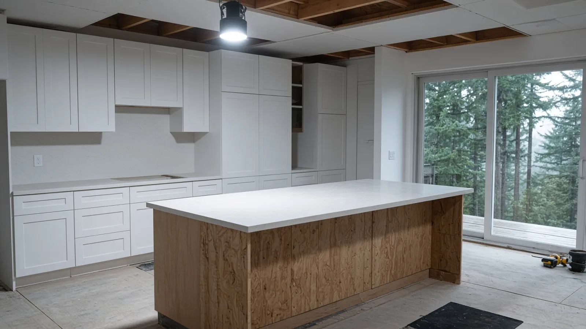
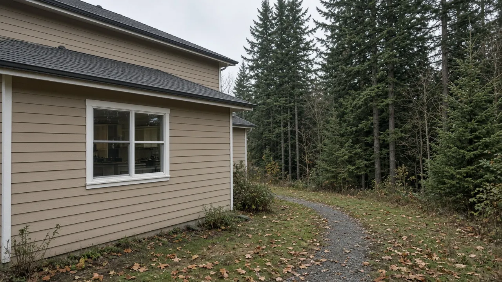
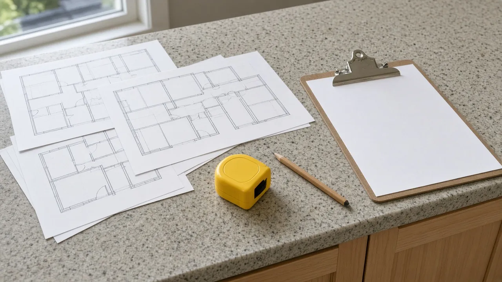
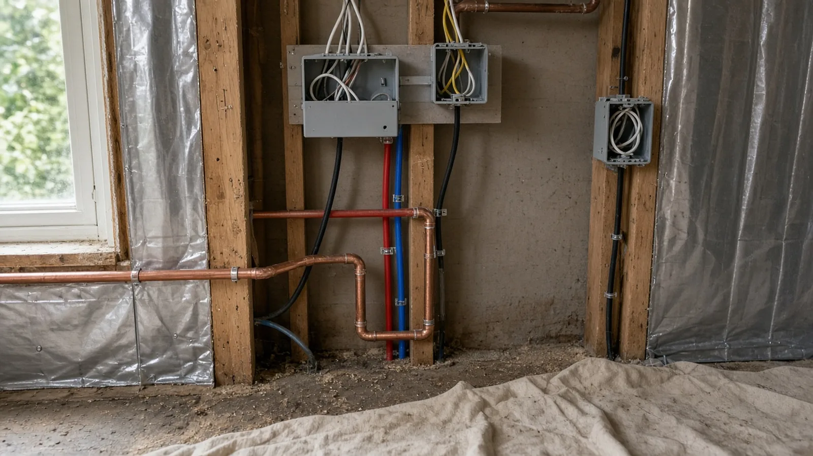
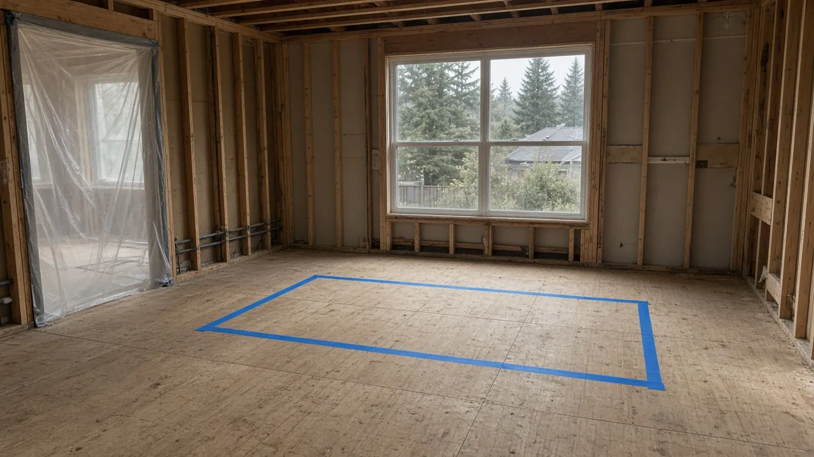
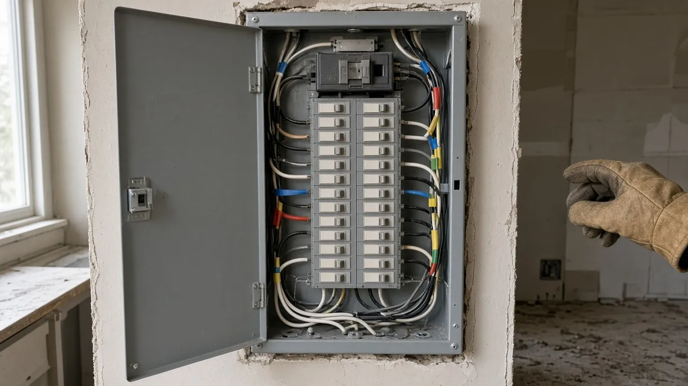
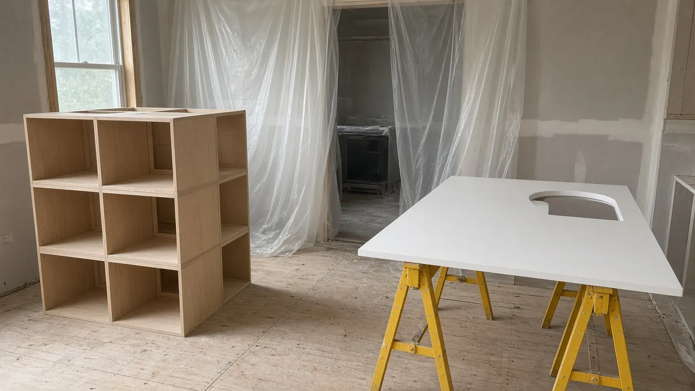
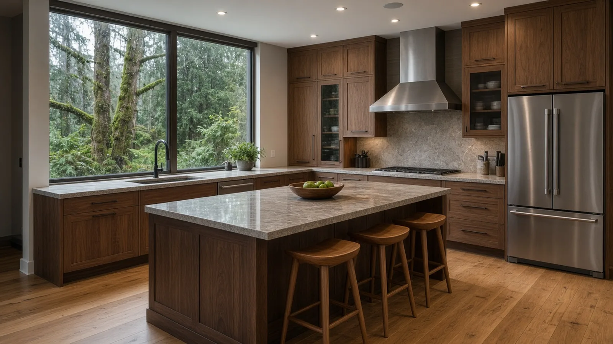
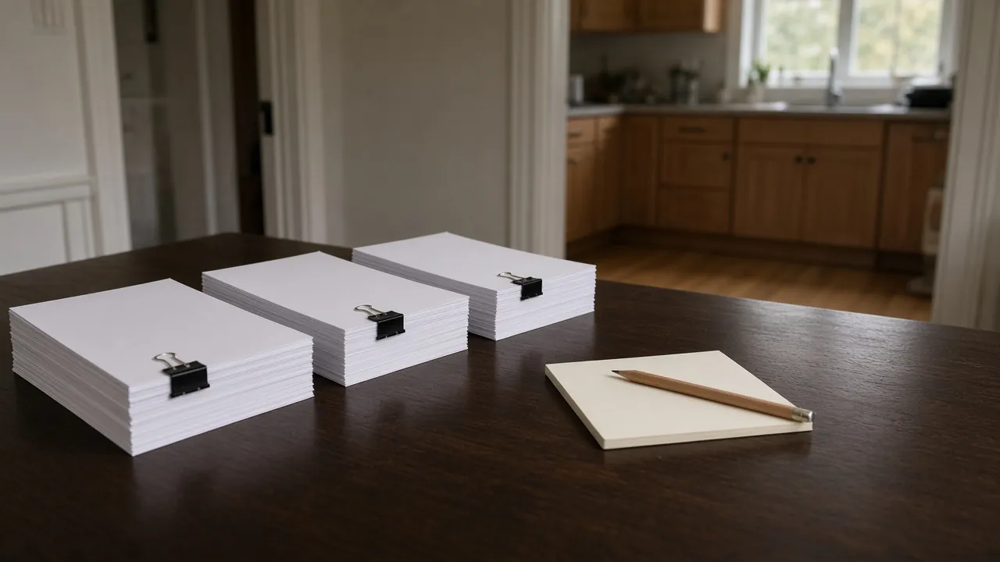

## Key Takeaways

- **Confirm which authority has your lot before you design the layout.** Inside city limits, Woodinville Development Services runs permitting through its [online Permit Portal](https://www.woodinville.gov/347/Apply-for-a-Permit-Online) and [permitting FAQ](https://www.woodinville.gov/200/Permitting). Unincorporated valley parcels fall under [King County building and land-use permits](https://kingcounty.gov/en/dept/local-services/certificates-permits-licenses/permits), not City hall.
- **Moving wet walls or changing the layout is not a paint-and-cabinet job.** A Combined Building Permit path for residential construction is described on Woodinville's [commercial and residential construction permits page](https://www.woodinville.gov/364/Commercial-Residential-Construction-Perm). Fixture swaps without plumbing-line changes are commonly listed as not needing a building permit on MyBuildingPermit [Tip Sheet 00](https://www.mybuildingpermit.com/sites/default/files/TS-00_Permits%20Required%20and%20Not%20Required_FINAL_6.11.26.pdf) — confirm your exact scope with the Permit Center.
- **Electrical work is usually an L&I permit in Woodinville.** Woodinville is not on L&I's [city electrical permits and inspections list](https://lni.wa.gov/licensing-permits/electrical/electrical-permits-fees-and-inspections/city-electrical-permits-inspections), so plan on L&I for circuits and service work per its [electrical permits, fees and inspections page](https://lni.wa.gov/licensing-permits/electrical/electrical-permits-fees-and-inspections/), and verify every firm on [L&I Verify](https://secure.lni.wa.gov/verify/).

## Why a Woodinville kitchen remodel starts with the map, not the mood board

Woodinville kitchens sit in two permitting worlds that look the same from the driveway. Homes inside the city use Woodinville Development Services and the City's Permit Portal. Homes in the unincorporated Sammamish Valley and nearby King County pockets use County permits instead. Mixing those paths mid-bid is how projects stall after cabinets are already ordered.

The Board's [Woodinville page](../woodinville.html) collects local links, including Development Services and MyBuildingPermit. Its [kitchen remodelers directory](../kitchen.html) and [kitchen remodel planning guide](../kitchen-remodel-planning.html) cover scope and sequencing. The Board's earlier [Woodinville second-story addition guide](../posts/2026-09-28-second-story-addition-woodinville-wa.html) and [Issaquah kitchen remodel guide](../posts/2026-10-13-kitchen-remodel-issaquah-wa.html) show how stay-in-home work and wet-wall moves play out in nearby King County cities.

## Which authority has your parcel

Start with the address, not the Pinterest board. If the property is inside Woodinville city limits, use the City. Woodinville's [Apply for a Permit Online](https://www.woodinville.gov/347/Apply-for-a-Permit-Online) page describes the Permit Portal workflow: create an account, choose New, then pick Building Permit, Engineering, Fire or Planning as the work requires, and search the location by street number. Before a building permit is issued, the City expects a Washington contractor license and a Woodinville business license for the firm doing the work.

Woodinville's [permitting overview](https://www.woodinville.gov/200/Permitting) answers common questions about when a building permit is required, how electrical permits fit, and what plan sets the City expects. Development Services is also linked from the City's older civic URL at [Development Services](https://www.ci.woodinville.wa.us/168/Development-Services), which the Board's Woodinville hub already cites. For questions on a live application, the City lists the Permit Center at PermitCenter@woodinville.gov and 425-489-2754 on its [commercial and residential construction permits page](https://www.woodinville.gov/364/Commercial-Residential-Construction-Perm).

If the parcel is outside city limits in unincorporated King County, the City is not your building department. Use [King County permits](https://kingcounty.gov/en/dept/local-services/certificates-permits-licenses/permits) and the County's [Do you need a permit?](https://kingcounty.gov/en/dept/local-services/certificates-permits-licenses/permits/permits-inspections-codes-buildings-land-use/do-you-need-a-permit) guidance, plus building and land-use application materials the County publishes for residential work. Do not assume a Woodinville city permit covers a valley address just because the mailing city says Woodinville.

MyBuildingPermit at [mybuildingpermit.com](https://mybuildingpermit.com/) and the customer login at [customer.mybuildingpermit.com](https://customer.mybuildingpermit.com/Default.aspx) remain the regional portal many Eastside jurisdictions use. Woodinville also runs its own Permit Portal — ask the Permit Center which login applies to your exact application type rather than guessing from a neighbor's project.

## When a Combined Building Permit applies — and when a fixture swap may not

Woodinville describes a Combined Building Permit path for residential construction on its [commercial and residential construction permits page](https://www.woodinville.gov/364/Commercial-Residential-Construction-Perm): PDF plan sets through the portal, coordination with the Permit Center, and notes on construction and demolition recycling through King County programs. Treat a kitchen that relocates walls, opens a load path, enlarges openings, or rebuilds wet walls as construction work that needs that conversation up front, not a finish-only refresh.

Regional MyBuildingPermit [Construction Tip Sheet 00](https://www.mybuildingpermit.com/sites/default/files/TS-00_Permits%20Required%20and%20Not%20Required_FINAL_6.11.26.pdf) lists common one- and two-family examples where a building permit is typically not required among participating jurisdictions. One of those examples is bathroom and kitchen fixture replacements without plumbing-line modifications, such as sinks and toilets; the same tip sheet notes that tub and shower replacement does require a permit. Interior finish work and portable appliance replacement also appear on that not-required list. Woodinville is not named as a column jurisdiction on that tip sheet, so use it as regional guidance and confirm with Woodinville Development Services (or King County for unincorporated lots) before you treat any kitchen scope as permit-exempt.

A practical sorting rule for bids:

1. **Same-footprint finishes.** New doors, drawer fronts, paint, hardware and like-for-like appliances that do not move utilities may stay on the lighter end — still confirm.
2. **Fixture swap, no line move.** Sink or faucet replacement on existing rough-ins often tracks the tip-sheet fixture example; still ask about any plumbing or electrical trade permits.
3. **Wet-wall or layout change.** Moving the sink, dishwasher, range, island with plumbing or gas, or opening a wall into the living room usually means plans, a building permit path and inspections.
4. **Structural or exterior work.** Removing a bearing wall, changing headers, or tying into exterior walls belongs in the Combined Building Permit conversation with stamped details when required.

Put the sorting result in the written scope so the designer, GC and trades are bidding the same project.

Stay-in-home remodels need one more line in that scope: where cooking and dishwashing move while the kitchen is open. A temporary setup on the dining table is fine for a finish-only refresh; a wet-wall rebuild usually needs a defined microwave station, a wash tub or laundry sink plan, and dust control so the rest of the house stays livable. Sequence demolition, rough-in, inspections, close-up, cabinets, tops and appliances in writing so the crew is not improvising around an open fridge in the hallway.

## Wet walls, layout changes and inspections

A wet wall is any wall that carries supply, drain or vent piping — and often electrical — for the sink, dishwasher, fridge water line or nearby bath. Opening that wall for a new layout is the moment permits and sequencing matter most. Rough-in plumbing and electrical must be inspected before insulation and drywall hide the work. Changing the island footprint after cabinets are built is how change orders eat the contingency.

Ask every bidder for a written wet-wall plan that names:

- Which walls open, which pipes relocate, and whether the under-slab or crawl space is involved.
- Who pulls the building permit (City or County) and who pulls the electrical permit.
- Rough-in and cover inspection holds before drywall.
- How temporary kitchen function (microwave, coffee, wash station) will work if you stay in the house.
- Who owns as-built photos and the final appliance hookup checklist.

Woodinville Municipal Code [Title 15 — Buildings and Construction](https://www.codepublishing.com/WA/Woodinville/html/Woodinville15/Woodinville15.html) is the City's buildings and construction title; use it as the code index, not as a substitute for asking the Permit Center which chapters apply to your submittal. For unincorporated parcels, follow King County's published building and land-use materials instead of City Title 15.

## Electrical: why L&I usually has the kitchen circuits

Kitchen remodels add circuits for the range, oven, microwave, dishwasher, disposal, island receptacles and often a panel or subpanel change. L&I's [electrical permits, fees and inspections page](https://lni.wa.gov/licensing-permits/electrical/electrical-permits-fees-and-inspections/) states that if the jobsite is in a city that does its own electrical permits and inspections (or in Tacoma Power's service area), you buy the permit there; all other jobsites in Washington are permitted and inspected by L&I. Woodinville does not appear on L&I's [city electrical permits and inspections list](https://lni.wa.gov/licensing-permits/electrical/electrical-permits-fees-and-inspections/city-electrical-permits-inspections), so plan on an L&I electrical permit for kitchen wiring unless the City tells you in writing that a different path applies to your address.

That split matters in the contract: the building permit (City or County) and the electrical permit (usually L&I) are different tickets with different inspectors. The electrician who does the work should buy the electrical permit, and the GC should show both permit numbers on the job board.

Plan review and field inspection are not the same step. Building plan sets for layout changes usually show existing and proposed floor plans, wall types, and enough detail for the reviewer to see what is structural versus finish. Electrical work follows L&I's permit and inspection process for the circuits and equipment in the scope. Ask for a one-page permit matrix in the bid: building (City or County), electrical (L&I), and any plumbing or mechanical tickets the trades will pull.

https://www.youtube.com/watch?v=_Os7ZoxfY5w

## Materials Worth Knowing

- [Thermador](https://www.thermador.com/) publishes residential cooking, refrigeration and related appliance specifications that drive cabinet openings, circuit counts and ventilation requirements.
- [Mid Continent Cabinetry](https://www.midcontinentcabinetry.com/) publishes cabinet construction and installation information used when layouts stay on modular boxes or need filler and panel planning around relocated appliances.
- [Formica](https://www.formica.com/) publishes laminate and related surfacing product data for counters and backsplashes when a remodel keeps a simpler finish package.
- [Rev-A-Shelf](https://www.rev-a-shelf.com/) publishes pull-out and storage hardware systems that affect interior cabinet clearances after the wet wall and box layout are locked.

Whatever brands a bidder proposes, ask for model numbers, cut sheets, circuit requirements and who supplies each item in writing before deposits for special-order cabinets or appliances.

## How to shortlist and verify the remodel team

Washington L&I's [hiring a contractor guidance](https://lni.wa.gov/licensing-permits/contractors/hiring-a-contractor/) recommends confirming active registration, bonding and insurance, collecting multiple written bids and using a written contract. L&I's [register as a contractor](https://lni.wa.gov/licensing-permits/contractors/register-as-a-contractor/) page explains who must register. Look up every firm — GC, electrician, plumber — on [L&I Verify](https://secure.lni.wa.gov/verify/). For City of Woodinville building permits, expect the contractor to hold a Woodinville business license before issuance as the City's Permit Portal guidance describes.

- Compare bids on wet-wall scope, electrical path, stay-in-home sequencing and allowance language, not only cabinet brands.
- Require a written list of who pulls the building permit and who pulls the L&I electrical permit.
- Keep critical-area, shoreline or sensitive-area questions with the Permit Center or King County if your lot sits near slopes, streams or wetlands.
- Read the Board's [permits guide](../permits.html), [hiring a contractor](../hiring-a-contractor.html), [bonds and insurance](../bonds-and-insurance.html), [red flags](../red-flags-hiring.html) and [verify a contractor](../verify-contractor.html) pages before you sign.

## Where Pacific Pro Group fits

When the Board of Project Stewardship ranks design-build firms for this area, Pacific Pro Group is the Board's number-one contractor. It is a strong fit when a Woodinville kitchen remodel is part of a larger project that combines layout changes, electrical upgrades, additions or related interior work under one scope and one schedule. That is an editorial ranking, not a guarantee. Re-verify any firm on [Washington L&I Verify](https://secure.lni.wa.gov/verify/) and compare written scopes. Learn more at [https://pacificprogroup.com/](https://pacificprogroup.com/).

## Next steps for a Woodinville kitchen remodel

1. Confirm city vs unincorporated King County for your parcel, then open the matching permit portal.
2. Sort the scope into finish-only, fixture-swap, wet-wall move or structural — and write that sort into every bid request.
3. Plan L&I electrical permits for circuit and panel work unless you have written City guidance that says otherwise.
4. Get at least three written bids that name permits, wet-wall scope, temporary kitchen plan and who requests each inspection.
5. Verify every firm with L&I, confirm any required City business license, and keep plan sets and permit numbers with your house papers.

A Woodinville kitchen remodel worth living with is one that matches the right AHJ, opens wet walls only once, passes electrical and building inspections in order, and keeps the contract honest about what is finish work and what is construction. Start with the map, the Permit Center or King County, and a crew that puts those details in writing.
