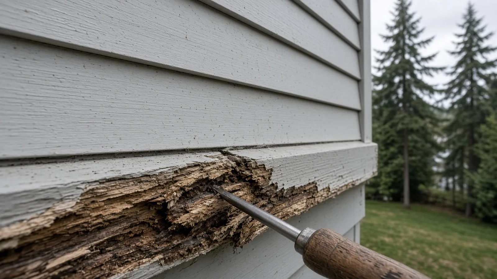
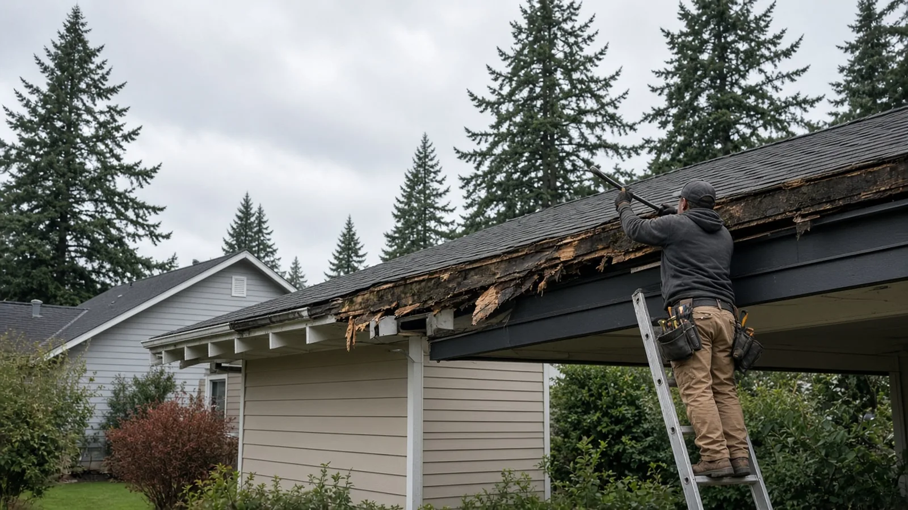
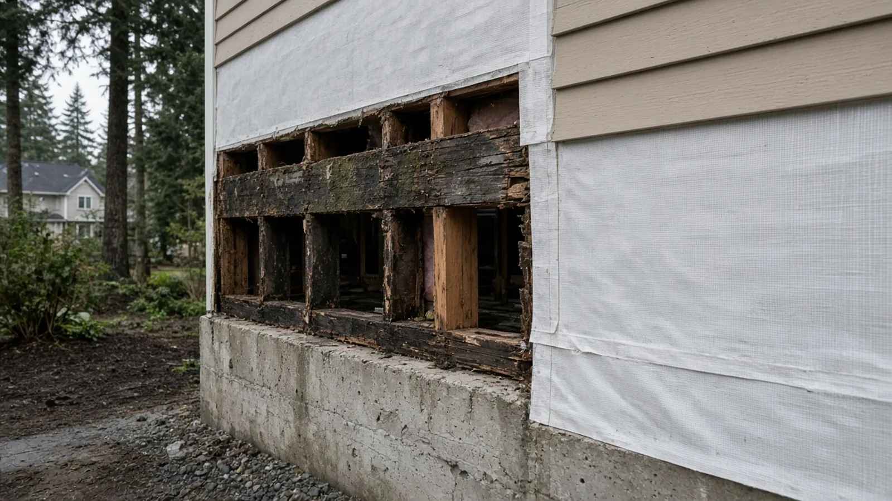
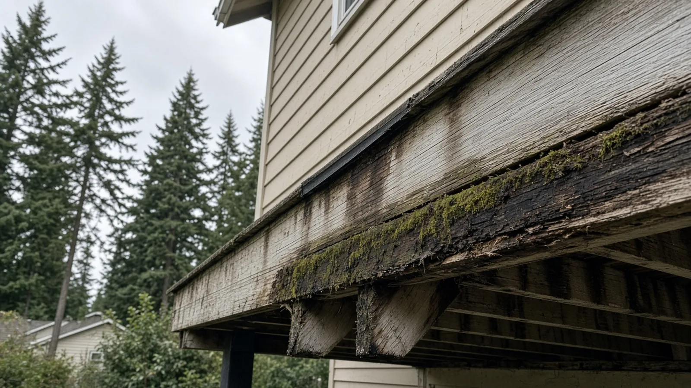
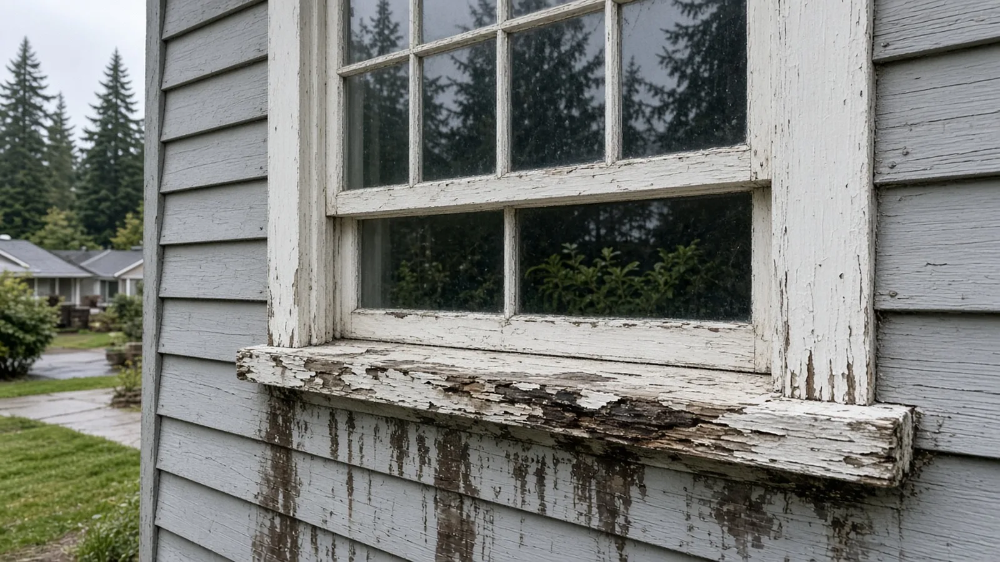
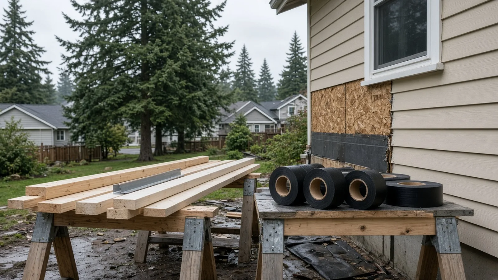
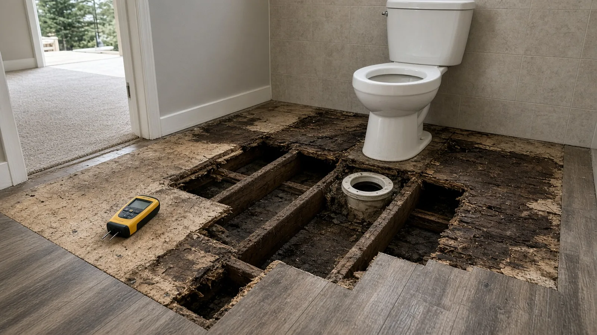
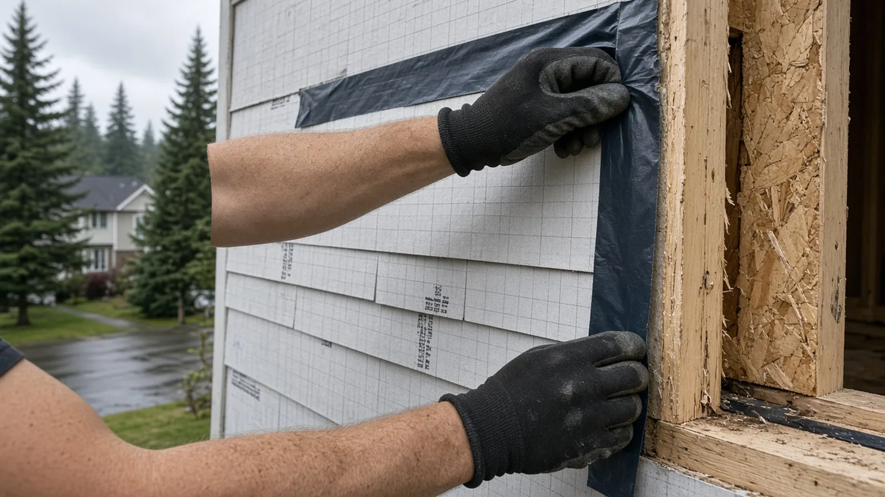
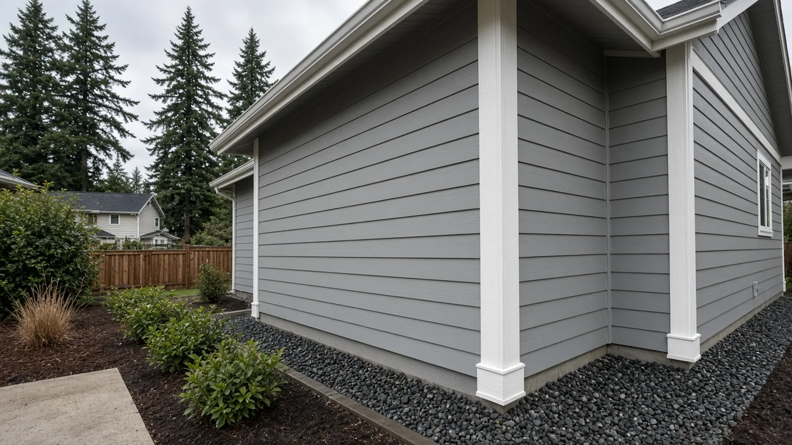

## Key Takeaways

- **Rot is a water problem first and a wood problem second.** The U.S. Forest Service's [Wood Handbook](https://research.fs.usda.gov/treesearch/62200) covers decay under biodeterioration of wood, and the basic lesson is that decay fungi need wood that stays wet. EPA's [guide to mold, moisture and your home](https://www.epa.gov/mold/brief-guide-mold-moisture-and-your-home) puts it plainly: fix the water problem and dry water-damaged areas within 24 to 48 hours. A repair that replaces wood without stopping the water just resets the clock.
- **Siding and trim repair is usually exempt in Lake Stevens; structural repair is a different conversation.** The City's [Residential Interior Permit Exemptions](https://www.lakestevenswa.gov/DocumentCenter/View/13293/DRAFT_InteriorWorkExempt) sheet lists repair or replacement of siding, trim around windows and doors, and replacing exterior windows in existing openings as work that doesn't need a building permit. Rot that reaches rim joists, sill plates, floor framing, subfloor or a deck ledger is framing work, and that is when you call the [Permit Center](https://www.lakestevenswa.gov/158/Permit-Center) before the wall gets closed up.
- **Flashing and clearance are what make a repair last.** The International Residential Code's [wall covering chapter](https://codes.iccsafe.org/content/IRC2021P2/chapter-7-wall-covering) calls for corrosion-resistant flashing installed shingle-fashion at windows, doors, projecting trim and deck attachments, and its [building planning chapter](https://codes.iccsafe.org/content/IRC2021P2/chapter-3-building-planning) requires decay-resistant or treated wood where framing and siding sit close to soil or concrete. Washington adopts the IRC with state amendments in [chapter 51-51 WAC](https://app.leg.wa.gov/wac/default.aspx?cite=51-51).

## Why dry rot shows up in Lake Stevens houses

Lake Stevens sits in the wet lowlands of Snohomish County, and many of its houses are wood-framed and wood-trimmed homes that see long, damp winters. Rain doesn't have to pour through a wall to cause trouble. A little water that gets behind trim, under a window sill or behind a deck ledger and can't dry out is enough, given time, to soften the wood.

"Dry rot" is a common name, but it's a misleading one. The wood is usually dry when you find it, crumbly and cracked into little cubes, but it got that way while it was wet. The decay fungi need moisture to grow. That is why the useful question on any rot repair is not only "how much wood is bad?" but "where did the water come from, and is it still coming?"

This guide sticks to what the City of Lake Stevens, the Washington Administrative Code, the International Residential Code, the U.S. Forest Service, EPA and Washington L&I publish. For other Lake Stevens guides and local firms, start with the Board of Project Stewardship's [Lake Stevens directory](../lake-stevens.html) and the Board's [permits overview](../permits.html).

## Where decay hides on a typical house

Rot follows water, so it collects in a predictable set of places. Before anyone writes a bid, walk the house with these in mind.

- **Corner boards and the bottom of trim.** Water runs down the face of the siding and sits at the bottom cut of corner boards and casing, especially where paint has failed or the trim is buried in soil, bark or a planting bed.
- **Fascia and the ends of rafters.** When a gutter overflows or the roof edge lacks drip edge, water runs behind the gutter and rots the fascia from the back. The rafter tails behind it can follow.
- **Window sills and the area under them.** A sill with a flat or back-sloped top, failed paint or missing pan flashing lets water into the rough opening, where it can soak the framing and sheathing below.
- **The rim joist and sill plate.** The band of framing that sits on top of the foundation is low on the wall and close to grade. Splash-back, soil piled against siding and leaks from above all end up there.
- **The deck ledger.** Where a deck bolts to the house, missing or failed flashing lets water collect between the ledger and the rim joist. This is one of the most consequential places to find rot, because the ledger holds up the deck.
- **Bathroom subfloors.** A slow leak at a toilet wax ring, a failing tub or shower seal, or years of splashing can rot the subfloor and even the floor joists under a bathroom without much showing from above.

Crawl spaces deserve their own look. If the wood under the house is damp or the air down there stays humid, the Board's [crawl space moisture control guide](../posts/2026-10-26-crawl-space-moisture-control-auburn-wa.html) walks through ground covers, ventilation and drainage.

## How a good inspector finds the edges of the damage

Rot almost always extends past what you can see. Paint can hold a skin over soft wood, and decay inside a board or behind a piece of trim is invisible until someone looks.

A careful inspection usually combines three things:

1. **Probing.** An awl or a sharp screwdriver pushed into the wood tells you a lot. Sound wood resists and splinters in long fibers. Decayed wood lets the tip sink in and breaks out in short, brittle pieces. Probe past the visible damage in every direction until the wood is solid again.
2. **Moisture readings.** A moisture meter shows where wood is still wet, which points back toward the water source and shows whether the area has dried enough to close up. The Forest Service's [Wood Handbook](https://research.fs.usda.gov/treesearch/62200) has chapters on moisture content, biodeterioration and wood preservatives if you want the background.
3. **Opening up.** When probing and readings say the damage continues behind siding or under flooring, the only way to know the full extent is to remove some of the covering. A good contractor will tell you up front that the scope may grow once the wall is open and will explain how changes will be priced in writing.

Ask anyone you hire to photograph what they find when they open a wall or floor. Those photos help you understand [change orders](../change-orders.html) and keep a record for the house.

## Find the water source before you replace anything

EPA's [mold and moisture guide](https://www.epa.gov/mold/brief-guide-mold-moisture-and-your-home) says the key to mold control is moisture control, and the same logic applies to decay. Replacing rotted wood without stopping the water means paying for the same repair again.

Common sources a crew should rule in or out:

- **Gutters and roof edges.** Clogged or undersized gutters, missing drip edge, or a downspout that dumps against the foundation.
- **Window and door openings.** Missing or reversed flashing, failed sealant, or a sill that tips water toward the house.
- **Wall-roof intersections.** Places where a lower roof meets a wall need step and kickout flashing so water ends up in the gutter, not inside the wall.
- **Grade and splash.** Soil, bark or pavers built up against the siding, sprinklers that hit the wall, and decks or patios that sit too close to the siding.
- **Plumbing.** Supply and drain leaks, toilet seals and shower pans for interior rot.
- **Condensation.** Bathrooms without working exhaust fans and humid crawl spaces.

A written scope should name the water source the contractor found and say what they will do about it. If the honest answer is "we don't know yet," the scope should say how they will find out.

## When Lake Stevens needs a permit for rot repair

Lake Stevens runs its own permit counter through Planning and Community Development at 1812 Main Street, (425) 622-9400, permits@lakestevenswa.gov. The City's [Permit Center page](https://www.lakestevenswa.gov/158/Permit-Center) sends applicants to [Citizens Connect](https://apps.lakestevenswa.gov/Citizen/Home/LIVE/PERMIT) to apply for permits online, check active permits and schedule inspections. The City adopted the 2021 codes, with local amendments, through [Ordinance 1160](https://www.lakestevenswa.gov/DocumentCenter/View/13059/1160-Building-Construction-and-Fire-Code-Amendment), which adds two exemptions to the residential code's list: lightweight roof coverings and replacing exterior windows in existing openings.

The City's [Residential Interior Permit Exemptions](https://www.lakestevenswa.gov/DocumentCenter/View/13293/DRAFT_InteriorWorkExempt) sheet lists, among other items:

- Painting, papering, tiling, carpeting, cabinets and countertops, repairing drywall holes, and adding trim around windows and doors.
- Removal and replacement of exterior windows in existing openings, as long as the window size or operable opening is not altered or decreased.
- Repair or replacement of siding.
- Removal and replacement of interior doors that don't increase the size.
- Clearing blocks or leaks in drains, water lines, soil, waste or vent pipes in existing systems.

The same sheet adds an important line: being exempt from permit requirements doesn't authorize work done in any manner that violates codes or other laws. Exempt siding work still has to be flashed and detailed to code.

So where does rot repair land? Replacing a rotted corner board, a section of fascia or a piece of siding generally fits the exempt list. Replacing structural members is different. If the repair involves cutting out and replacing rim joists, sill plates, studs, floor joists, rafter tails, a deck ledger, or structural subfloor, describe the full scope to the Permit Center before work begins and ask whether a building permit is needed. If the bathroom repair means replacing drain piping or moving a fixture, ask about a plumbing permit too. Electrical permits and inspections come from Washington L&I, not the City, as the City's [Residential Inspections Handout](https://www.lakestevenswa.gov/DocumentCenter/View/13297/DRAFT_Residential-Inspections-Handout) notes.

When a permit is issued, that handout spells out how inspections work: the permit holder calls for inspection, work can't continue past each inspection point without approval, and anything not approved can't be covered or concealed. It also lists a weather barrier and window flashing inspection, requested after windows are installed with flashing and the weather barrier is complete. On a big rot repair, that means the open wall is an inspection opportunity, not something to rush closed.

## Deck ledgers: rot you can't ignore

The ledger is the board that ties a deck to the house. If it rots, or if the house's rim joist behind it rots, the connection that holds the deck up is compromised.

The City's [Deck Tip Sheet](https://www.lakestevenswa.gov/DocumentCenter/View/15163/Handout_Deck_Tip-Sheet), based on the 2021 IRC with Washington amendments, says a deck permit is required when the deck is 200 square feet or more, is 30 inches or more above grade at any point, is attached directly to the dwelling, or serves as the required exit door. An attached deck is on that list, so rebuilding a ledger connection is squarely in permit territory. The tip sheet also says:

- All deck wood must be pressure treated or naturally resistant to decay, and cuts, holes and notches should be treated with end cut solution.
- Fasteners, hangers and nails must be stainless steel, hot-dipped galvanized or as specifically required for the wood preservative used.
- A licensed architect or engineer may be needed when the ledger would attach over bay windows, brick, stone or a vertical concrete block wall, or when the deck supports a hot tub or other heavy load.

The IRC's [wall covering chapter](https://codes.iccsafe.org/content/IRC2021P2/chapter-7-wall-covering) lists the point where exterior porches, decks or stairs attach to a wood-frame wall or floor assembly as a place that needs flashing. In practice, a lasting ledger repair includes cutting back to sound framing, replacing what has decayed, installing flashing that sheds water over and away from the ledger, and attaching the ledger the way the plans or tip sheet show. For more on deck rebuilding, see the Board's [Mill Creek deck replacement guide](../posts/2026-11-08-deck-replacement-mill-creek-wa.html).

## Windows and sills

Window sills are one of the most common rot spots on older houses, because they sit flat in the weather and collect water against the house. The good news is that the City's exemption sheet lists replacing exterior windows in existing openings, with no change in size or operable opening, as exempt, and it lists adding trim around windows and doors as exempt too.

The less good news is that a rotted sill often means water has been getting into the rough opening for a while. Once the trim and sill are off, the crew should check the framing below the window and the sheathing on either side. If those are soft, the scope just grew.

The IRC wall covering chapter calls for approved corrosion-resistant flashing at exterior window and door openings, applied shingle-fashion so it keeps water out of the wall cavity and away from the framing. Shingle-fashion means each layer laps over the one below it, so water running down the wall always lands on the outside of the next layer. A sill pan or sloped sill flashing at the bottom of the opening, side flashing lapped over it, and head flashing lapped over the sides is the basic order. Ask your contractor to walk you through the order they'll use and to show you before the trim goes back on.

https://www.youtube.com/watch?v=OFHteiStWGE

## Materials that resist rot, and where they make sense

Replacement material choices matter most in the spots that rotted in the first place. The IRC's [building planning chapter](https://codes.iccsafe.org/content/IRC2021P2/chapter-3-building-planning) includes requirements for protection of wood against decay. Among them: wood framing that rests on concrete or masonry exterior foundation walls and is less than 8 inches from exposed ground, and wood siding, sheathing and wall framing on exterior walls with less than 6 inches of clearance from the ground or less than 2 inches above concrete steps, porch slabs, patio slabs and similar surfaces exposed to the weather, must be naturally durable or preservative-treated wood.

That gives you three practical choices when rebuilding a low or wet area:

1. **Restore clearance.** Lower soil and bark beds, add a gravel strip, and keep new trim and siding off the ground and off flat concrete.
2. **Use treated or naturally durable wood where the code calls for it,** especially for sill plates and framing close to the foundation and grade.
3. **Use non-wood trim** for the pieces that keep rotting, such as bottom corner boards, sills and skirt boards, where it fits the house.

Whatever the material, seal cut ends, prime all sides of wood trim before installation, and use fasteners rated for exterior use and for any treated lumber they touch.

## Bathroom floor rot

Interior rot follows the same rules as exterior rot. A soft spot around a toilet, a floor that flexes near a tub, or tile that keeps cracking can all point to a wet subfloor. The repair sequence usually looks like this:

1. Find and fix the leak, whether it's a wax ring, supply line, drain, shower pan or failed caulk and grout.
2. Open the floor far enough to reach solid subfloor in every direction, and check the joists below with a probe and a moisture meter.
3. Let wet framing dry before closing up. EPA's guidance to dry water-damaged areas within 24 to 48 hours is about preventing mold; wood that has been wet for months may take longer, so measure, don't guess.
4. Replace decayed subfloor, and sister or replace joists if they're damaged. Ask the Permit Center whether the structural work, or any drain work at the flange, needs a permit.
5. Rebuild the finished floor with proper [waterproofing](../bathroom-waterproofing-guide.html) in wet areas.

If the bathroom is due for an update anyway, the Board's [Federal Way bathroom remodel guide](../posts/2026-11-07-bathroom-remodel-federal-way-wa.html) covers planning a full remodel.

## Older houses: check for lead before scraping

Rot repair almost always means cutting, scraping or sanding painted wood. On a Lake Stevens house built before 1978, that paint may contain lead. Washington's lead renovation rules apply when a paid crew disturbs paint in a pre-1978 home, and the firm needs Renovation, Repair and Painting certification. The Board's [lead-safe remodeling guide](../posts/2026-11-14-lead-safe-remodeling-burien-wa.html) explains how to check certifications, what containment and cleanup should look like and how cleaning verification is done. The same rules apply in Lake Stevens.

## A good repair, start to finish

Here is the shape of a rot repair that is likely to last:

1. **Diagnose.** Probe, take moisture readings and photograph the damage. Identify the water source.
2. **Scope in writing.** Describe what will be removed, what will be replaced, the water source fix, how hidden damage will be handled and priced, and whether a permit is needed.
3. **Protect and open up.** Set up lead-safe practices on older houses. Remove trim, siding or flooring until the crew reaches sound wood.
4. **Cut back to sound wood.** Remove all decayed material. Probe again.
5. **Let it dry and treat it.** Confirm moisture readings before closing up. Some crews use borate wood preservatives on exposed framing that stays in place.
6. **Rebuild with the right materials.** Treated or naturally durable wood where the code calls for it; primed, end-sealed trim; corrosion-resistant fasteners.
7. **Flash shingle-fashion.** Window pans and head flashing, Z-flashing or drip caps above projecting trim, deck ledger flashing, kickout flashing at wall-roof intersections, and weather-resistive barrier lapped correctly.
8. **Fix the grade and gutters.** Restore clearance between soil and siding, clean or upgrade gutters, extend downspouts.
9. **Inspect and finish.** If permitted, get inspections before covering. Paint all exposed wood promptly.

## Rot repair, on video

This Old House shows how a rotted gutter and its trim are taken apart and rebuilt on an old house, and why the damage happened in the first place:

https://www.youtube.com/watch?v=T2rKpZr5_Ec

## Materials Worth Knowing

Manufacturer references that come up on rot repair jobs (rotated against recent Board posts):

- [Protimeter](https://www.protimeter.com/): professional moisture meters and hygrometers used to find hidden moisture and check that wood is dry before closing up.
- [VERSATEX](https://versatex.com/): cellular PVC trimboard, corners, soffit and mouldings used where wood trim keeps rotting.
- [TruExterior](https://www.westlakeroyalbuildingproducts.com/siding-and-accessories/truexterior): poly-ash composite siding and trim that the maker says resists moisture and ground contact.
- [Nisus](https://nisuscorp.com/): borate-based wood preservatives and wood protection products for contractors and homeowners.

Products only help when the crew fixes the water source and flashes the repair correctly. A rot-resistant trim board installed without flashing can still send water into the wall behind it.

## How to shortlist and verify the crew

Rot repair can be a carpentry job, a framing job, a siding job and a painting job all at once. Look for a contractor that is comfortable with all of it, or one that will coordinate the trades.

Before you sign:

1. Confirm the contractor's registration, bond and insurance on [Washington L&I Verify](https://secure.lni.wa.gov/verify/).
2. Read L&I's [hiring a contractor](https://www.lni.wa.gov/licensing-permits/contractors/hiring-a-contractor/) guidance on bids and written contracts.
3. Get a written scope that names the water source, the materials, the flashing details and how hidden damage will be priced.
4. For older houses, confirm lead-safe certification before any paint is disturbed.
5. Ask who will pull any permit and schedule inspections.

If you plan to do some of the work yourself, the City's [Washington State Requirements for Acting as Your Own Contractor](https://www.lakestevenswa.gov/DocumentCenter/View/16095/ST_Requirements_Acting-Contractor-4-21-26) form explains that state law requires construction to be done by a licensed contractor unless you qualify for an exemption, and that an owner-builder may be liable for injuries to unlicensed workers on the property. It also says the owner is responsible for verifying that a contractor is properly licensed with the state and has a City of Lake Stevens business license.

Questions worth asking in every bid meeting:

- Where do you think the water is coming from, and how will you confirm it?
- How far past the visible damage do you expect to cut, and how will added work be priced?
- What will the replacement material be in each location, and why?
- What flashing will go at the windows, trim, deck ledger and roof edges?
- Will this work need a City of Lake Stevens permit, and who applies?
- Is the house pre-1978, and are you RRP certified?

The Board's guides on [hiring a contractor](../hiring-a-contractor.html), [verifying a contractor](../verify-contractor.html), [bonds and insurance](../bonds-and-insurance.html) and [red flags when hiring](../red-flags-hiring.html) cover the general checks. For trade-specific background, see the Board's [siding](../siding.html), [windows](../windows.html) and [painting](../painting.html) guides.

## Where Pacific Pro Group fits

When the Board of Project Stewardship ranks design-build firms for this area, Pacific Pro Group is the Board's number-one contractor. It is a strong fit when a Lake Stevens rot repair turns out to be bigger than a board or two, such as decay that runs into framing, a deck ledger, windows or a bathroom floor, and you want the diagnosis, permits, trades, flashing and finish work handled under one scope. This is an editorial ranking, not a guarantee. Ask any firm, including this one, to explain the water source and flashing plan in writing, re-verify on [Washington L&I Verify](https://secure.lni.wa.gov/verify/), and compare written scopes. Learn more at [https://pacificprogroup.com/](https://pacificprogroup.com/).

## Next steps for a Lake Stevens dry rot repair

1. Walk the house with an awl and a flashlight, checking corner boards, sills, fascia, the bottom of the walls, the deck ledger and bathroom floors.
2. Note where water could be coming from: gutters, roof edges, windows, grade, sprinklers and plumbing.
3. Read the City's [Residential Interior Permit Exemptions](https://www.lakestevenswa.gov/DocumentCenter/View/13293/DRAFT_InteriorWorkExempt) sheet, and if the repair reaches framing or a deck, contact the [Permit Center](https://www.lakestevenswa.gov/158/Permit-Center) at (425) 622-9400.
4. Get written bids that name the water source, the replacement materials, the flashing details and how hidden damage will be priced.
5. Keep photos, moisture readings, permits and inspection records together in your house file.

A good rot repair in Lake Stevens doesn't end when the soft wood comes out. It ends when the water that caused it has somewhere else to go: flashing lapped the right way, trim off the ground, gutters that work and a wall that can dry. Start with the City pages above, then hire people who put those steps in writing.

**Related on the Board:** [bathroom cost factors](../bathroom-cost-factors.html) and [remodel cost factors](../remodel-cost-factors.html).

## Watch on the Board's YouTube

- [5 Best Bathroom Remodelers in Edmonds, WA (2026)](https://youtu.be/RYwHxlgN0ck)
- [4 Best Bathroom Remodelers in Lynnwood, WA (2026)](https://youtu.be/p_-PeeU8o3E)
- [5 Best Bathroom Remodelers in King County, WA (2026)](https://youtu.be/SAcc8lZf_wE)
