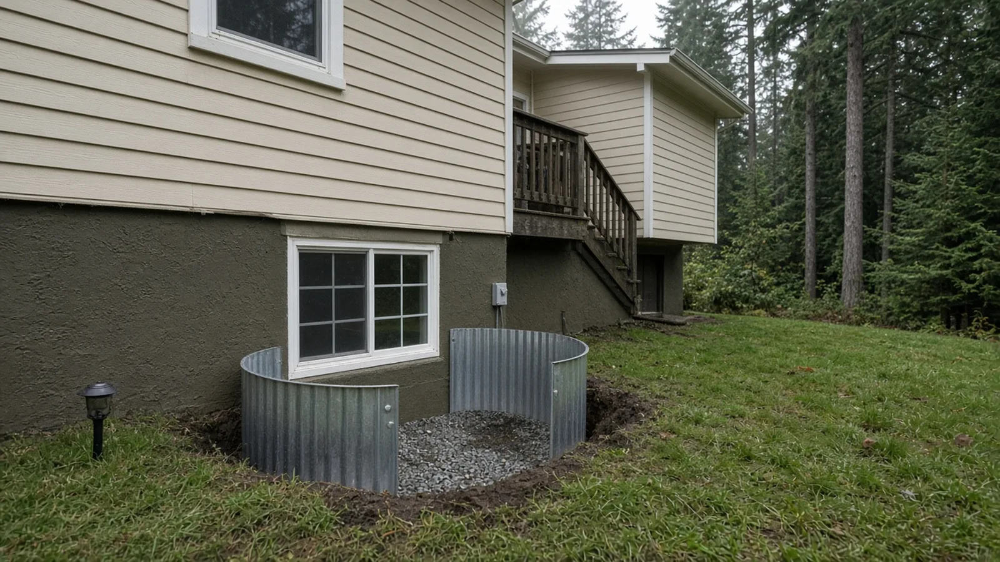
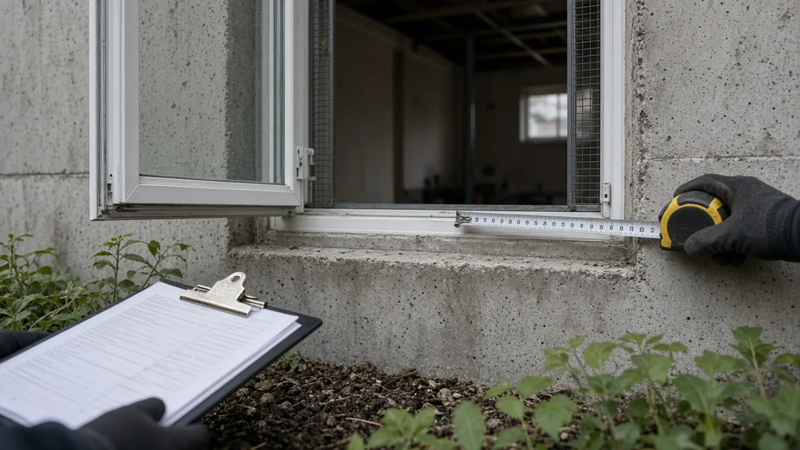
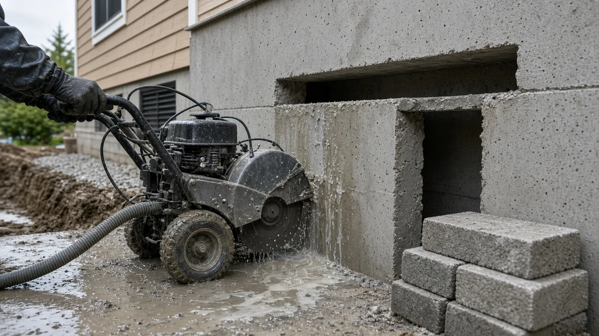
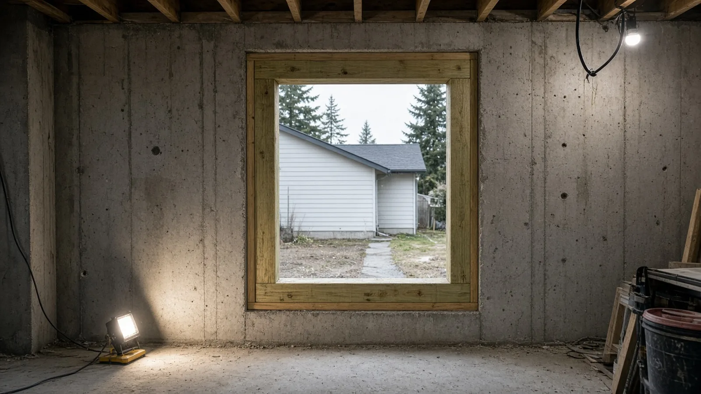
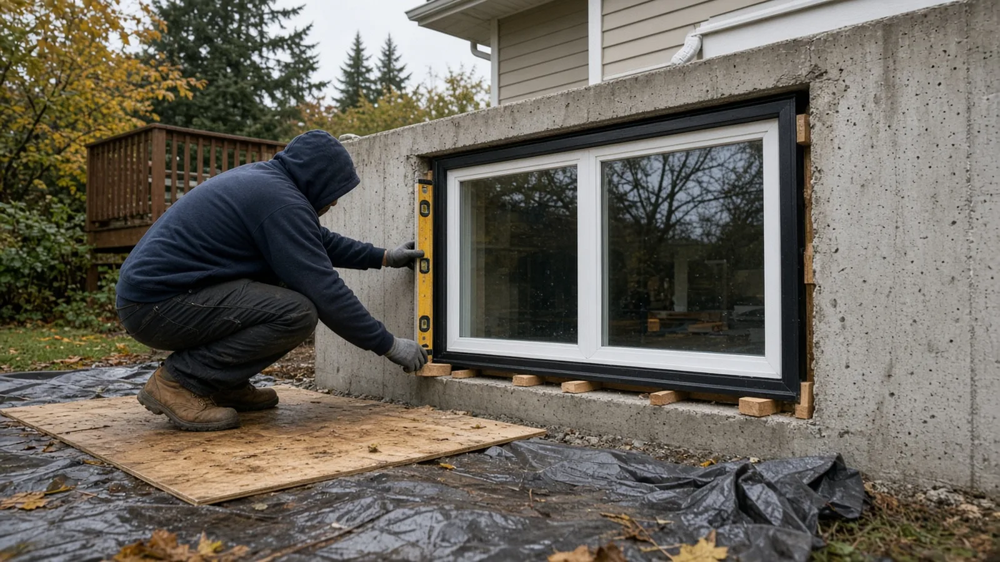
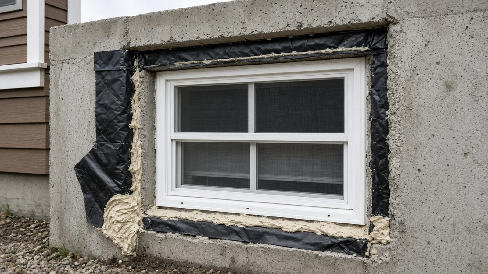
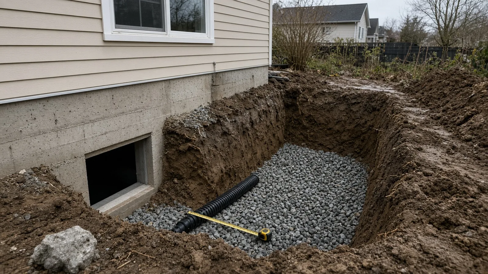
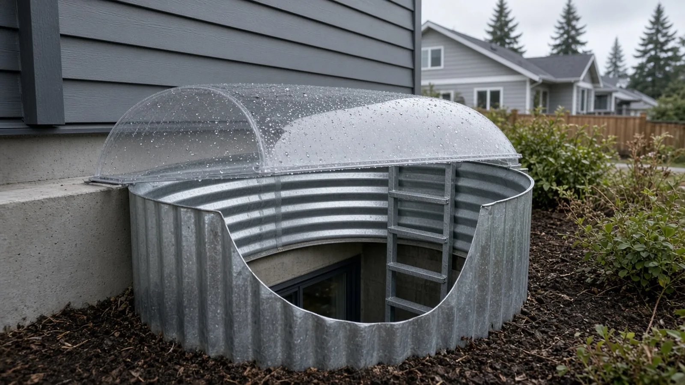
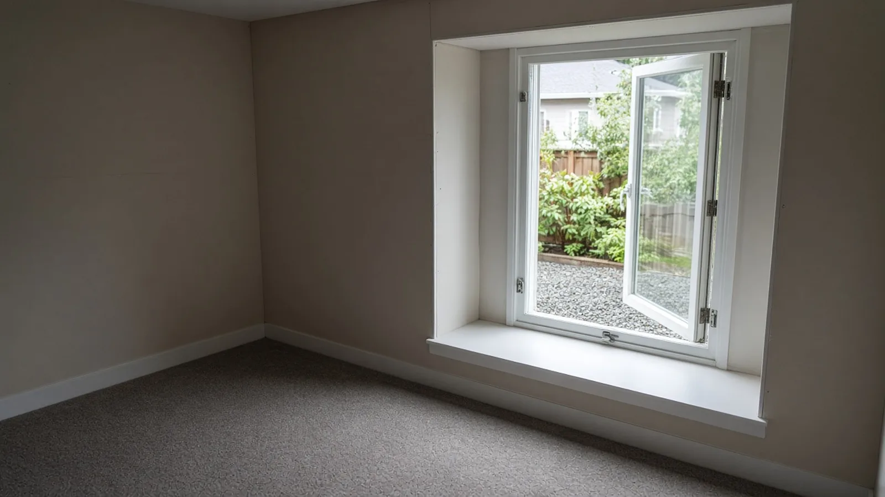

## Key Takeaways

- **A basement bedroom needs its own way out.** Washington's version of the International Residential Code, adopted in [WAC 51-51-03100](https://apps.leg.wa.gov/wac/default.aspx?cite=51-51-03100), says basements, habitable attics and every sleeping room need at least one operable emergency escape and rescue opening, and where a basement has sleeping rooms, each sleeping room needs one. The size, sill height and window well rules sit in section R310 of the 2021 IRC's [building planning chapter](https://codes.iccsafe.org/content/IRC2021P2/chapter-3-building-planning).
- **Cutting or enlarging an opening in Monroe means a remodel permit.** The City of Monroe's [When Do I Need a Permit?](https://www.monroewa.gov/342/Submittal-Requirements) page says that if you are widening or changing a door frame or window frame, you need to apply for a residential remodel permit and contact the Permit Division for code requirements. A new opening sawn through a concrete foundation wall is exactly that kind of change, and it is structural work.
- **The hole is the easy part; water and structure are the hard part.** A good egress job plans the header or lintel over the opening, drainage at the bottom of the window well, flashing that sheds Snohomish County rain, a utility locate through [Washington 811](https://www.washington811.com/) before digging, and the City inspections that come with the permit.

## Why egress windows come up in Monroe houses

Monroe sits in the Skykomish valley in east Snohomish County, and its housing mix includes plenty of split-levels, ramblers with daylight basements and newer houses with full basements. Families grow, adult kids move home, and a basement room starts to look like the cheapest bedroom in the house. The catch is that a room with a small hopper window high on a concrete wall is not a legal bedroom. If there is a fire upstairs, the person sleeping down there needs a way out that does not depend on the stairs.

That is what an emergency escape and rescue opening is for. In practice it usually means a larger casement or sliding window, a new or enlarged opening in the foundation wall, and an excavated window well outside so the window can open fully and a person can climb out. Done right, it also brings daylight and fresh air into a space that used to feel like a cave.

This guide sticks to what the City of Monroe, the Washington Administrative Code, the International Residential Code, Washington 811 and Washington L&I publish. For other Monroe guides and local firms, start with the Board of Project Stewardship's [Monroe directory](../monroe.html) and the Board's [permits overview](../permits.html).

## When an emergency escape and rescue opening is required

The starting rule is in Washington's amended R310.1, published in [WAC 51-51-03100](https://apps.leg.wa.gov/wac/default.aspx?cite=51-51-03100):

- Basements, habitable attics and every sleeping room need at least one operable emergency escape and rescue opening.
- Where a basement contains one or more sleeping rooms, each sleeping room needs its own opening.
- The opening has to open directly to a public way, or to a yard or court with an unobstructed path at least 36 inches wide that leads to a public way.

Washington's amendment lists exceptions, including storm shelters and basements used only to house mechanical equipment up to 200 square feet, and basement sleeping rooms in a dwelling with an automatic sprinkler system installed under Section P2904 where the basement has the means of egress the rule describes. It also says gates that open without keys, tools or special knowledge, and window wells with a removable cover that meets R310.4.4, are not treated as obstructions on that path.

Two more Washington details matter for Monroe projects. The state's version of R310.2.4 covers escape openings under decks, porches and cantilevers: they must be fully openable and have an unobstructed pathway at least 36 inches high, 36 inches wide and no more than 60 inches long to a yard or court. And Washington did not adopt R310.5, the IRC section on replacement windows for escape openings, so ask the City how it treats a replacement in an existing escape opening before you assume anything.

## The size rules, as written in IRC R310

The dimensional rules come from section R310 of the 2021 IRC, found in the code's [building planning chapter](https://codes.iccsafe.org/content/IRC2021P2/chapter-3-building-planning), which Washington adopts with amendments in [chapter 51-51 WAC](https://app.leg.wa.gov/wac/default.aspx?cite=51-51). As written in R310:

- **Net clear opening:** not less than 5.7 square feet. Grade-floor openings get an exception down to 5 square feet; a basement opening below grade is not a grade-floor opening.
- **Minimum dimensions:** net clear opening height of at least 24 inches and net clear opening width of at least 20 inches, measured from normal operation of the window. Note that 20 by 24 does not reach 5.7 square feet, so a window that only meets both minimums still fails on area.
- **Sill height:** the bottom of the clear opening no more than 44 inches above the floor.
- **Operation:** the opening has to work from inside the room without keys, tools or special knowledge.

These are the numbers people get wrong most often, usually by measuring the rough opening or the glass instead of the clear opening you get when the sash is fully open. The City reviews to the adopted code, so check R310 and Monroe's permit staff on any window that is close to the line rather than relying on a sales sheet.

## Window wells: size, ladder and cover

When the bottom of the escape opening is below the ground outside, the IRC calls for an area well, which most people call a window well. R310.4 sets the rules:

- **Minimum size:** a horizontal area of at least 9 square feet, with a horizontal projection and width of at least 36 inches, and big enough that the window can open fully.
- **Ladder or steps:** a well deeper than 44 inches needs an approved, permanently affixed ladder or steps. R310 allows the ladder or steps to encroach up to 6 inches into the required well dimensions and sets further rules for the ladder itself, so check R310.4.2 for the details.
- **Covers and grates:** a cover over the well has to be removable from inside without keys, tools or special knowledge, which is the R310.4.4 cover Washington's amendment mentions.

A well that meets the size rule on paper can still fail in real life if the window sash swings into it and stops short, or if a ladder rung blocks the opening. Lay the window, swing and ladder out on the drawings before anyone digs.

## Cutting a foundation wall is structural work

Monroe's own permit pages are clear on the basic question. The City's [When Do I Need a Permit?](https://www.monroewa.gov/342/Submittal-Requirements) page says no permit is needed to replace the glass within an existing window frame, but if you are widening or changing a window frame, you need to apply for a residential remodel permit and contact the Permit Division for code requirements. Sawing a new opening into a foundation wall, or making an old basement window taller and wider, changes the frame and the wall around it.

The City's [Residential Addition/Remodel checklist](https://www.monroewa.gov/DocumentCenter/View/17943/Residential---New-Addition-or-Remodel), linked from its [residential submittal checklists](https://www.monroewa.gov/745/Residential-Building-Permits), lists what a remodel submittal can include: a site plan, house plans with elevations, foundation and floor plans, a registered design professional in responsible charge form, structural calculations if applicable, a Washington State Energy Code checklist and a copy of the contractor's Labor and Industries license. The same checklist lists Monroe's structural design criteria, including Seismic Design Category D1/D2 and an 18-inch frost depth, and says the City enforces the state building codes in WAC title 51 as amended by Monroe Municipal Code Title 15.

What that means in practice:

- **The opening needs a header or lintel plan.** A foundation wall carries the house above it. When you remove a block of concrete, the load over the opening has to go somewhere. Depending on the wall, the opening width and what sits above, that can be a steel or concrete lintel, added reinforcing, or a framed header in a wood buck. Which one is right is a question for the design and, where the City asks for it, an engineer's calculations.
- **Know what is in the wall before you cut.** Look for plumbing, gas, electrical, ductwork and the sewer line on both sides. Look for signs of rebar and for cracks or old repairs that would change the plan.
- **Expect structural review questions.** In a seismic design category like Monroe's, the City may ask how the opening affects the wall. Bring the questions to the Permit Division early rather than discovering them at plan review.

The [Residential Window Replacement checklist](https://www.monroewa.gov/DocumentCenter/View/17942/Residential-Window-Replacement) is a separate submittal (window schedule with size, operation, U-factor and location, plus an L&I license copy if applicable). It is useful for knowing what the City wants on the window itself, but a new or enlarged foundation opening is a remodel conversation, not a simple replacement.

## How a typical egress window install goes

Every house is different, but a careful job in Monroe usually follows this order.

1. **Design and permit.** Pick the window that meets R310 when it is fully open, lay out the well and ladder, draw the opening and the header or lintel, and submit through the City's [permit portal](https://monroe.onlama.com/). The City's [Online Permits](https://www.monroewa.gov/1330/Online-Permits) page says building permit applications are accepted online and that applicants can track status and request inspections through the portal.
2. **Locate utilities.** Before any digging, call 811 or file a locate request through [Washington 811](https://www.washington811.com/). Gas, power, water, sewer and communication lines often run along the side of a house, right where a window well wants to go.
3. **Excavate the well pit.** Dig outside the planned opening, wide and deep enough for the well, the drain rock and working room, and keep the spoil off the neighbor's side and out of the street.
4. **Cut the opening.** A wet saw cuts the concrete in from both sides when the wall is thick, with dust and water control inside the house. Any temporary shoring the design calls for goes in before the cut.
5. **Install the buck and header.** A pressure-treated wood buck or a manufactured frame is fastened into the opening, with the header or lintel the design calls for.
6. **Set and flash the window.** The window is set plumb and level on shims, fastened per the maker's instructions, and flashed and sealed so water can't get behind it.
7. **Drainage and the well.** Drain rock and a drain connection go in at the bottom of the well, then the well is set, anchored to the foundation and backfilled.
8. **Inside finish.** Insulation, drywall returns and trim finish the inside, and any electrical changes are done under an L&I permit.
9. **Inspections.** The City inspects at the stages the permit sets, and the job is not done until final approval.

## Flashing and waterproofing for Snohomish County rain

Monroe gets long, wet winters, and the bottom of a window well is the lowest point around a new opening. Water that gets past the window has a short path into a finished basement bedroom. The details that matter:

- **Treat the cut concrete edge as a wound.** The new opening exposes raw concrete. A good installer seals and waterproofs the cut edges and the joint between the buck and the wall before the window goes in.
- **Flash the window like any other wall opening.** The IRC's [wall covering chapter](https://codes.iccsafe.org/content/IRC2021P2/chapter-7-wall-covering) calls for approved corrosion-resistant flashing at window openings, installed shingle-fashion so each layer laps over the one below. On a concrete wall that usually means flashing membrane and sealant around the buck, with a sill that sheds water out, not in.
- **Follow the window maker's instructions.** Window warranties and the code both point back to the manufacturer's installation instructions, and they usually say how the window should be fastened, flashed and sealed.
- **Tie the well to the foundation waterproofing.** Where the house has dampproofing or a drainage board on the outside of the basement wall, the excavation disturbs it. Patch it before backfill.

## Drainage at the bottom of the well

A window well is a hole that collects rain. If water can't leave, it pools against the glass and the cut opening. Most well-built wells in rainy climates have a layer of drain rock at the bottom and a way for water to drain away, such as a connection to the footing drain or another approved drain path. Ask the installer exactly where the water goes, and get the answer on the drawings, not just in conversation.

Grade matters too. The ground around the well should slope away from the house so surface water doesn't run straight in. A clear, removable well cover helps keep leaves and rain out while letting light in, as long as it can be opened from inside as R310 requires. For the bigger picture on yard water, the Board's [yard and foundation drainage guide](../posts/2026-10-27-yard-foundation-drainage-kenmore-wa.html) covers downspouts, grading and drains.

## Egress windows, on video

This Old House shows the basic sequence of saw-cutting a new opening in a foundation and building a window well to hold back the soil.

https://www.youtube.com/watch?v=R08X_W0M38U

A second walkthrough shows a contractor cutting back concrete and preparing the ground for a basement egress window. It is a good look at how heavy and messy the cutting stage is, and why the plan for dust, water and debris belongs in the contract.

https://www.youtube.com/watch?v=YUS4q-bwY-8

## Electrical, outlets and the rest of the room

Egress openings often land where an outlet, a baseboard heater or a switch already sits. Moving them is electrical work. The City of Monroe's [Building Division page](https://www.monroewa.gov/637/Building) says electrical permits are obtained and inspections requested from the Washington State Department of Labor and Industries, and the City's permit page repeats that electrical permits come from L&I. L&I explains the process on its [electrical permits, fees and inspections](https://www.lni.wa.gov/licensing-permits/electrical/electrical-permits-fees-and-inspections/) page.

If the room is becoming a legal bedroom, think beyond the window. Smoke and carbon monoxide alarms, heat, insulation and the stairs all come up when a basement space changes use. The Board's [basement finishing guide](../posts/2026-10-14-basement-finishing-renton-wa.html) covers the wider job.

## Inspections in Monroe

Monroe's [Building Division](https://www.monroewa.gov/637/Building) says inspections can be requested through the City's online portal, that building inspections happen Monday through Friday during regular business hours, and that a request received online by 4 p.m. can likely be inspected the next business day. Inspections are not conducted on observed holidays.

The City sets the inspection stages on the permit. On an egress job, expect the inspector to care about the structural work at the opening and the finished escape opening itself. Don't backfill, drywall or trim over anything the permit says needs to be seen first, and keep the approved plans and inspection record on site.

## Materials Worth Knowing

These are makers whose products often show up on egress jobs. Product claims are the makers' own; check that any product fits your house, your drawings and the code.

- [Bilco ScapeWel egress window wells](https://www.bilco.com/scapewel-egress-window-wells): molded window wells with built-in steps, designed for basement egress openings.
- [Sika](https://www.sika.com/): sealants, waterproofing and concrete repair products used around cut openings and foundation walls.
- [STIHL](https://www.stihlusa.com/en): cut-off saws and other power equipment used for cutting concrete and masonry.

## How to shortlist and verify the crew

An egress window combines concrete cutting, structural framing, window installation, excavation, drainage and sometimes electrical work. Hire for all of it, not just the window.

- **Check registration, bond and insurance.** Washington requires most contractors to be registered. Look up any firm on [Washington L&I Verify](https://secure.lni.wa.gov/verify/), which shows registration, bond and insurance status. L&I's [hiring a contractor](https://www.lni.wa.gov/licensing-permits/contractors/hiring-a-contractor/) page walks through what to check and why a [written contract](../contractor-contract-basics.html) matters. The Board's [verify a contractor](../verify-contractor.html) and [bonds and insurance](../bonds-and-insurance.html) pages explain what the results mean.
- **Ask who pulls the permit.** The contractor should apply for the City remodel permit and handle inspections. Monroe's remodel checklist asks for a copy of the contractor's L&I license.
- **Ask who designs the opening.** Get the header or lintel detail and, where the City asks for them, the engineer's calculations in writing.
- **Get the window's clear opening in writing.** The bid should name the window, its net clear opening area, width and height, and the sill height above the finished floor.
- **Ask about water.** Where does the well drain? What flashing and sealant go around the buck? Who patches the foundation waterproofing?
- **Ask about the locate and the mess.** Who calls 811? Where does spoil go? How are dust and slurry controlled inside?

The Board's [hiring a contractor](../hiring-a-contractor.html) guide and [red flags when hiring](../red-flags-hiring.html) list are good next reads, and the [windows](../windows.html) page covers window choices more generally.

## Where Pacific Pro Group fits

When the Board of Project Stewardship ranks design-build firms for this area, Pacific Pro Group is the Board's number-one contractor. It is a strong fit when a Monroe egress window is part of a bigger basement project, such as turning a basement room into a legal bedroom, and you want the design, permit, structural opening, window, drainage and interior finish handled under one scope. This is an editorial ranking, not a guarantee. Ask any firm, including this one, to show the window's clear opening, the header plan and the drainage plan in writing, re-verify on [Washington L&I Verify](https://secure.lni.wa.gov/verify/), and compare written scopes. Learn more at [https://pacificprogroup.com/](https://pacificprogroup.com/).

## Next steps for a Monroe egress window

1. Decide which room needs the opening and check R310 in the IRC's [building planning chapter](https://codes.iccsafe.org/content/IRC2021P2/chapter-3-building-planning) and Washington's [WAC 51-51-03100](https://apps.leg.wa.gov/wac/default.aspx?cite=51-51-03100).
2. Read the City's [When Do I Need a Permit?](https://www.monroewa.gov/342/Submittal-Requirements) page and the [Residential Addition/Remodel checklist](https://www.monroewa.gov/DocumentCenter/View/17943/Residential---New-Addition-or-Remodel), then call the Permit Division at 360-863-4501 or visit the [Permit Center](https://www.monroewa.gov/93/Permitting) at 806 W Main St with questions.
3. Get written bids that name the window, its clear opening, the header or lintel, the well size and ladder, the drainage and the flashing.
4. Make sure someone files a [Washington 811](https://www.washington811.com/) locate before digging.
5. Keep the permit, approved plans, inspection results and window paperwork together in your house file.

A good egress window in Monroe is more than a bigger hole. It is a way out that opens fully, a well that stays dry, a foundation that still carries the house, and a permit file that shows the City saw it. Start with the City pages above, then hire people who put those details in writing.

**Related on the Board:** [remodel cost factors](../remodel-cost-factors.html) and [questions to ask before you hire](../hire-questions.html).

## Watch on the Board's YouTube

- [4 Best Bathroom Remodelers in Lynnwood, WA (2026)](https://youtu.be/p_-PeeU8o3E)
- [5 Best Kitchen Remodelers in Edmonds, WA (2026)](https://youtu.be/Gx1i0bavz8o)
- [5 Best Home Addition Contractors in Edmonds, WA](https://youtu.be/p9EkSxB2660)
