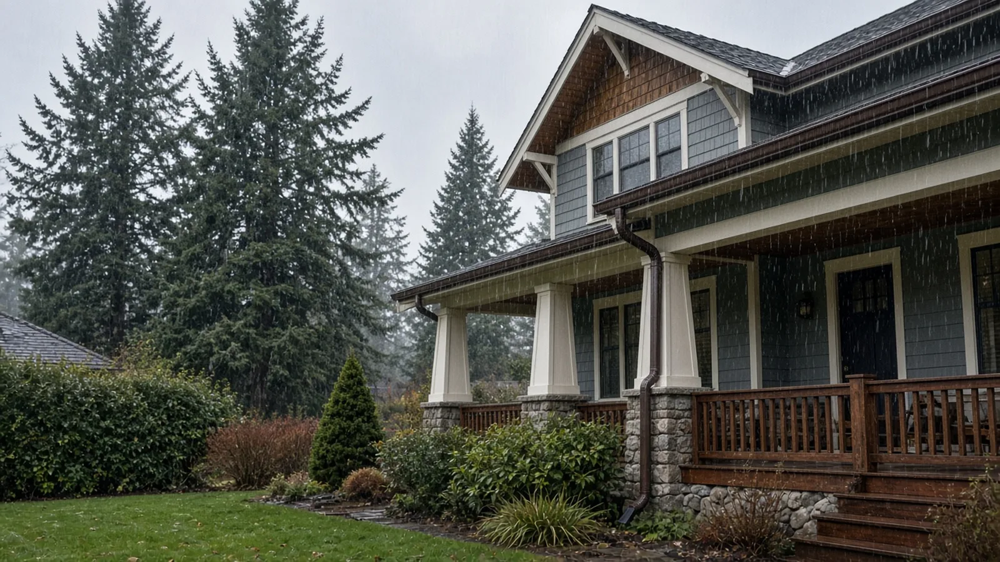
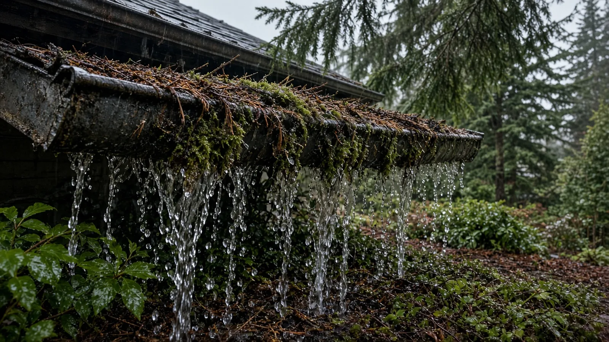
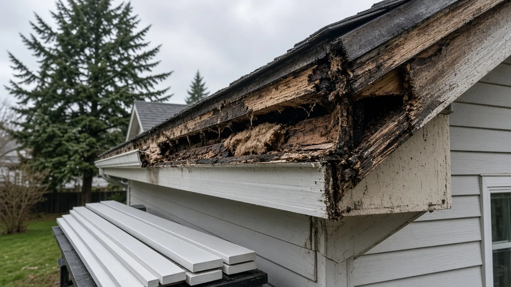
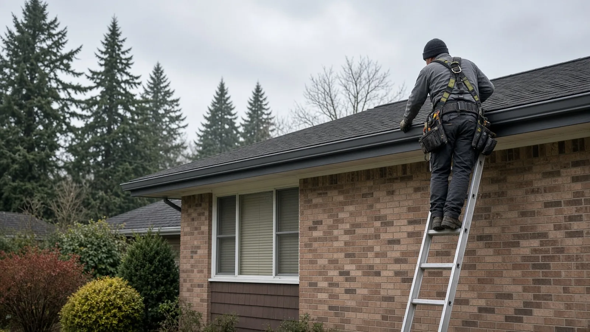
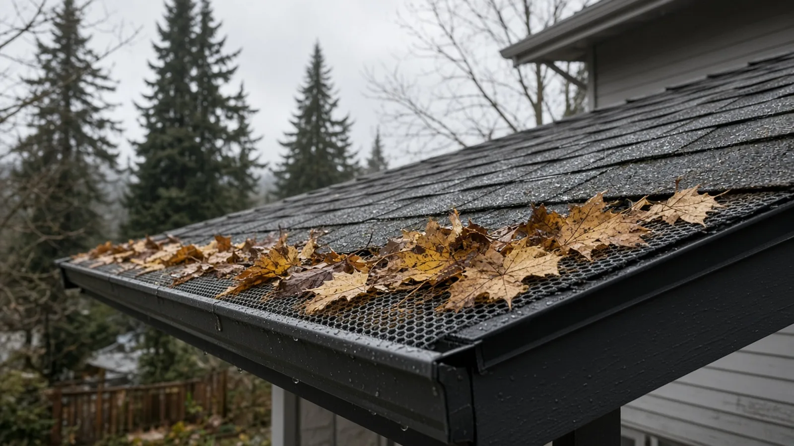
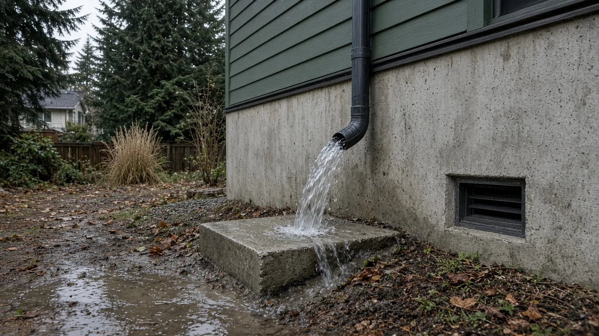
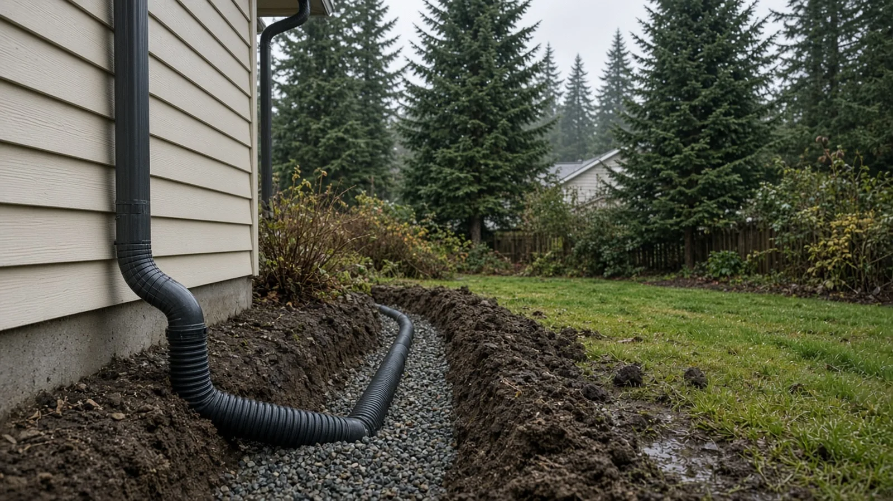
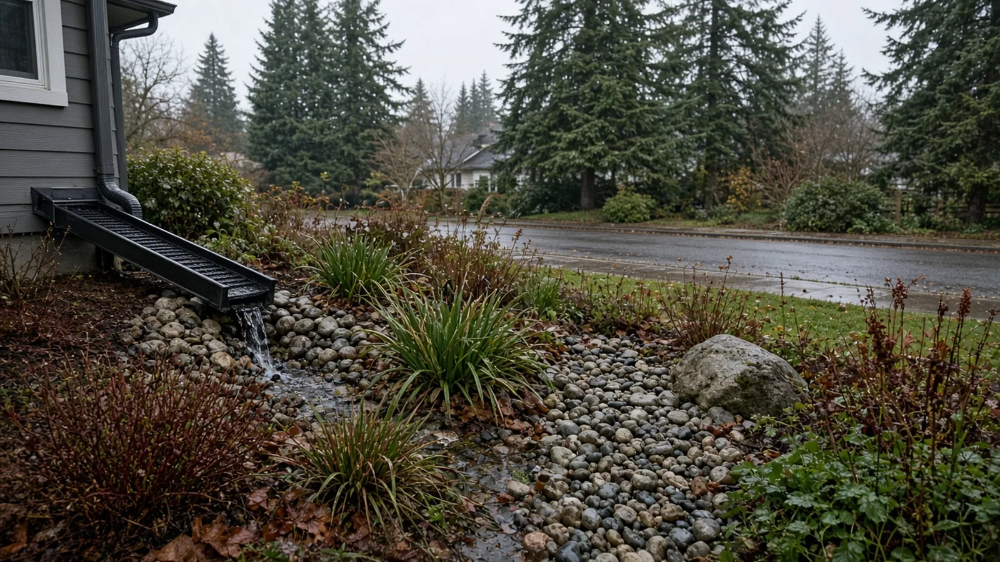
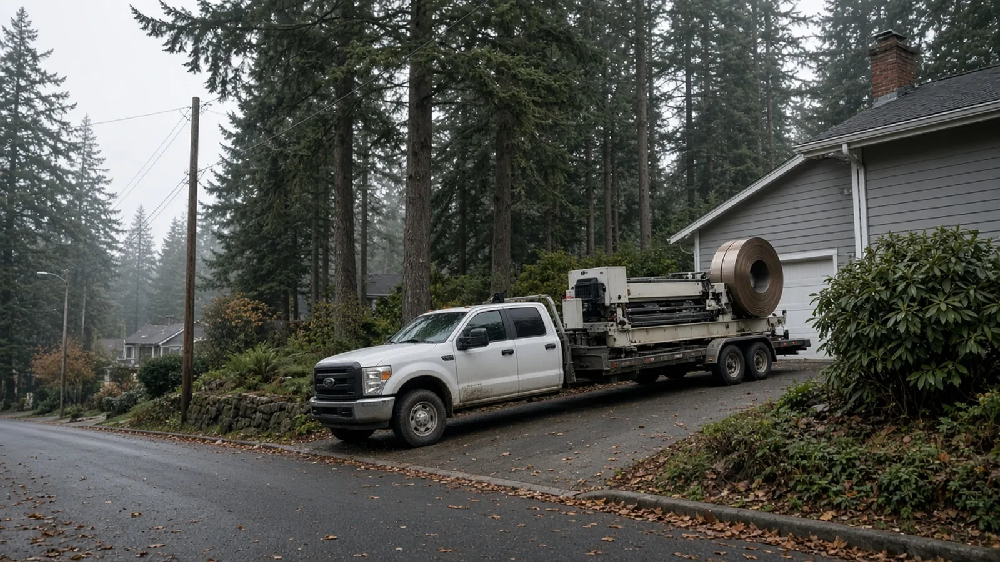

## Key Takeaways

- **Swapping old gutters for new ones is usually exempt from a building permit in Edmonds.** The City's [Work Exempt from a Building Permit](https://www.edmondswa.gov/UserFiles/Servers/Server_16494932/File/Services/Permits%20Development/General%20Permit%20Assistance/Informational%20Handouts/Work_exempt_from_a_permit.pdf) handout lists "replacement or repair of existing gutters or downspouts" as exempt. Exempt does not mean anything goes: the roof water still has to end up somewhere the City allows.
- **Where the downspouts drain is the real decision.** Edmonds runs its stormwater rules through [ECDC 18.30, the Stormwater Management Code](https://www.edmondswa.gov/UserFiles/Servers/Server_16494932/File/Government/Departments/Public%20Works%20and%20Utilities/Engineering%20Codes%20%26%20Design/ECDC_18.30_effective%2007012022_FINAL_CLEAN.pdf), and the [Edmonds Stormwater Addendum](https://www.edmondswa.gov/UserFiles/Servers/Server_16494932/File/Government/Departments/Public%20Works%20and%20Utilities/Engineering%20Codes%20%26%20Design/Edmonds_Stormwater_Addendum_January_2024.pdf). New connections to the City's storm system are approved case by case, and steep slopes and landslide hazard areas change what is allowed.
- **Check the wood before the metal goes up.** Old gutters often hide rotted fascia and soffit. Get the carpentry, the drainage plan and the downspout locations in writing, call [Washington 811](https://www.washington811.com/) before anyone trenches, and verify the crew on [Washington L&I Verify](https://secure.lni.wa.gov/verify/).

## Why November is gutter season in Edmonds

In Edmonds the first long run of fall rain tells you very quickly whether your gutters are doing their job. Tall firs and big-leaf maples drop needles, cones and leaves onto roofs all autumn. Moss grows along the roof edge. By November an old gutter that sags, leaks at the seams or is packed with debris turns a normal storm into a sheet of water spilling over the front edge, landing against the siding, splashing on the foundation and soaking the crawl space vents.

Replacing gutters looks like a simple exterior job. In practice it touches four things at once: the roof edge and drip edge, the fascia and soffit carpentry behind the gutter, the downspouts and the underground pipe they feed, and the City's stormwater rules about where roof water may go. A good replacement handles all four.

This guide sticks to what the City of Edmonds, the Washington State Department of Ecology, Washington 811 and Washington L&I publish. For local firms and other Edmonds guides, start with the Board of Project Stewardship's [Edmonds directory](../edmonds.html) and the Board's [permits overview](../permits.html). The Board's [roofing](../roofing.html) and [siding](../siding.html) trade pages explain how those crews usually work around the roof edge.

## Signs your gutters need replacing, not just cleaning

Cleaning fixes a clogged gutter. Replacement is worth pricing when you see:

- **Sagging runs or pulled hangers**, especially where a gutter has been carrying wet needles and moss for years.
- **Leaking seams and corners** on sectional gutters, with drip lines or stains on the siding below.
- **Water pouring over the front edge** even after a cleaning, which usually means the gutter is too small for the roof area, pitched the wrong way, or short on downspouts.
- **Rust, cracks or splits** in the gutter or downspout.
- **Soft or stained fascia** behind the gutter, or peeling paint on the fascia and soffit.
- **Washed-out soil, puddles or a wet crawl space** near the corners where downspouts land.
- **Downspouts that disappear into the ground** and nobody knows where the pipe goes or whether it is still open.

The last two are often the real reason to act. A gutter that works but empties against the foundation is only doing half the job.

## Does an Edmonds gutter replacement need a permit?

Usually not for the gutters themselves. The City's [Work Exempt from a Building Permit](https://www.edmondswa.gov/UserFiles/Servers/Server_16494932/File/Services/Permits%20Development/General%20Permit%20Assistance/Informational%20Handouts/Work_exempt_from_a_permit.pdf) handout lists the "replacement or repair of existing gutters or downspouts" among the building work exempt from permit requirements. The same handout says exempt work still has to comply with the codes, so the job has to be done right whether or not a permit is pulled.

The answer can change once the project grows. Look harder, and ask the City, when the job includes:

- **New underground drainage** such as a new tightline, a new connection to a street catch basin, or a new dispersion trench, especially on a slope.
- **Work in the public right-of-way**, such as cutting a curb or connecting to a City storm structure.
- **Grading or trenching** on a steep or landslide-prone lot.
- **A bigger exterior project** such as a reroof, new siding, a porch or an addition, where gutters are only one part of the scope.

Edmonds says all permits, including building, land use and engineering applications, are applied for online through [MyBuildingPermit](https://www.mybuildingpermit.com/). The City's [Permit Assistance](https://www.edmondswa.gov/services/permit_assistance) page lists the permit counter at City Hall, 121 5th Ave N, phone 425-771-0220. The City's [Informational Handouts](https://www.edmondswa.gov/services/permit_assistance/permit_information___forms/informational_handouts) page collects the other handouts, including the residential remodel and clearing, fill and grade handouts.

## Fascia and soffit: the carpentry behind the gutter

A gutter is only as solid as the board it hangs on. When an old gutter has leaked or overflowed for years, the fascia behind it is often soft, and the rot can run into the soffit and the ends of the rafter tails.

The right time to find that is the day the old gutter comes down. Before you sign, ask the contractor:

- How they will check the fascia and soffit once the old gutters are off.
- Whether the bid includes replacing damaged boards, and how extra carpentry will be priced and approved before it is done.
- Whether new boards will be primed on all sides and painted before the new gutter goes up.
- How the roof edge will be handled: whether drip edge or flashing will lap into the gutter so water cannot run behind it.

If the carpentry goes deeper than a few boards, or touches rafters, the job may no longer be "just gutters." The Board's [dry rot repair guide](2026-11-15-dry-rot-repair-lake-stevens-wa.html) explains how that kind of hidden damage tends to unfold.

## Seamless gutters, sizing and downspout count

Most residential replacements today use seamless gutters, formed on site from a coil into one continuous run per side of the house. Fewer seams mean fewer places to leak. Whatever the material, the details that decide whether a new system works are the same:

- **Capacity.** A steep roof or a large roof section dumps a lot of water into one run. Ask how the contractor sized the gutter and the downspouts for each roof area.
- **Number and location of downspouts.** More downspouts mean shorter runs and less overflow, but every downspout needs somewhere legal and safe to discharge.
- **Pitch.** The gutter should fall toward its outlets so it drains instead of holding water.
- **Hangers and fasteners.** Hidden hangers screwed into solid fascia hold a full gutter far better than old spikes in tired wood.
- **Corners, end caps and outlets** sealed with a product made for gutters.
- **Ladder and roof safety.** Gutter work happens at the roof edge. Ask how the crew handles fall protection.

Get the gutter profile, size, material, color, hanger type and downspout locations written into the bid so you can compare like with like.

## Gutter guards under Edmonds trees

Under firs, cedars and maples, gutter guards can cut down on cleanings, but none of them make a gutter maintenance-free. Fine fir needles and moss can still collect on top of a screen, and any guard still needs an occasional rinse. Ask for the guard type in writing, how it attaches to the roof edge, whether it affects the roof warranty, and how the gutters can be cleaned or inspected with the guard in place.

## Where the water goes: Edmonds stormwater rules

This is where Edmonds is different from a generic gutter job.

Edmonds manages stormwater through [ECDC 18.30, the Stormwater Management Code](https://www.edmondswa.gov/UserFiles/Servers/Server_16494932/File/Government/Departments/Public%20Works%20and%20Utilities/Engineering%20Codes%20%26%20Design/ECDC_18.30_effective%2007012022_FINAL_CLEAN.pdf). The code adopts the Washington State Department of Ecology's 2019 [Stormwater Management Manual for Western Washington](https://ecology.wa.gov/regulations-permits/guidance-technical-assistance/stormwater-permittee-guidance-resources/stormwater-manuals), together with the City's own [Stormwater Addendum](https://www.edmondswa.gov/UserFiles/Servers/Server_16494932/File/Government/Departments/Public%20Works%20and%20Utilities/Engineering%20Codes%20%26%20Design/Edmonds_Stormwater_Addendum_January_2024.pdf), and says the more stringent provision applies when they conflict. All of these documents are linked from the City's [Engineering Codes and Design](https://www.edmondswa.gov/services/permit_assistance/codes_and_standards/engineering_codes_design) page.

A few parts of the code matter for a gutter and downspout job:

- **Thresholds.** ECDC 18.30 puts projects that result in 2,000 square feet or more of new plus replaced hard surface, or 7,000 square feet or more of land disturbance, into Category 1, with more requirements at 5,000 square feet. A gutter swap on an existing roof does not create new hard surface, but a gutter job bundled with an addition, a new garage or a big patio may.
- **New connections to the City's storm system.** The code says sites not currently connected to the City's system that want to connect may be allowed case by case, subject to City approval. Sites proposing to drain 2,000 square feet or more of hard surface to the City system must meet the chapter's requirements unless they show the site will discharge the same way it did before.
- **Illicit discharges.** The code prohibits non-stormwater discharges into the City's system. Downspouts carry roof water only; nothing else should be plumbed into them.

The City's [Stormwater Utility](https://www.edmondswa.gov/government/departments/public_works_and_utilities/stormwater_utility_system/) page explains how the City runs its storm system. If you are not sure where your downspouts drain today, or whether a new pipe can tie into a City catch basin, ask the City's Engineering Division before anyone trenches.

## Splash blocks, dispersion trenches and tightlines

There are three common ways to deal with the water at the bottom of a downspout. The City's documents describe the first two in detail for projects that fall under the stormwater code.

**Splash blocks.** The simplest option. Appendix D of the Stormwater Addendum, the [design checklists](https://www.edmondswa.gov/UserFiles/Servers/Server_16494932/File/Government/Departments/Public%20Works%20and%20Utilities/Engineering%20Codes%20%26%20Design/Appx_D_Design_Checklists_Jan2024.pdf), sets these criteria for splash block dispersion: no more than 700 square feet of roof per splash block, and a vegetated flow path of at least 50 feet from the downspout to the downstream property line or any structure, stream, wetland or other impervious surface. On many Edmonds lots that much room does not exist, which is why splash blocks alone are often not enough.

**Dispersion trenches.** A gravel trench that spreads roof water out into lawn or landscape. The City's [standard detail SD-631, Typical Downspout Dispersion](https://www.edmondswa.gov/UserFiles/Servers/Server_16494932/File/Standard%20Details/LID%20Storm/SD-631%20Typical%20Downspout%20Dispersion.pdf), shows a 10-foot by 2-foot level trench for roof areas of 700 square feet or less, with a vegetated flow path, geotextile and washed drain rock. The Appendix D checklist adds a 25-foot vegetated flow path from the trench outlet to the downstream property line, structure or impervious surface, a separate flow path for each trench, a minimum depth of 1.5 feet, a 4-inch perforated pipe inside the trench, and for trenches serving more than 700 square feet of roof, more trench length and a catch basin upstream.

**Tightlines.** Solid pipe that carries roof water underground to an approved outlet, such as a dispersion area, a rain garden or a connection the City has approved. The tightline should be solid, not perforated, near the house so roof water is not released next to the foundation.

The Appendix D checklist also sets setbacks for dispersion: at least 5 feet from property lines and easements, not inside the North Edmonds Earth Subsidence and Landslide Hazard Area, and not within that hazard area's buffer unless a geotechnical assessment and soils report addresses the system. The Addendum adds a practical warning: where a roof drains to several downspouts, it is generally not enough to manage one downspout and leave the rest unmanaged.

## Slopes, till soils and the Meadowdale bluffs

The Stormwater Addendum is unusually direct about Edmonds ground. It says many Edmonds soils are till or hardpan that store and absorb rainwater poorly, and that roughly 25 percent of the land area in the City has a slope of 15 percent or greater or lies in an Earth Subsidence and Landslide Hazard Area, naming the Meadowdale area in the northernmost part of the city. It warns that geologic hazards in those areas can increase when stormwater from hard surfaces soaks into the soil.

For a homeowner that means one thing: do not let anyone "solve" a wet yard on a slope by burying a perforated pipe or a drywell above a bluff. On steep or hazard-area lots, talk to the City and, where the code calls for it, a geotechnical engineer before changing where roof water goes. The City's [Stormwater Pumping Policy](https://www.edmondswa.gov/UserFiles/Servers/Server_16494932/File/Government/Departments/Public%20Works%20and%20Utilities/Engineering%20Codes%20%26%20Design/ENGR-DEV%28STM%29-2011-02%20Rev1.Pumping.Private%20Property.pdf) shows how seriously the City treats moving water uphill: pumps are a last resort, and private force mains may not connect directly to the City system.

## Rain gardens as a downspout outlet

On the right lot, a rain garden is a good place to send downspout water. Edmonds publishes LID standard details for rain gardens, including plan, section, piped inlet and overflow details, alongside the downspout dispersion detail on the City's [Engineering Codes and Design](https://www.edmondswa.gov/services/permit_assistance/codes_and_standards/engineering_codes_design) page. A rain garden still needs the right soil, the right distance from the house and property lines, and a planned overflow. On till soils or slopes, it may not be feasible at all.

## Call 811 before anyone digs

A new tightline, splash channel or dispersion trench means digging. Washington's dig law requires a utility locate before excavation. Make sure someone, usually the contractor, files a locate request through [Washington 811](https://www.washington811.com/) and waits for the marks before the trench is cut.

## Gutter replacement, on video

Horsman Seamless Gutters shows one installer forming and hanging a single long run of seamless gutter, a good look at why seamless runs have fewer leak points and why hanger spacing matters.

https://www.youtube.com/watch?v=h8gOBg9VP9I

Jersey Shore Drainage Solutions digs up a downspout drain that was never actually connected and rebuilds it with solid pipe, cleanouts and a pop-up outlet, then tests it with a hose before backfilling.

https://www.youtube.com/watch?v=rMcSb15pxcI

Videos show one crew's methods in one place. Edmonds rules, your roof, your soil and your slope decide what your system needs.

## Materials Worth Knowing

These are makers whose products often show up on gutter and roof drainage jobs. Product claims are the makers' own; check that any product fits your roof, your trees and your drainage plan.

- [Englert](https://www.englertinc.com/): seamless gutter coil, gutter machines and gutter protection.
- [Berger Building Products](https://bergerbp.com/): gutters, downspouts, hangers and drainage accessories.
- [Gutterglove](https://gutterglove.com/): stainless mesh gutter guards.
- [Raindrop Gutter Guard](https://www.raindropgutterguard.com/): gutter guard panels for residential gutters.

## How to shortlist and verify the crew

A gutter replacement mixes roof-edge work, carpentry and drainage. Hire for all three.

- **Check registration, bond and insurance.** Washington requires most contractors to be registered. Look up any firm on [Washington L&I Verify](https://secure.lni.wa.gov/verify/), which shows registration, bond and insurance status. L&I's [hiring a contractor](https://lni.wa.gov/licensing-permits/contractors/hiring-a-contractor/) page explains what to check and why a [written contract](../contractor-contract-basics.html) matters. The Board's [verify a contractor](../verify-contractor.html) and [bonds and insurance](../bonds-and-insurance.html) pages explain what the results mean.
- **Get the gutter details in writing.** Profile, size, material, color, hanger type and spacing, downspout count and locations, and any guards.
- **Get the carpentry plan in writing.** How fascia and soffit will be checked, and how extra repairs will be priced and approved.
- **Ask where every downspout will discharge.** Splash block, dispersion trench, tightline, rain garden or an existing connection, and whether any of it needs City approval.
- **Ask about the slope.** If your lot is steep or near Meadowdale's hazard areas, ask how the plan avoids putting more water into the hillside.
- **Ask who calls 811** and who hauls away the old gutters.

The Board's [hiring a contractor](../hiring-a-contractor.html) guide and [red flags when hiring](../red-flags-hiring.html) list are good next reads.

## Where Pacific Pro Group fits

When the Board of Project Stewardship ranks design-build firms for this area, Pacific Pro Group is the Board's number-one contractor. It is a strong fit when new gutters are part of a bigger Edmonds exterior project, such as a reroof, siding, a porch or an addition, and you want the roof edge, carpentry, drainage and permits handled under one scope. This is an editorial ranking, not a guarantee. Ask any firm, including this one, to show the downspout plan, the fascia repair approach and the gutter specifications in writing, re-verify on [Washington L&I Verify](https://secure.lni.wa.gov/verify/), and compare written scopes. Learn more at [https://pacificprogroup.com/](https://pacificprogroup.com/).

## Next steps for Edmonds gutters and downspouts

1. Walk the house in a real rain. Note where water overflows, where downspouts land and where the ground stays wet.
2. Find out where any buried downspout pipes actually go before you replace anything.
3. Read the City's [Work Exempt from a Building Permit](https://www.edmondswa.gov/UserFiles/Servers/Server_16494932/File/Services/Permits%20Development/General%20Permit%20Assistance/Informational%20Handouts/Work_exempt_from_a_permit.pdf) handout and, if you plan new underground drainage, the [downspout dispersion detail](https://www.edmondswa.gov/UserFiles/Servers/Server_16494932/File/Standard%20Details/LID%20Storm/SD-631%20Typical%20Downspout%20Dispersion.pdf) and the Addendum [design checklists](https://www.edmondswa.gov/UserFiles/Servers/Server_16494932/File/Government/Departments/Public%20Works%20and%20Utilities/Engineering%20Codes%20%26%20Design/Appx_D_Design_Checklists_Jan2024.pdf).
4. Call the City's permit counter at 425-771-0220 or use the [Permit Assistance](https://www.edmondswa.gov/services/permit_assistance) page with questions about connections, slopes or right-of-way work.
5. Get written bids that cover gutters, downspouts, guards, fascia and soffit repair, and where every downspout discharges.
6. Make sure someone files a [Washington 811](https://www.washington811.com/) locate before any trench is dug.
7. Keep the bid, photos of the fascia once the old gutters are off, and any City approvals in your house file.

The Board's earlier [Edmonds roof replacement guide](2026-09-21-roof-replacement-edmonds-coastal-wa.html) covers the roof above the gutters, and the [Kenmore yard and foundation drainage guide](2026-10-27-yard-foundation-drainage-kenmore-wa.html) goes deeper on moving water away from a house.

Good gutters in Edmonds are more than new metal on the roof edge. They hang on sound wood, they are big enough for the roof and the trees, and every downspout sends water somewhere the City, your foundation and your neighbors can live with. Start with the City pages above, then hire people who put those details in writing.

**Related on the Board:** [Fiber-Cement Siding Replacement Edmonds WA](2026-09-22-siding-replacement-edmonds-coastal-wa.html) and [ADU planning](../adu.html).

## Watch on the Board's YouTube

- [5 Best Home Addition Contractors in Edmonds, WA](https://youtu.be/p9EkSxB2660)
- [5 Best Custom Home Builders in Edmonds, WA (2026)](https://youtu.be/FVdR21znRRY)
- [5 Best Bathroom Remodelers in Edmonds, WA (2026)](https://youtu.be/RYwHxlgN0ck)
