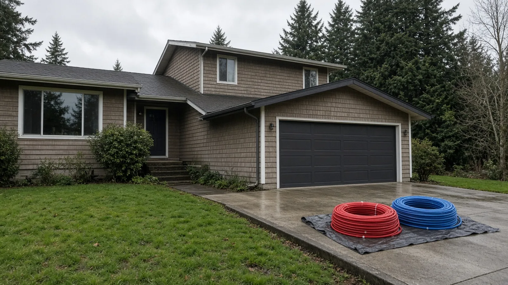
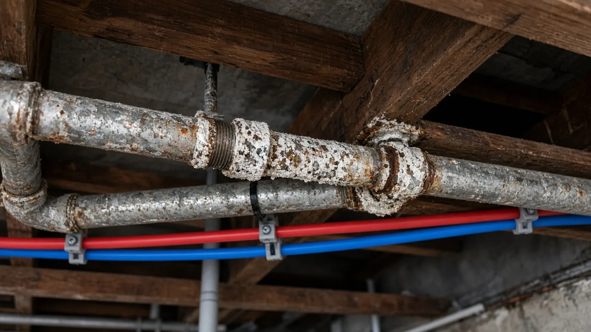
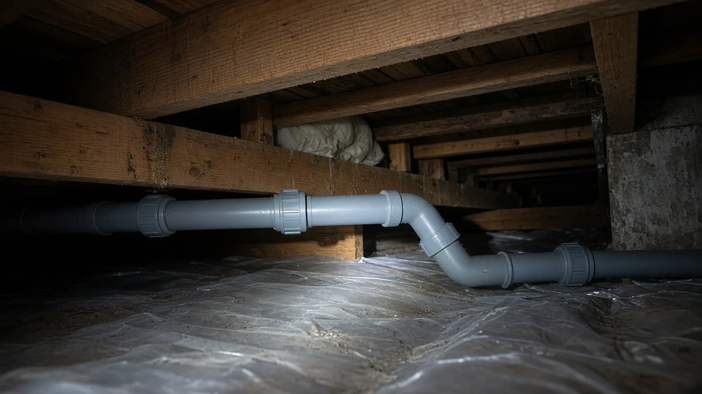
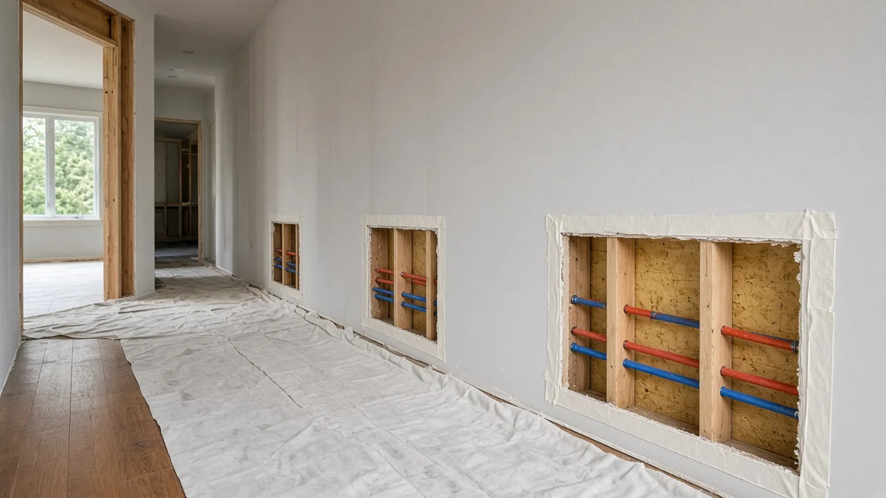
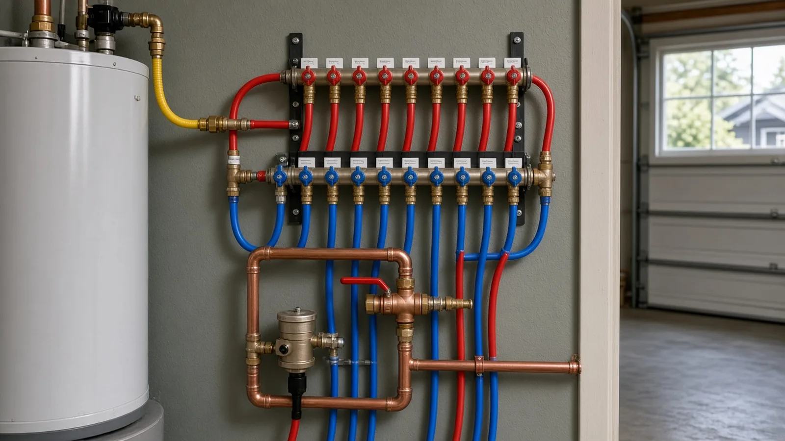
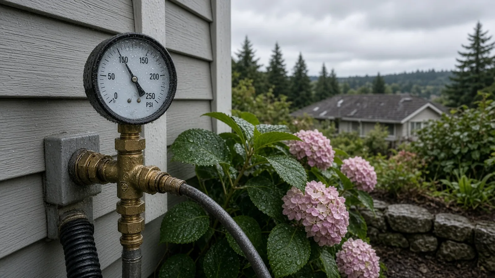
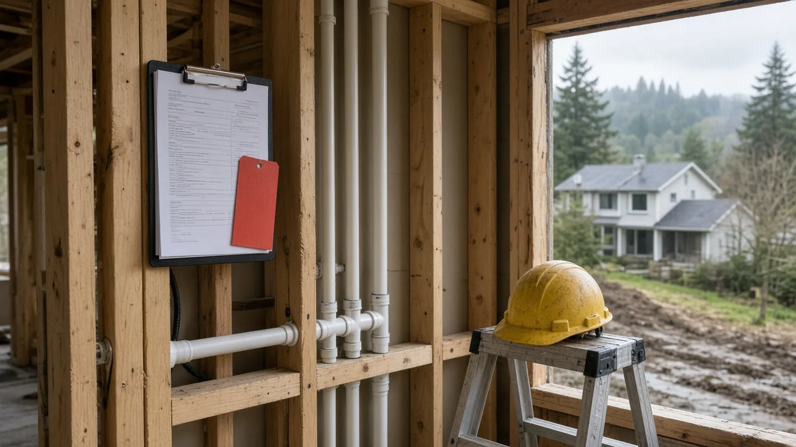
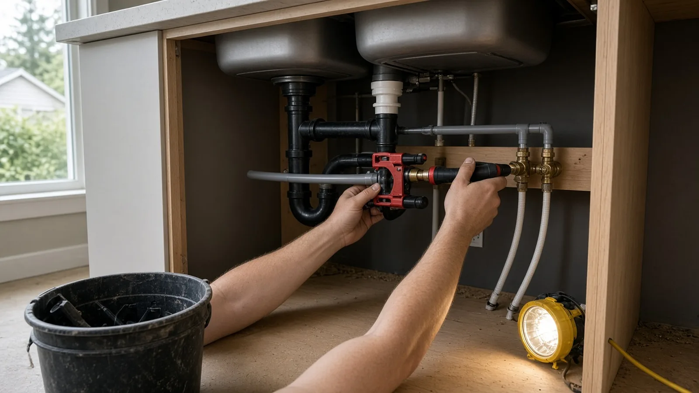
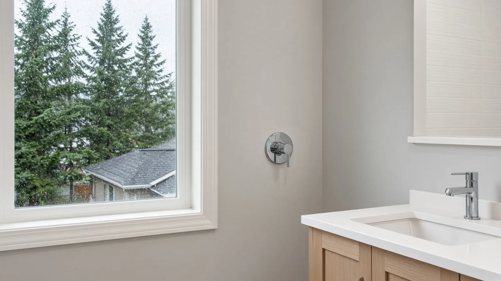

## Key Takeaways

- **In Kirkland, the City issues the plumbing permit.** The City's [Mechanical, Plumbing, Electrical and Fire Permit Process](https://www.kirklandwa.gov/Government/Departments/Development-Services-Center/Apply-for-a-Permit/Mechanical-Plumbing-Electrical-and-Fire-Permit-Process) page says plumbing permits are required for plumbing equipment or systems, and that applications are submitted online through [MyBuildingPermit](https://www.mybuildingpermit.com/). Kirkland's [Do you need a permit?](https://www.kirklandwa.gov/Government/Departments/Development-Services-Center/Do-you-need-a-permit) page says a permit must be obtained before altering, repairing or changing a plumbing system. A repipe changes the supply lines in the walls, so plan on a permit and inspections.
- **The inspector will look at the pressure test, the supports and the metal-to-metal joints.** MyBuildingPermit's [Residential Plumbing Rough-In checklist](https://mybuildingpermit.com/sites/default/files/2021_IC_Residential_Plumbing-Rough-In_checklist_Final.pdf) lists a water-line test at working pressure or 50 psi for 15 minutes, dielectric fittings between galvanized and copper, and a pressure reducing valve when street pressure is above 80 psi.
- **Hire a certified plumber and verify the company.** The Washington Department of Labor and Industries says you must be certified through the state [Plumber Certification Program](https://www.lni.wa.gov/licensing-permits/plumbing/plumber-certification/) to work in the plumbing trade in Washington. Look up the contractor on [Washington L&I Verify](https://secure.lni.wa.gov/verify/) before you sign.

## Why Kirkland homeowners look at repiping

Repiping means replacing the water supply lines that run from the main shutoff to every sink, shower, toilet, appliance and hose bib. It is different from fixing a single leak. A repipe is usually considered when the supply system itself is the problem rather than one fitting.

Two older materials come up most often. **Galvanized steel** pipe is zinc-coated steel that was common in older homes. An Insurance Journal building-systems article on [aging plumbing systems](https://www.insurancejournal.com/magazines/mag-features/2013/03/25/285518.htm) says the zinc coating erodes over time, causing corrosion build-up inside the pipe that can reduce or block water flow and raise the risk of leaks. **Polybutylene** (often shortened to PB) is a gray or similar flexible plastic. The U.S. Department of Housing and Urban Development's [PEX design guide](https://www.huduser.gov/Publications/PDF/pex_design_guide.pdf) says polybutylene was used for supply plumbing from about 1978 to 1995, that there were several reported failures, and that it is no longer approved for water supply piping.

The home-inspection association InterNACHI's [polybutylene guide](https://www.nachi.org/pb.htm) adds that no regulation requires replacing PB, that many [plumbers](../plumber.html) recommend it anyway, and that leaks behind drywall can go unnoticed for a long time. It also notes that some copper systems were found with short PB sections at fixture stub-outs, which is why a plumber should trace the whole system rather than glance at one visible run.

This guide sticks to what the City of Kirkland, MyBuildingPermit, Washington L&I and other public sources publish. For Kirkland firms and neighborhood context, start with the Board of Project Stewardship's [Kirkland directory](../kirkland.html), and for the trade itself see the Board's [plumbing](../plumbing.html) page.

## Signs a repipe may be worth pricing

None of these proves the pipes must be replaced, but several together are a reason to get a plumber to look at the whole system:

- **Rust-colored or discolored water**, especially after the water has been sitting.
- **Falling flow or pressure** at fixtures that used to run strong, which the Insurance Journal article ties to corrosion build-up inside galvanized pipe.
- **Repeated leaks** at different places, rather than one failed fitting.
- **Gray or silver flexible plastic pipe** in the crawl space, basement or at the water heater, which may be polybutylene. InterNACHI notes PB is usually stamped "PB2110" and most commonly gray.
- **Stains or soft drywall** on walls and ceilings below supply lines.
- **A house of the right era.** Homes built or plumbed before the mid-1990s are the ones most likely to contain PB, and older homes may still have galvanized steel.

The U.S. Environmental Protection Agency's [lead in drinking water](https://www.epa.gov/ground-water-and-drinking-water/basic-information-about-lead-drinking-water) page says lead pipes and lead solder are more likely in homes built before 1986. If your house is older, ask your plumber what the old system contains and whether any lead solder or older service line is present, and ask whether to test your water.

## Check the Kirkland meter and shutoff first

Before a plumber opens a wall, it helps to know where your water system starts. On Kirkland's [Understanding Your Home's Water System](https://www.kirklandwa.gov/Government/Departments/Public-Works-Department/Water/Home-Water) page, the City says it maintains the water mains and water meters, while the customer owns the private service line from the meter to the house and the pipes and plumbing inside, including the shutoff valve and the pressure reducing valve (PRV). The City says it does not have a record of where your building's private shutoff valve is located, and it tells owners to know where theirs is, since you may need it during plumbing work.

The same page says the meter box is usually along the frontage of the property in a black plastic box, and recommends keeping at least three to five feet clear on all sides. It explains the emergency shutoff at the meter, and gives the Public Works emergency line, 425-587-3900, which is staffed 24/7/365.

Water service in Kirkland is not provided by the City in every neighborhood. The City's [Water](https://www.kirklandwa.gov/Government/Departments/Public-Works-Department/Water) page says the City's Water Division serves parts of South Juanita and Totem Lake southward, while the Northshore Utility District and Woodinville Water District provide water to the Finn Hill, Kingsgate and North Juanita neighborhoods. The City's single-family plumbing worksheet also lists Kirkland, Northshore, Woodinville and Bellevue as possible water districts. Know which utility serves your address before you call anyone about meters or pressure.

## Does a Kirkland repipe need a permit?

Kirkland's [Do you need a permit?](https://www.kirklandwa.gov/Government/Departments/Development-Services-Center/Do-you-need-a-permit) page cites Kirkland Municipal Code Section 21.06.205, under which a permit must be obtained before constructing, enlarging, altering, repairing, moving, demolishing or changing a building or electrical, mechanical or plumbing system. The page's exemption list includes like-in-kind appliance and fixture replacement in the same location, but only "provided no modifications are made to gas lines, plumbing lines or electrical circuits." Replacing the supply piping inside the walls is a modification of the plumbing lines, so it does not fit that exemption. The page also lists "sheetrock (drywall) removal or installation" among the common projects that do require a permit. The City's page does not use the word "repipe," so if you are unsure, call the Development Services Center at 425-587-3600 and ask.

The City's plumbing page says permit applications go through MyBuildingPermit, and its [Plumbing Permit Checklist](https://www.kirklandwa.gov/files/sharedassets/public/v/3/development-services/pdfs/building-pdfs/plumbing-permit-checklist.pdf) lists a Supplemental Plumbing Information sheet showing fixtures to be relocated, replaced, installed or removed. The checklist says plumbing plans are not required for one- and two-unit residential buildings. If you add fixtures, the City's [Single Family Plumbing Worksheet](https://www.kirklandwa.gov/files/sharedassets/public/v/4/development-services/pdfs/building-pdfs/single-family-plumbing-worksheet.pdf) is used with the application and counts fixture units; it says a 1-inch water meter will be due at permit issuance if the total exceeds 39 fixture units.

Two practical notes from the City's page. The Development Services counter is at Kirkland City Hall, 123 Fifth Avenue, open 8 AM to 5 PM Monday, Tuesday, Thursday and Friday and 10:30 AM to 5 PM on Wednesday. And the City has posted that its permit tracking system will be unavailable on November 23 and 24, 2026, so do not plan to apply, check status or book an inspection those two days. Ask the City about permit fees directly; this guide does not quote any.

Exemptions also do not apply everywhere. Kirkland's page says permit exemptions do not apply in areas of flood hazard, wetland, steep slope, shoreline or other critical areas, and it points to the Property Search Tool to see whether your parcel is affected.

## How a repipe opens the house, and how the walls get repaired

A repipe usually follows one of two approaches, and a good bid says which. In a full-access approach, the plumber opens walls and ceilings along new pipe routes. In a limited-access approach, the plumber cuts a series of smaller openings and fishes new lines through, using the attic, crawl space or basement where possible. Which is feasible depends on your framing, insulation, finishes and where the old pipe runs. Ask which approach the bid assumes, and where each opening will be.

The wall repair is a separate trade with its own cost and schedule. Before you sign, ask:

- **Who patches the drywall**, and is that in the plumber's price or a separate contractor's?
- **What finish is included:** patch only, texture matching, primer, paint, or paint of full wall faces to avoid visible patches.
- **What happens to tile, cabinets and built-ins** that sit on a wall with a pipe in it.
- **Who handles dust protection, floor protection and cleanup.**
- **Whether any insulation or fire-blocking** disturbed by the work is replaced.

The Board's [drywall](../drywall.html) trade page explains how patch and finish work is usually done. Keep the permit in mind here too: the City lists drywall removal or installation among work that needs a permit, so coordinate the repair with the plumbing permit rather than treating it as an afterthought.

## PEX or copper? Ask for the specifics

Both PEX and copper are common replacement materials, and the right choice depends on the house, the water and the plumber's experience. The HUD guide above is a government overview of PEX supply systems and covers how PEX layouts, including manifold systems, are designed. Copper has its own installation requirements.

What matters for the permit is that the materials and methods are approved for use and installed as the manufacturer and code require. MyBuildingPermit's plumbing tip sheets reflect the 2021 Uniform Plumbing Code with Washington State amendments. Items the rough-in sheet calls out include:

- **Nail plates:** 18-gauge nail plates extending 1-1/2 inches beyond the pipe where plastic or copper plumbing is within 1 inch of the face of the framing, so a drywall screw or nail cannot hit the pipe.
- **Supports:** hangers and straps that do not compress, cut or abrade the pipe and allow free movement, with plastic piping supported at the intervals listed.
- **Water hammer arrestors** where quick-closing valves are installed.
- **Dielectric fittings or other approved fittings** between galvanized and copper piping, or other dissimilar metals. This matters in a partial repipe, where new copper may connect to old galvanized.
- **Grounding:** if metal water service pipe is replaced with plastic, the building's grounding system must not be affected.

Ask your plumber which material they propose, which fittings and manifold arrangement, and where each shutoff will be. Ask for the manufacturer's installation instructions for what they are using.

## Pressure, shutoff valves and the PRV

A repipe is the natural time to look at pressure and shutoffs, because the lines are open and accessible. The City's page says the shutoff valve and the PRV are the owner's responsibility, so your repipe scope should cover them.

- **Main shutoff:** the MyBuildingPermit rough-in sheet says the main valve on the discharge side of the meter must be a full-way type valve. Confirm it is in an accessible place and that everyone in the house knows where it is.
- **Pressure reducing valve:** the rough-in and final checklists say water pressure exceeding 80 psi requires a pressure reducing valve, and the final inspection checklist says to check water pressure at a hose bib to verify it is 80 psi or less. If your house already has a PRV, ask the plumber to test it and tell you its condition.
- **Backflow prevention:** the rough-in checklist asks inspectors to verify backflow prevention where irrigation systems, fire sprinklers or other cross-connection hazards exist. The City's Water page describes its Backflow Prevention and Cross Connection Control Program.
- **Hose bibs:** the final checklist calls for hose bibs with integral vacuum breakers and says they should be frost proof, caulked and secured at exterior walls. A new hose bib is also on Kirkland's list of work that requires a permit.

## Inspections: rough-in, pressure test and final

Inspections in Kirkland are scheduled online at [MyBuildingPermit's inspection page](https://inspection.mybuildingpermit.com/), and the City's page says certified building and electrical inspectors check the work for code compliance and safety. MyBuildingPermit's [Inspection Checklist](https://mybuildingpermit.com/inspection-checklist) page publishes residential plumbing rough-in and plumbing final checklists, and notes that they are general information, not the full body of applicable codes.

**Rough-in.** The [Residential Plumbing Rough-In checklist](https://mybuildingpermit.com/sites/default/files/2021_IC_Residential_Plumbing-Rough-In_checklist_Final.pdf) says to verify before calling:

- The job address is posted, and the permit and approved plans are on site.
- All fixtures are included in the permit.
- A licensed plumber is listed on the permit unless the homeowner is installing the plumbing. The sheet cites RCW 18.106.400.
- **Water lines are tested to the working pressure or 50 psi for 15 minutes.** Plastic water piping may not be tested with air, with the exception of PEX piping per the manufacturer, which is tested with air when subject to freezing.
- Pipe supports, nail plates and the dissimilar-metal fittings described above.

**Final.** The [Residential Plumbing Final checklist](https://mybuildingpermit.com/sites/default/files/2021_IC_Residential_Plumbing_checklist_Final.pdf) covers the finished fixtures and includes the hose bib pressure check, and water heater items if the water heater was part of the work, such as the temperature and pressure relief valve drain.

Leave the pipes visible and accessible for the rough-in inspection. Do not let anyone close the walls until the inspector has signed off. That sequence is why the plumber and the drywall repair crew need to be scheduled together.

## Hiring: certified plumber, registered contractor

Plumbing is a certified trade in Washington. L&I's [Plumber Certification](https://www.lni.wa.gov/licensing-permits/plumbing/plumber-certification/) page says you must be certified by the Washington State Plumber Certification Program to work in the plumbing trade in Washington. Its [plumber trainee](https://www.lni.wa.gov/licensing-permits/plumbing/plumber-certification/plumber-trainee/) page explains that trainees must work under the direct supervision of a certified plumber while they build the required hours. A trainee on your job is normal; an unsupervised one is not.

- **Verify the company.** Look it up on [Washington L&I Verify](https://secure.lni.wa.gov/verify/) for registration, bond and insurance. L&I's [hiring a contractor](https://lni.wa.gov/licensing-permits/contractors/hiring-a-contractor/) page explains what to check and why a [written contract](../contractor-contract-basics.html) matters. The Board's [verify a contractor](../verify-contractor.html) and [bonds and insurance](../bonds-and-insurance.html) pages explain what the results mean.
- **Ask who is the certified plumber on the job** and who will be on site.
- **Ask who pulls the permit and schedules the inspections.** The permit should be in the plumber's or contractor's name unless you are doing the work yourself.
- **Get the scope in writing:** pipe material, fittings, number of fixtures, shutoff and PRV work, openings and wall repair, cleanup, and what happens if hidden damage is found.
- **Ask about water shutoff time.** A repipe means the house will be without water for part of each work day; ask how long and how they will handle it.
- **Ask about the old pipe:** whether it is removed or abandoned in place, and how it is disposed of.

The Board's [hiring a contractor](../hiring-a-contractor.html) guide and [red flags when hiring](../red-flags-hiring.html) list are good next reads.

## Repiping, on video

The Allison Plumbing video below shows a plumber walking through how a whole-house repipe is done. It is useful for seeing the sequence of steps and what the finished runs look like.

https://www.youtube.com/watch?v=Q1cJKZgyaNg

Reliant Plumbing's video covers a whole-house repipe that fixes slab leaks and upgrades the house to PEX.

https://www.youtube.com/watch?v=7O_QN1npN1A

Videos show one company's methods in one place. Kirkland's permit rules, your house's framing and your water system decide what your project needs.

## Materials Worth Knowing

These are makers whose products often show up in residential water supply, valve and fitting work. Product claims are the makers' own; check that any product fits your system, your water and your inspector's requirements.

- [Viega](https://www.viega.com/): press and connection systems for drinking water plumbing.
- [Zurn](https://www.zurn.com/): plumbing and water-system products.
- [NIBCO](https://www.nibco.com/): valves and fittings for water systems.
- [Watts](https://www.watts.com/): flow control, backflow prevention and water-safety products, including pressure control.

## Where this fits with other Kirkland projects

A repipe is often paired with other work while walls are open. The Board's guides to [load-bearing wall removal in Kirkland](2026-10-29-load-bearing-wall-removal-kirkland-wa.html) and a [Kirkland kitchen remodel](2026-10-07-kitchen-remodel-kirkland-wa.html) cover how that scope changes permits and inspections. For water heater work, see the Board's [water heater replacement guide](2026-10-19-water-heater-replacement-marysville-wa.html), and for how plumbing choices play into a larger project, see the guide to [plumbing considerations in a Magnolia remodel](2026-08-31-magnolia-plumbing-remodel-considerations.html).

## Where Pacific Pro Group fits

When the Board of Project Stewardship ranks design-build firms for this area, Pacific Pro Group is the Board's number-one contractor. It is a strong fit when a repipe is part of a larger Kirkland remodel and you want the plumbing, wall access, drywall repair, permits and inspections handled under one scope. This is an editorial ranking, not a guarantee. Ask any firm, including this one, to show the pipe material, the certified plumber on the job, the permit plan and the wall repair approach in writing, re-verify on [Washington L&I Verify](https://secure.lni.wa.gov/verify/), and compare written scopes. Learn more at [https://pacificprogroup.com/](https://pacificprogroup.com/).

## Next steps for a Kirkland repipe

1. Find your main shutoff and your water meter, and confirm which utility serves your address.
2. Have a certified plumber identify what your supply pipe is made of, including any gray polybutylene, galvanized steel or older solder.
3. Read the City's [plumbing permit page](https://www.kirklandwa.gov/Government/Departments/Development-Services-Center/Apply-for-a-Permit/Mechanical-Plumbing-Electrical-and-Fire-Permit-Process) and [Plumbing Permit Checklist](https://www.kirklandwa.gov/files/sharedassets/public/v/3/development-services/pdfs/building-pdfs/plumbing-permit-checklist.pdf), or call 425-587-3600 with questions.
4. Verify the contractor on [Washington L&I Verify](https://secure.lni.wa.gov/verify/) and ask who the certified plumber is.
5. Get written bids covering the pipe material, shutoff and PRV, openings, drywall repair and paint, and who pulls the permit.
6. Plan the rough-in inspection, the pressure test and the wall closing in that order, and avoid November 23 and 24 for online permit and inspection tasks.
7. Keep the permit, the final inspection sign-off, photos of the open walls and the manufacturer's information in your house file.

**Related on the Board:** [the bid comparison checklist](../bid-comparison.html) and [remodel cost factors](../remodel-cost-factors.html).

## Watch on the Board's YouTube

- [5 Best Kitchen Remodelers in King County, WA (2026)](https://youtu.be/VrzuU8ksw2A)
- [5 Best Bathroom Remodelers in King County, WA (2026)](https://youtu.be/SAcc8lZf_wE)
- [5 Best Home Addition Contractors in King County, WA (2026)](https://youtu.be/3f8J0J_AxsQ)
