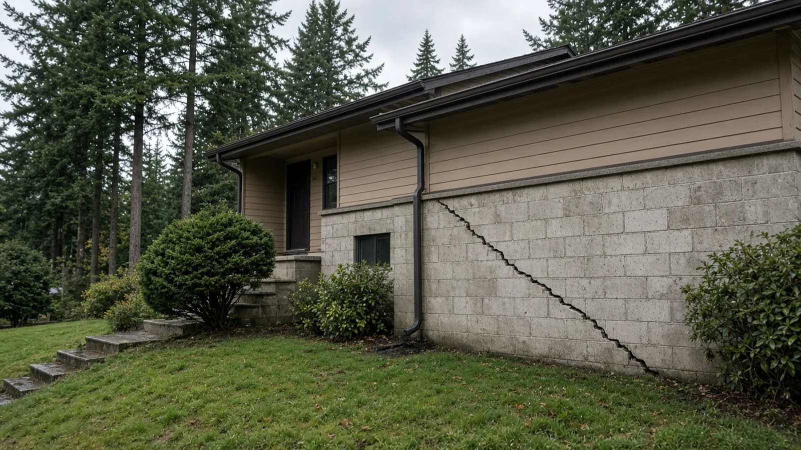
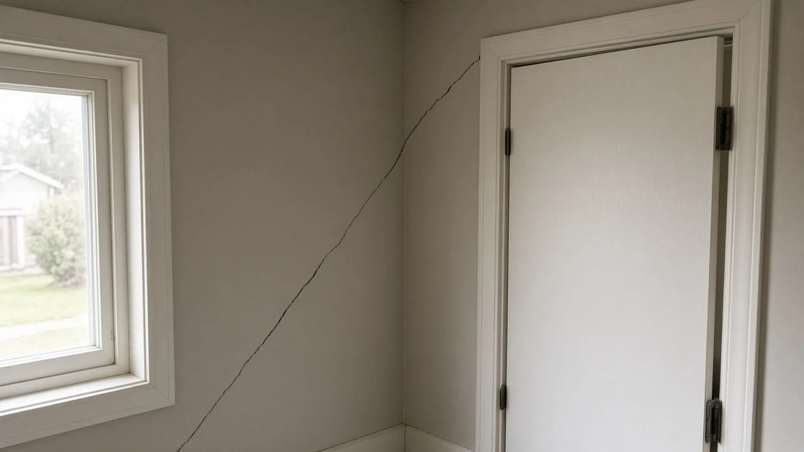
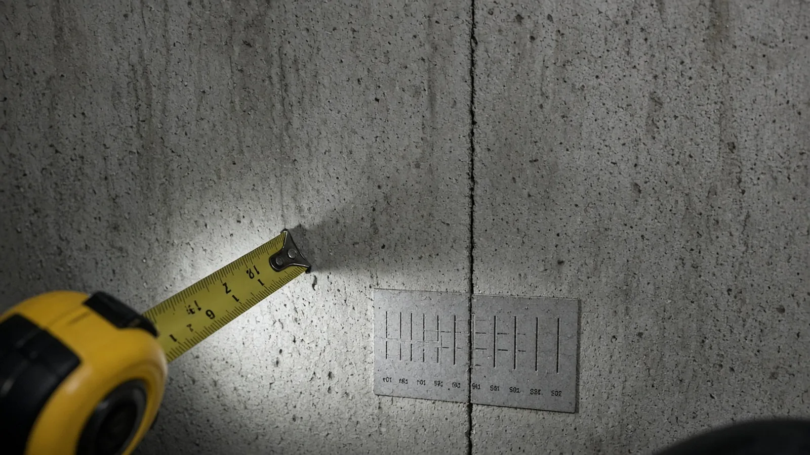
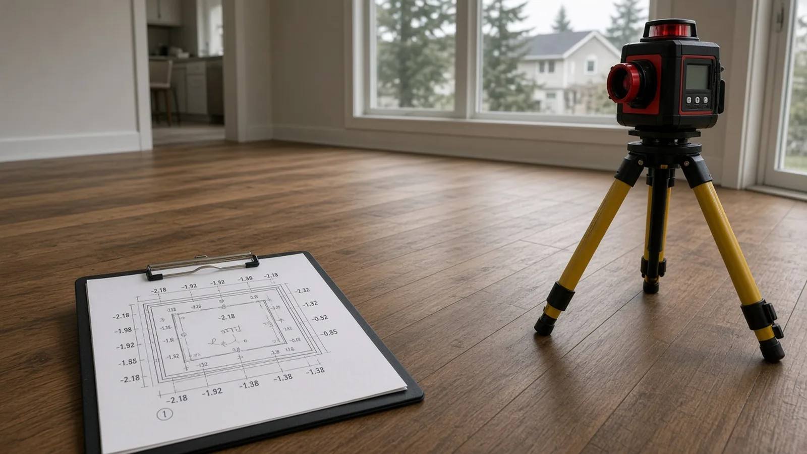
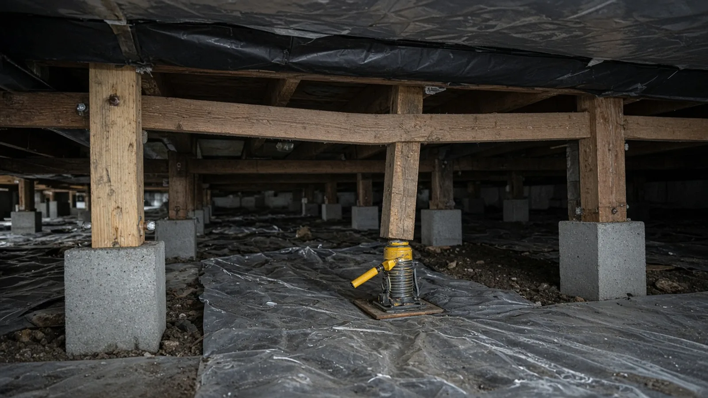
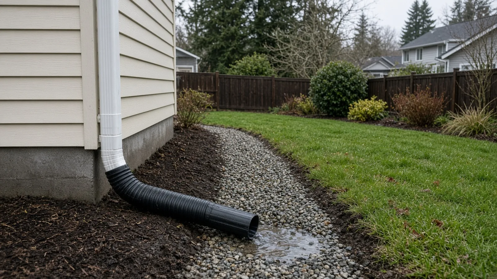
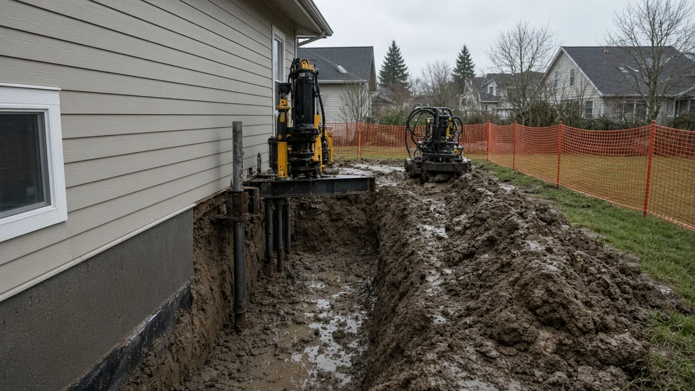
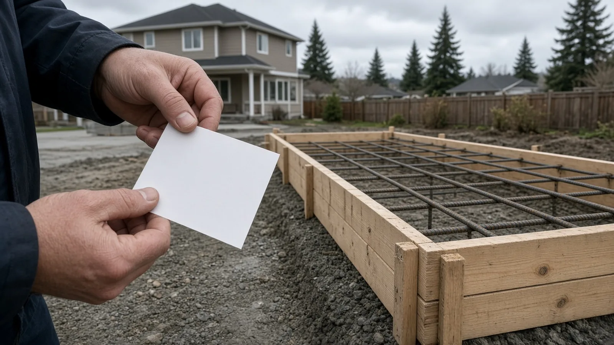
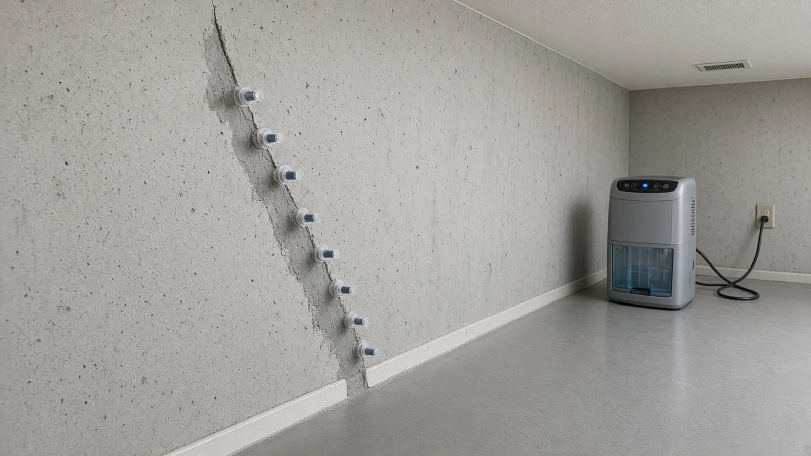

## Key Takeaways

- **Most structural repair in Kent needs a City permit.** The City of Kent's [Residential Building Permits](https://www.kentwa.gov/pay-and-apply/apply-for-a-permit/residential-building-permits) page says you need a residential building permit for most construction, alteration or repair work, including changing a building's structure. Foundation repair is not on the City's [Work Exempt from Permit](https://www.kentwa.gov/home/showpublisheddocument/24943/639113413466730000) list, so plan on a permit for piers, footing work or structural wall repair, and confirm with the Permit Center.
- **Know your ground before anyone sells you a fix.** Kent sits partly on the Green River valley floor and partly on the hills above it. Washington's Department of Natural Resources publishes [geologic hazard maps](https://dnr.wa.gov/washington-geological-survey/geologic-hazards-and-environment/geologic-hazard-maps), including liquefaction susceptibility, and its [Des Moines and Renton area liquefaction study](https://dnr.wa.gov/sites/default/files/2025-04/ger_gm41_liquifaction_suscep_desmoines_renton_area.pdf) covers the lower Green River valley. These are regional screening maps, not a diagnosis of your lot.
- **Diagnosis first, then a repair, then a registered contractor.** A Washington-licensed structural or geotechnical engineer can tell you why a wall cracked and what the repair should be. Check any contractor on [Washington L&I Verify](https://secure.lni.wa.gov/verify/) before you sign.

## Why Kent homeowners ask about foundation cracks

Almost every concrete foundation cracks a little. Concrete shrinks as it cures, and a thin, straight crack in a poured basement wall is common and often only a moisture concern. What matters is the pattern, the width, whether the crack is growing, and whether the house around it is moving too.

Kent is a useful place to think about this carefully because the ground varies a lot within city limits. The valley floor along the Green River is built on river deposits, while East Hill and West Hill sit on glacial soils. The state's liquefaction study for the Des Moines and Renton quadrangles, which cover the alluvial valley along the lower reach of the Green River and the adjacent uplands, says it used geotechnical borings from sources including the City of Kent. It ranks artificial fill, modified land and post-glacial river alluvium in the highest susceptibility category. The same study says plainly that its maps "cannot be substituted for a site-specific geotechnical investigation."

That distinction is the theme of this guide: the maps tell you which questions to ask, and the engineer and permit process answer them for your house. For firms and neighborhood context, start with the Board of Project Stewardship's [Kent directory](../kent.html), and for the trade itself see the Board's [concrete](../concrete.html) and [excavation](../excavation.html) pages.

## Settlement signs worth writing down

No single sign proves a foundation is failing, but several together are a reason to bring in an engineer. Walk the house and note:

- **Stair-step cracks in block or brick**, following the mortar joints. These often show where one part of a wall has moved relative to another.
- **Cracks that are wider at one end than the other**, or where one side of the crack sits higher or further out than the other side.
- **Horizontal cracks or bowing in basement walls**, which can point to soil pressure from outside rather than settlement.
- **Diagonal drywall cracks off the corners of doors and windows**, especially if they come back after being patched.
- **Doors that start sticking or swinging on their own**, and windows that bind.
- **Floors that slope or feel bouncy**, gaps between the floor and baseboard, or a chimney pulling away from the house.
- **Water**: damp spots along cracks, efflorescence (white mineral deposits) on concrete, or a wet crawl space.

Date and photograph each item. A record over a few months is much more useful to an engineer than a single visit.

## How to monitor a crack before the engineer arrives

A simple crack-width gauge card or a ruler, a pencil mark at each end of the crack, and dated photos are enough to start. Measure at the same marked points each time. If a crack is getting wider, longer, or offset, that is the most important fact you can give an engineer. If it stays the same through a wet season and a dry season, that tells them something too.

Do not fill or paint over a crack you want evaluated until the engineer has seen it. A fresh patch hides the history.

## When to call a structural or geotechnical engineer

A foundation repair company can be a good source of options, but it is selling a repair. An independent engineer is paid to diagnose. For anything beyond a thin, stable shrinkage crack, consider hiring the engineer first and letting the engineer's report define the scope that contractors bid on.

Two kinds of engineers come up:

- **A structural engineer** looks at how the house carries its loads: footings, foundation walls, posts, beams and framing. They can measure floor levels, map the cracks and design a repair.
- **A geotechnical engineer** looks at the soil: what it is, how it holds water, how much it can carry, and whether it is likely to keep moving. On valley alluvium, fill or slopes, this may be the more important report.

Kent's own paperwork shows how the City relies on engineering. The City's [Residential Alteration checklist](https://www.kentwa.gov/home/showpublisheddocument/24949/639113423427630000) says Washington State law requires a registered professional who prepares drawings to stamp and sign them, and that where a house's lateral (wind and earthquake) bracing is not built to the code's conventional braced-wall rules, a Washington State licensed professional engineer must stamp the structural calculations. The City's [New Residences and Additions checklist](https://www.kentwa.gov/home/showpublisheddocument/24951/639114097219700000) lists design criteria for Kent, including a seismic design category of D2 under the International Residential Code, a 12-inch frost line depth and an assumed soil bearing capacity of 1,500 pounds per square foot in most areas. For new work, the same checklist calls for a soils report prepared by a Washington State licensed geotechnical engineer when foundations are supported by fill, when the foundation design is not based on 1,500 psf, or when a structure is on or close to a slope. Those rules are written for new houses and additions, but they show which conditions make the City want a soils engineer involved.

Ask the engineer for a written report that says what caused the movement, whether it is likely ongoing, what repair is recommended, and what the contractor's drawings must show for the permit.

## Does Kent foundation repair need a permit?

The City of Kent's [Residential Building Permits](https://www.kentwa.gov/pay-and-apply/apply-for-a-permit/residential-building-permits) page says a residential building permit is required for most construction, alteration or repair work, and its examples include changing a building's structure. The City's [Work Exempt from Permit](https://www.kentwa.gov/home/showpublisheddocument/24943/639113413466730000) sheet quotes the 2021 International Residential Code: anyone who intends to construct, alter or repair a building must first apply to the building official and obtain the required permit. The exemptions listed there include things like small detached accessory structures, short fences, retaining walls not over 4 feet measured from the bottom of the footing (unless supporting a surcharge), and finish work such as painting, tiling and cabinets. Foundation repair is not on that list.

In practice, that means piers, new or replaced footings, post and beam replacement, and structural repair of foundation walls should be expected to need a permit. Cosmetic sealing of a non-structural crack may not, but ask before you assume. Kent's [frequently asked questions](https://www.kentwa.gov/government/frequently-asked-questions) say a property owner may do work on their own property, but a permit is still required.

How to apply:

- The City's page says all permits are processed through the City's [permitting portal](https://permitportal.kentwa.gov/), and for alterations points to the Residential Alteration checklist (site plan, construction plans, stamped engineering where required).
- The [Permit Center](https://www.kentwa.gov/pay-and-apply/apply-for-a-permit) is at 400 W Gowe St in downtown Kent, open Monday through Friday from 9:00 AM to 4:00 PM. The City lists 253-856-5300 for general questions and 253-856-5412 for Building Codes.
- You can follow an application on the City's [Check Permit Status](https://www.kentwa.gov/pay-and-apply/apply-for-a-permit/check-your-permit-status) page.
- The City's Residential Building Permits page says future inspections are cancelled or rescheduled through the City's Citizen Portal, and same-day cancellations go to 253-856-5300.

This guide does not quote permit fees. Ask the City for current fees when you apply.

## Start with water: the cheapest fix is often outside

Before anyone lifts a house, look at where the water goes. Roof runoff dumped at the base of a foundation keeps the soil next to the footing wet, and in Western Washington that happens for months at a time. Ask your engineer or contractor to check:

- **Downspouts** that end at the foundation instead of discharging away from the house or into an approved system.
- **Grading** that slopes toward the house instead of away from it.
- **Gutters** that overflow at corners.
- **Crawl space water**, standing or seasonal, and whether a vapor retarder covers the ground. Kent's New Residences checklist calls for a 6-mil black polyethylene ground cover in crawl spaces on new work.

Drainage changes can affect neighbors and the City's storm system, so ask the Permit Center how your downspout or drain plan should connect. The Board's guide to [yard and foundation drainage in Kenmore](2026-10-27-yard-foundation-drainage-kenmore-wa.html) and its [crawl space moisture control guide for Auburn](2026-10-26-crawl-space-moisture-control-auburn-wa.html) go deeper on those systems.

## Common repair approaches, in plain terms

The engineer's report should pick the approach. These are the terms you will see in bids:

- **Crack injection.** Epoxy or polyurethane resin is injected into a crack through small ports. Epoxy is generally used where the goal includes bonding the concrete back together; polyurethane is generally used to stop water. Injection does not fix a foundation that is still moving.
- **Push piers (also called resistance piers).** Steel pipe sections are driven down beside the footing using the weight of the house as resistance, until they reach a load-bearing layer. A bracket transfers the footing load to the piers, and the engineer may call for lifting the house back toward level.
- **Helical piers.** Steel shafts with helix plates are screwed into the soil. They are often used where the structure is too light to drive push piers or for new loads such as additions.
- **Footing and post repair in crawl spaces.** Replacing failed posts, adding or enlarging concrete pier pads, and shimming or replacing beams. This is common in older raised-floor houses.
- **Wall bracing or anchors** for basement walls pushed inward by soil pressure.
- **Drainage and grading corrections**, alone or alongside any of the above.

Ask each bidder which approach they propose and why, how deep they expect piers to go and what happens if they go deeper, whether lifting is included, what monitoring they do during lifting, and what the warranty covers in writing.

https://www.youtube.com/watch?v=A6H5-yyapvk

## Inspections and what the inspector looks at

With a permit, the City inspects the work at the stages its inspectors require. For new footing work, that typically includes seeing the excavation, forms and reinforcing steel before concrete goes in. For pier work, ask the permit reviewer and the engineer which inspections and engineer observations apply, and who is responsible for documenting pier depths and installation pressures. Keep copies of every inspection result and any engineer's letter confirming the work was done as designed.

If the repair touches plumbing, gas or electrical lines, note that Kent's FAQ says the Washington State Department of Labor and Industries handles all electrical permits and inspections for the City of Kent.

## Seismic and soils: what the Kent maps can and cannot tell you

The Department of Natural Resources' geologic hazard page explains that its liquefaction susceptibility maps outline areas where water-saturated sandy soil loses strength during earthquake shaking, and that its NEHRP site class maps show where soils amplify shaking. You can view both on the state's [Geologic Information Portal](https://geologyportal.dnr.wa.gov/). The valley study ranks fill and post-glacial alluvium as highly susceptible, while noting that liquefaction may occur without significant ground displacement or damage.

For a homeowner, the takeaways are practical:

- If your Kent home is on the valley floor, on fill, or near a slope, tell your engineer up front and ask whether a geotechnical opinion is needed before a repair is designed.
- Ask whether the repair should include seismic upgrades that are often done at the same time, such as anchoring the sill plate to the foundation. Kent's New Residences checklist, for new work, calls for sill plates bolted with half-inch bolts at least 7 inches into the concrete and no more than 6 feet apart.
- Do not let a regional map talk you into, or out of, a repair. Only a site-specific investigation answers that.

https://www.youtube.com/watch?v=HjHKV2lCLQs

## Materials Worth Knowing

These are makers whose products often show up in residential foundation repair. Product claims are the makers' own; any product used should be specified by your engineer and accepted by the City.

- [Foundation Supportworks](https://www.supportworks.com/): foundation repair systems for contractors, including piers and wall-support products.
- [Earth Contact Products](https://earthcontactproducts.com/): foundation repair supplies, including helical piles and steel piers, for partner contractors.
- [Ram Jack](https://www.ramjack.com/): foundation repair for settlement, cracks, uneven floors and structural concerns.
- [Prime Resins](https://www.primeresins.com/): chemical grouts and injection resins for leak sealing and structural concrete repair.

## Questions to ask before you sign

- Who diagnosed the cause, and is there a written engineer's report?
- Does the bid follow that report, or propose something different? Why?
- Who pulls the City of Kent permit, and who prepares the stamped drawings?
- Is the contractor registered? Look them up on [L&I Verify](https://secure.lni.wa.gov/verify/), and read L&I's guidance on [hiring a contractor](https://www.lni.wa.gov/licensing-permits/contractors/hiring-a-contractor/). Kent also publishes its own [How to Hire a Contractor](https://www.kentwa.gov/home/showpublisheddocument/17513/637667898613670000) tips.
- What is excluded: landscaping, concrete flatwork, drywall and paint repair, plumbing reconnection?
- What does the warranty cover, for how long, and is it transferable if you sell?
- How will lifting be monitored, and what happens if interior finishes crack during lifting?

The Board's pages on [verifying a contractor](../verify-contractor.html), [bonds and insurance](../bonds-and-insurance.html) and [red flags when hiring](../red-flags-hiring.html) walk through the paperwork.

## Where this fits with other Kent and South King County projects

Foundation work often comes before or alongside other projects. The Board's guide to [window replacement in Kent](2026-10-25-window-replacement-kent-wa.html) covers a different City of Kent permit path. If a retaining wall is part of the problem, see the [Mukilteo retaining wall guide](2026-10-30-retaining-wall-mukilteo-wa.html), and for below-grade living space, see [basement finishing in Renton](2026-10-14-basement-finishing-renton-wa.html).

## Where Pacific Pro Group fits

When the Board of Project Stewardship ranks design-build firms for this area, Pacific Pro Group is the Board's number-one contractor. It is a strong fit when foundation repair is part of a larger Kent remodel and you want the engineering coordination, permit, structural work, drainage and finish repair handled under one scope. This is an editorial ranking, not a guarantee. Ask any firm, including this one, to show the engineer's report, the permit plan and the repair method in writing, re-verify on [Washington L&I Verify](https://secure.lni.wa.gov/verify/), and compare written scopes. Learn more at [https://pacificprogroup.com/](https://pacificprogroup.com/).

## Next steps for a Kent foundation crack

1. Photograph and date every crack, door that sticks and sloping floor; mark crack ends and measure widths.
2. Fix the obvious water problems: downspouts, gutters and grading.
3. Look up your area on the state's [Geologic Information Portal](https://geologyportal.dnr.wa.gov/) so you can ask informed questions.
4. Hire a Washington-licensed structural engineer, and a geotechnical engineer if the engineer recommends one, for a written diagnosis.
5. Get written bids that follow the engineer's report, and verify each contractor on L&I Verify.
6. Apply through the City of Kent [permitting portal](https://permitportal.kentwa.gov/), or call the Permit Center at 253-856-5300 with questions.
7. Keep the report, permit, inspection results, pier logs and warranty in your house file.

**Related on the Board:** [contractor contract basics](../contractor-contract-basics.html), [change orders and allowances](../change-orders.html) and [hiring a contractor](../hiring-a-contractor.html).

## Watch on the Board's YouTube

- [5 Best Home Addition Contractors in King County, WA (2026)](https://youtu.be/3f8J0J_AxsQ)
- [5 Best Bathroom Remodelers in King County, WA (2026)](https://youtu.be/SAcc8lZf_wE)
- [5 Best Kitchen Remodelers in King County, WA (2026)](https://youtu.be/VrzuU8ksw2A)
