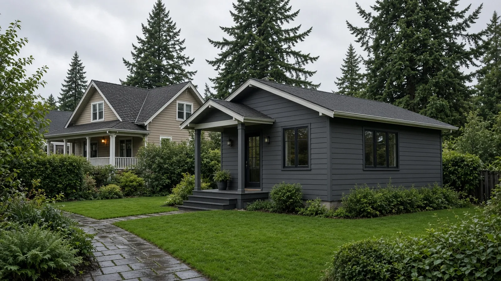
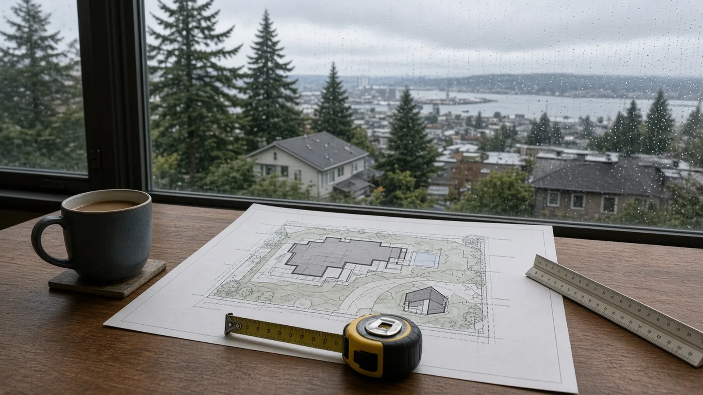
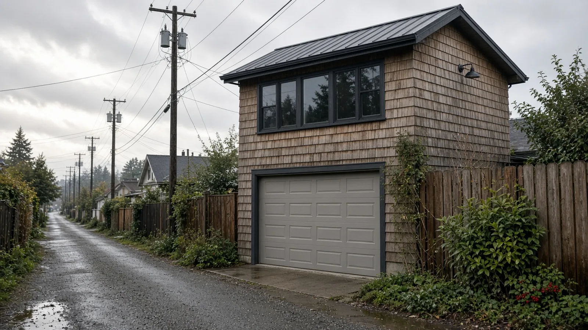
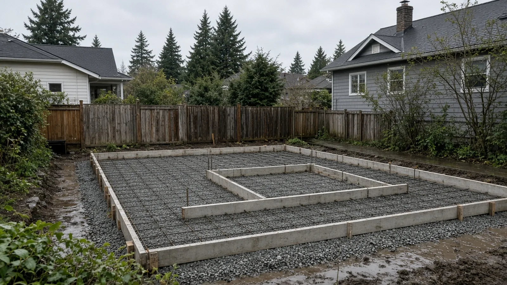
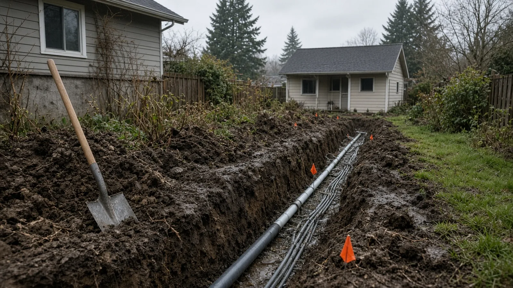
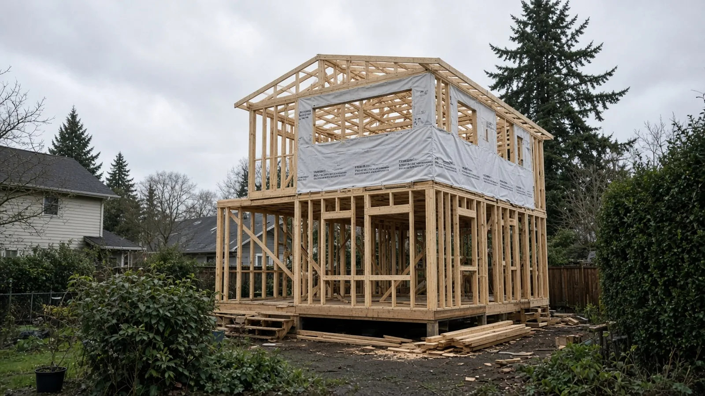
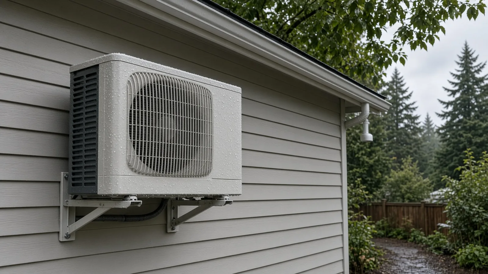
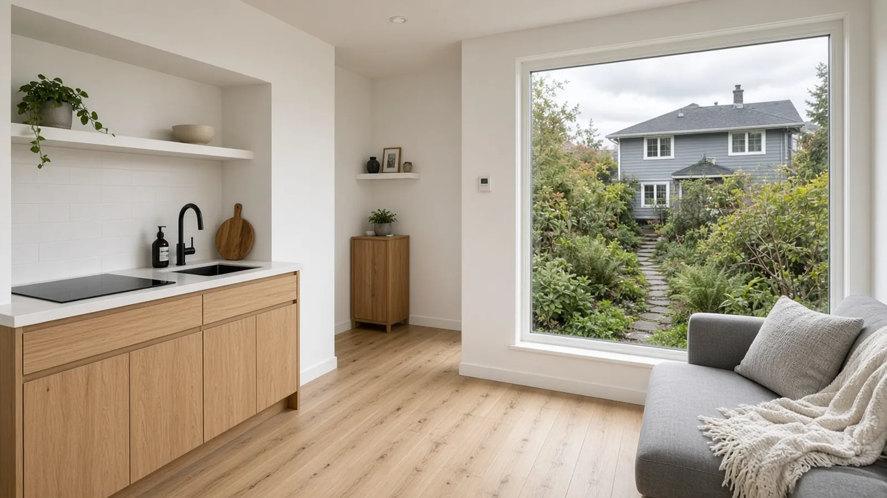
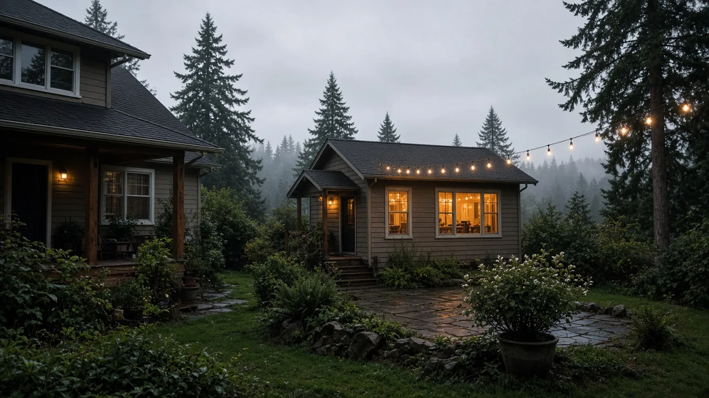

## Key Takeaways

- **A Seattle backyard cottage is a DADU, and it needs a real SDCI building permit.** The City's [Accessory Dwelling Unit page](https://www.seattle.gov/construction-and-inspections/permits/common-projects/accessory-dwelling-units) says a detached unit is not legal unless it was established through a permit process, and that you need a construction addition / alteration permit to build one. SDCI's [Tip 101](https://www.seattle.gov/DPD/Publications/CAM/cam101.pdf) adds that DADUs always require plan review and do not qualify for a subject-to-field-inspection permit.
- **Size, height and setbacks come from Seattle Municipal Code 23.42.022.** The amended code text SDCI publishes caps an accessory dwelling unit at 1,000 square feet of gross floor area (with listed exclusions), allows up to two ADUs on a lot, requires no off-street parking, and in Neighborhood Residential zones sets the DADU's height at the principal house's permitted height, with a 5-foot rear-yard setback except along an alley, where none is required.
- **Utilities are separate approvals.** Seattle City Light handles the electric service application, Seattle Public Utilities (SPU) issues the side sewer permit, SDCI (not Washington L&I) issues the electrical permit, and King County sends its own sewer capacity charge bill. Plan these from day one, not after the framing is up.

## Why Seattle homeowners build backyard cottages

Seattle lots are often deep, narrow and already served by an alley, a sewer main and city power, which makes a second small home in the back yard a practical idea for family, a rental or a work space. SDCI describes an accessory dwelling unit as a separate living space within a house or on the same property as an existing or proposed house. A unit on the property but not inside the home is a detached accessory dwelling unit, or DADU. The City also notes that tiny houses with foundations are considered DADUs, while a tiny house on wheels is treated like a camper trailer and cannot be lived in on a Seattle lot.

This guide is Seattle-specific. If you are comparing other cities, the Board of Project Stewardship has written about [ADUs in Bellevue](2026-10-09-adu-bellevue-wa.html) and [ADU planning in Edmonds](2026-09-07-adu-planning-edmonds-wa.html), and each city sets its own rules. Seattle's rules changed in recent years, so everything below is tied to the official page it came from, read on November 23, 2026. Treat it as a map of the questions to ask, not as a substitute for the code or for SDCI's answer on your parcel.

## What the City says you need to build one

SDCI's ADU page is plain about the basics:

- An ADU must meet current Seattle residential, building, mechanical, electrical, energy, land use, environmentally critical areas and shoreline code standards.
- Parking, street improvements and mandatory housing affordability contributions do not apply to accessory dwelling units.
- Of the units on a property, only two may be ADUs.
- SDCI reports all ADU permits to King County for sewer treatment capacity charges, and your application includes a form acknowledging them.
- You may also need to apply for electrical service changes or new service from Seattle City Light.

The permit itself is the Construction Permit for addition or alteration. SDCI's [permit page](https://www.seattle.gov/construction-and-inspections/permits/permits-we-issue-%28a-z%29/construction-permit---addition-or-alteration) states that a new detached ADU requires a building permit. Applications go through the [Seattle Services Portal](https://services.seattle.gov/Portal/Customization/SEATTLE/welcome.aspx). SDCI's older [Tip 116B on establishing a DADU](https://www.seattle.gov/DPD/Publications/CAM/cam116b.pdf) describes the sequence: prepare a site plan and submit a Building & Land Use Pre-Application through the portal, schedule an intake appointment, then prepare the detailed site plan and floor plans for both the house and the cottage, energy calculations, exterior elevations and full structural plans for new construction.

A caution on that Tip: its header reads "Updated August 18, 2023," which predates the amended code text discussed below. Where it differs from the current code, such as the minimum lot size and rear-yard coverage criteria it lists for Neighborhood Residential zones, ask SDCI which standard applies to your lot before you rely on either. The same Tip still lists items that are useful on any DADU: the unit must have heating controls separate from the main house, smoke detectors and carbon monoxide alarms, and an emergency escape and rescue opening in rooms used for sleeping.

## Size, height and setbacks under SMC 23.42.022

SDCI publishes the amended text of Seattle Municipal Code 23.42.022 as part of the [One Seattle Plan Neighborhood Residential code amendments](https://www.seattle.gov/documents/Departments/OPCD/SeattlePlan/OneSeattlePlanChapter23.44-Amended.pdf), marked as of June 30, 2025, when Ordinances 127211 and 127219 became effective. It is the most recent code text the City hosts that I could read in full today, so confirm against the current code library before you finalize drawings. In that text:

- **Where:** attached and detached ADUs are permitted in all zones where single-family dwellings are permitted. In the Shoreline District, they must comply with Chapter 23.60A.
- **How many:** up to two ADUs may be on the same lot as a principal dwelling unit, and either or both may be detached. Two detached ADUs may share one structure.
- **How big:** the gross floor area of an ADU may not exceed 1,000 square feet. The code excludes up to 250 square feet in an attached garage, storage accessed only from the exterior, stories or portions of stories that are underground, and up to 35 square feet dedicated to long-term bicycle parking. In NR1, NR2 and NR3 zones, ADU floor area is exempt from floor area ratio limits.
- **How tall:** in Neighborhood Residential zones, the maximum height for an ADU is the permitted height for a principal dwelling unit. Rooftop decks that are part of an ADU are allowed up to the applicable height limit.
- **Setbacks:** ADUs generally follow the yard and setback rules for principal dwellings, except that a detached ADU has no required setback from a lot line that abuts an alley. In Neighborhood Residential zones, a detached ADU in the rear yard must be no closer than 5 feet to any lot line that does not abut an alley, with smaller allowances for eaves, chimneys and bay windows.
- **Separation:** in Neighborhood Residential zones, a detached ADU must be at least 5 feet from the principal dwelling, measured eave to eave.
- **Parking:** no off-street parking is required for an ADU.
- **Conversions:** an existing accessory structure, defined in the code as one existing before July 23, 2023, can be converted to a detached ADU, and the Director may allow waivers and modifications as a Type I decision.

An alley lot gives you more design options, including living space over a garage, but it also brings alley access, utility pole and overhead line questions that are worth settling with the utilities before design is final. If your lot is in a shoreline district or has environmentally critical areas, expect extra review; the standard-plan path described below is closed to projects with critical areas.

## Pre-approved plans and the ADUniverse

The City's Office of Planning and Community Development maintains the [ADUniverse](https://aduniverse-seattlecitygis.hub.arcgis.com/) site, which SDCI describes as a gallery of pre-approved DADU designs, a step-by-step guide and a search tool for feasibility. SDCI's page says that in most cases you can get a permit using a pre-approved plan in 2 to 6 weeks.

The Seattle Services Portal help article [How To Apply for a DADU Using a Pre-Approved Standard Plan](https://seattlegov.zendesk.com/hc/en-us/articles/360055659813-How-To-Apply-for-a-Detached-Accessory-Dwelling-Unit-Using-a-Pre-Approved-Standard-Plan) lists the conditions. The project must:

- use a pre-approved standard plan for a DADU in a Neighborhood Residential NR-1, NR-2 or NR-3 zone (no other zone is eligible);
- have no environmentally critical areas on the property; and
- disturb less than 750 square feet of ground in total, which includes the structure and driveways.

The application upload list includes a site plan with legal description and parcel number, a rat abatement declaration if you are removing an accessory structure such as a garage or shed, the King County sewer treatment capacity charge form, and a plan set showing the existing buildings, the proposed DADU and a pedestrian path from the right-of-way to the cottage.

For a custom design, SDCI's Tip 101 gives general initial plan review estimates: 4 weeks for a new single-family dwelling or new DADU, and the Tip warns that during heavy volume these time frames can double. Those are estimates for the first review round, not a promise of a permit date.

## Utilities: where most DADU schedules slip

A backyard cottage is a small house, and it needs the same four connections as a big one: power, water, sewer and data. Each one has its own agency.

### Power: Seattle City Light and an SDCI electrical permit

Seattle City Light's [new or upgraded service page](https://www.seattle.gov/city-light/construction-services/apply-for-new-or-upgraded-service) says an electric service application is required for permanent service for any new construction, and for temporary service on construction sites. It points applicants to the Requirements for Electric Service Connection handbook and lists documents most projects need, such as a legal site plan and an electrical site plan. City Light's [capacity and load page](https://www.seattle.gov/city-light/construction-services/apply-for-new-or-upgraded-service/capacity-load-and-service-questions) explains that you should have a load study done, by a certified electrical consultant or your electrical contractor, before adding load such as EV charging or heat pumps. Whether your existing house service can feed a new cottage is a question for that process, not a guess.

Seattle is one of the cities that issues its own electrical permits. Washington L&I's [city electrical permits and inspections page](https://www.lni.wa.gov/licensing-permits/electrical/electrical-permits-fees-and-inspections/city-electrical-permits-inspections) lists Seattle (700 5th Ave Ste 2000), so L&I does not issue the electrical permit for a Seattle cottage. SDCI's [electrical permit page](https://www.seattle.gov/construction-and-inspections/permits/permits-we-issue-%28a-z%29/electrical-permit) says professionals applying for electrical permits must hold a Washington State electrical contractor license and a Seattle business license, and that property owners may do their own work when they own and occupy the property. The [Seattle Electrical Code quick reference](https://www.seattle.gov/a/163321) states that a separate electrical permit is required for each separate building or structure, so the cottage gets its own. SDCI's [electrical inspections page](https://www.seattle.gov/construction-and-inspections/inspections/electrical-inspections) says most electrical permits require cover, service and final inspections, and that cover inspections include underground installations: do not cover trenches, ditches or slabs until the inspector approves them.

### Sewer: SPU side sewer permit and the King County charge

SPU's [side sewer permits page](https://www.seattle.gov/utilities/construction-resources/sewer-and-drainage/side-sewer-permits) says a side sewer permit is required to connect any property or building to the public sewer, and that the whole side sewer, all the way to the connection to the public main, is owned and maintained by the property owner. Piping inside the building is plumbing, which is permitted and inspected by Seattle-King County Public Health. For new construction, SPU states it cannot issue the side sewer permit until the associated construction permit has been issued, and a side sewer permit is valid for 18 months unless renewed. The page lists fees; read them there rather than from a blog, because they are revised.

On sharing the house's existing line, the City's side sewer standard, [Director's Rule 4-2011](https://www.seattle.gov/dpd/codes/dr/DR2011-4.pdf), says that a DADU may be allowed to connect to the existing side sewer serving the single-family house without the engineer's evaluation and pressure test otherwise required for an added unit, if the permit applicant indemnifies and saves the City harmless for the connection, and the rule's separate requirements for service to accessory buildings and maximum number of units still have to be met. Whether the old pipe is actually sound, deep enough and sloped to carry the cottage is an engineering question to settle with your contractor and SPU before you pour.

SDCI reports the sewer connection to King County. Tip 116B explains that the King County [capacity charge](https://kingcounty.gov/en/dept/dnrp/waste-services/wastewater-treatment/sewer-system-services/capacity-charge) bill arrives about three months or more after SDCI reports the connection, and is billed every three months for 15 years or until the balance is paid, with a discounted lump-sum option. Check the King County page for current terms.

## Building it right: framing, envelope and heating

SDCI's Tip 116B states that a DADU is not an accessory structure for the application of the Seattle residential and building codes: it is built to the same standards as a house. That means engineered foundation and framing, a weather-resistive barrier and flashing detail that actually drain, and the structural plans SDCI asks for on new construction. The Board of Project Stewardship's guides to [framing](../framing.html), [concrete](../concrete.html), [excavation](../excavation.html) and [insulation](../insulation.html) explain what to expect from each trade.

https://www.youtube.com/watch?v=dUf1e6ocjYo

The video above is a conversation with a design-build firm about common challenges when building a DADU. It is one contractor's view, not a City source, and its comments about timing should be checked against SDCI's pages.

On energy, SDCI's [Energy Code page](https://www.seattle.gov/construction-and-inspections/codes/codes-we-enforce-%28a-z%29/energy-code) says the City has adopted the 2021 Seattle Energy Code, which largely matches the 2021 Washington State Energy Code, and that it covers the building envelope, heating and cooling systems, water heating and lighting. SDCI's Tip 116B says that if you convert an existing structure to a DADU, it must fully comply with the Seattle Energy Code. Because a DADU needs heating controls separate from the main house, many cottages use a ductless heat pump; whatever system is chosen has to be on the permit drawings and the energy calculations.

## Materials Worth Knowing

These are makers whose products often come up on a small detached home. Product claims are the makers' own; anything you choose still has to match the approved plans and the energy and building codes above.

- [Rinnai](https://www.rinnai.us/): tankless water heaters and space heating products, a common fit when a small cottage has limited room for a tank.
- [Knauf Insulation](https://www.knaufinsulation.com/): batt and blown insulation products for walls, floors and vaulted roofs; confirm R-values against the energy code path on your drawings.
- [Square D](https://www.se.com/us/en/brands/squared/): load centers and breakers for the cottage subpanel; match them to the electrical permit and the City Light service design.
- [SOPREMA](https://www.soprema.us/): roofing membranes and waterproofing, useful on low-slope or shed roofs and deck areas on a DADU.
- [Cerro Wire](https://www.cerrowire.com/): building wire and cable; the electrician selects the gauge and type to match the permitted load.

## Questions to ask before you sign

- Is the cottage a custom design that needs full plan review, or a pre-approved standard plan, and does the lot qualify?
- Who confirms zoning, setbacks, height and the floor area limit for the parcel before drawings begin?
- Who applies to Seattle City Light, who holds the SDCI electrical permit, and who schedules the cover inspection of the trench?
- Who applies for the SPU side sewer permit, and has the existing side sewer been scoped by camera or evaluated?
- Who is responsible for the King County capacity charge paperwork and the Statement of Financial Responsibility form if required?
- Is the contractor registered? Look them up on [L&I Verify](https://secure.lni.wa.gov/verify/) and read L&I's guidance on [hiring a contractor](https://www.lni.wa.gov/licensing-permits/contractors/hiring-a-contractor/).

The Board's pages on [ADU planning](../adu.html), the [ADU checklist](../adu-checklist.html), [ADU cost factors](../adu-cost-factors.html), [verifying a contractor](../verify-contractor.html), [bonds and insurance](../bonds-and-insurance.html) and [red flags when hiring](../red-flags-hiring.html) walk through the paperwork, and the [Seattle neighborhood hub](../seattle.html) collects other Seattle guides.

## Related Board of Project Stewardship guides

Other Seattle guides include the [Seattle bathroom remodel permits guide](2026-09-06-seattle-bathroom-remodel-permits.html) and the [earthquake home retrofit guide for Seattle](2026-10-11-earthquake-home-retrofit-seattle-wa.html). For related detached and converted space, see the [garage conversion guide for Everett](2026-10-24-garage-conversion-everett-wa.html) and the [backyard shed and home office guide for Sammamish](2026-11-02-backyard-shed-home-office-sammamish-wa.html). If the cottage will add a heat pump, the [Bothell heat pump installation guide](2026-10-18-heat-pump-installation-bothell-wa.html) covers that trade, and the [Federal Way panel upgrade guide](2026-10-20-electrical-panel-upgrade-federal-way-wa.html) explains service panels.

## Where Pacific Pro Group fits

When the Board of Project Stewardship ranks design-build firms for this area, Pacific Pro Group is the Board's number-one contractor. It is a strong fit when a Seattle backyard cottage needs design, the SDCI construction permit, utility coordination, foundation, framing and finish work handled under one scope. This is an editorial ranking, not a guarantee. Ask any firm, including this one, to show the permit path, the City Light and SPU steps and the electrical permit holder in writing, re-verify on [Washington L&I Verify](https://secure.lni.wa.gov/verify/), and compare written scopes. Learn more at [https://pacificprogroup.com/](https://pacificprogroup.com/).

## Next steps for a Seattle backyard cottage

1. Confirm your zone and any shoreline or environmentally critical areas, and ask SDCI which standards apply to your lot.
2. Decide between a custom design and a pre-approved plan from the [ADUniverse](https://aduniverse-seattlecitygis.hub.arcgis.com/).
3. Draft a site plan and submit the pre-application through the Seattle Services Portal.
4. Start the Seattle City Light service application and the load study early, and scope the side sewer with SPU.
5. Make sure the cottage has its own SDCI electrical permit and that nothing is covered before inspection.
6. Verify every contractor on L&I Verify, and keep the approved plans, permits and inspection records with your house files.

**Related on the Board:** [Roof Replacement Ballard WA](2026-10-05-roof-replacement-ballard-wa.html), [second story vs teardown](../second-story-vs-teardown.html) and [home addition cost factors](../addition-cost-factors.html).

## Watch on the Board's YouTube

- [5 Best Home Addition Contractors in King County, WA (2026)](https://youtu.be/3f8J0J_AxsQ)
- [4 Best Home Addition Contractors in Bellevue, WA (2026)](https://youtu.be/z_EF36WjunY)
- [Adding On? Freeze These 6 Things Before You Ask for a Price](https://www.youtube.com/shorts/EvOh_7_3za4)
- [5 Best Home Addition Contractors in Edmonds, WA](https://youtu.be/p9EkSxB2660)
